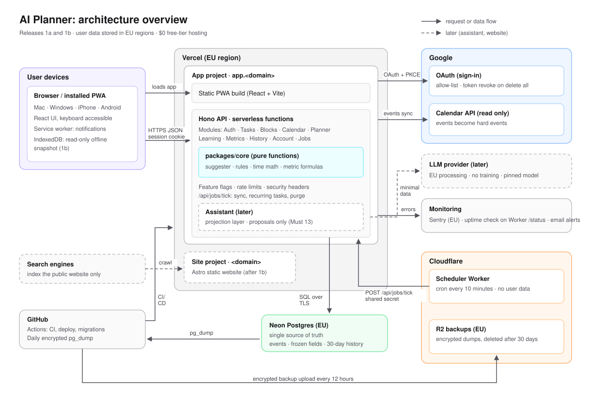

# Architecture: AI Planner

This document describes how to build the product defined in the [PRD](PRD.md). Requirement references such as "Must 3" point to PRD section 5. Release 1a, Release 1b and Public, and the requirement IDs A, P, S, PR, U, C, R, Q and W (PRD section 6), are defined in the PRD, as are the glossary terms in PRD section 4.

**Decided:** TypeScript everywhere. Budget-first serverless hosting: Vercel for the app, Neon for Postgres, and Cloudflare Workers cron as a free external scheduler. One repo with a shared `core` package. The installed PWA serves as the desktop app for now. The hosting choices stay conditional until the free-tier checks in section 16 pass, and the monthly budget ceiling is proposed in section 17.

**Open:** LLM provider, desktop wrapper (Tauri or Electron), and the items in section 17.

Items marked **(verify)** are facts about third-party services or regulation that must be checked against current sources before relying on them.

## 1. Constraints that drive the design

| Constraint                                                                                                                                              | Source         | Consequence                                                                                                                                     |
| ------------------------------------------------------------------------------------------------------------------------------------------------------- | -------------- | ----------------------------------------------------------------------------------------------------------------------------------------------- |
| Mostly built by Claude Code, in TypeScript                                                                                                              | Owner          | Mainstream, well-documented tools. Strict types and tests catch mistakes early.                                                                 |
| Budget matters                                                                                                                                          | Owner          | Free tiers wherever possible (section 13). Proposed ceiling $25 a month for hosting and services, plus a separate LLM budget, to be confirmed by the owner (sections 13 and 17).                                                                                                      |
| Nobody operates servers                                                                                                                                 | Owner          | Managed services only. No server to patch.                                                                                                      |
| Web first, mobile and desktop later, one backend                                                                                                        | PRD 7          | A real API boundary. Business rules live in shared code, not in the UI.                                                                         |
| The planner works without the LLM                                                                                                                       | PRD 4, Must 8  | The suggester is plain code. The assistant is an optional layer on top.                                                                         |
| Wall-clock times survive DST changes                                                                                                                    | Must 12        | Store local time plus zone, and derive the instant (section 6.2).                                                                               |
| Metrics rebuilt exactly from recorded events                                                                                                            | PRD 3, Must 15 | Append-only event table and frozen fields from Release 1a.                                                                                      |
| Last write wins by server receive time, 30-day edit history                                                                                             | Must 12        | Server-side field history. No sync engine.                                                                                                      |
| Offline means a read-only view                                                                                                                          | Must 12        | A cached snapshot in the browser is enough.                                                                                                     |
| New Google events appear within 15 minutes                                                                                                              | Must 3         | A scheduled job every 10 minutes, plus sync on app open (section 7).                                                                            |
| Delete all, backups purged within 30 days, tokens revoked                                                                                               | Must 14        | Backup retention of 30 days or less. Encrypted tokens. Revocation in the delete flow.                                                           |
| The assistant does not ship without data minimization, injection resistance and AI Act compliance                                                       | Must 13        | Projection layer, rules enforced in code, proposals only, transparency labels (section 9).                                                      |
| WCAG 2.2 AA, including non-drag alternatives in the calendar                                                                                            | Must 16        | Accessible component library, keyboard grid, automated and manual checks (section 10).                                                          |
| Non-functional requirements: EU and US use, EU data residency, Core Web Vitals, OWASP ASVS, RPO 24 h and RTO 1 day, browser list, ready for translation | PRD 6          | EU regions for every provider, first-party performance monitoring, security headers and audit log, off-site backup every 12 hours (sections 11, 12, 14). |

Scale is one user now and a few hundred later, with thousands of rows per user per year. Nothing here needs caching, queues or replicas.

## 2. Overview



Text version:

```
  Browser (PWA: React, service worker, IndexedDB snapshot)
        |  HTTPS, typed API
        v
  Vercel functions: Hono API  ──────────────►  Google Calendar API (read only)
   |  commands and queries                      Google OAuth
   |  (packages/core: rules, suggester,
   |   time math, metrics)                      LLM provider (later, minimized data only)
   v
  Neon Postgres (single source of truth)

  Cloudflare Worker (cron, every 10 min) ──► POST /api/jobs/tick (shared secret)
   |  keeps the last tick result in KV
   v
  GET /status (no database) ◄── uptime monitor every 5 min

  GitHub Actions (every 12 h) ──► pg_dump, encrypted ──► R2 backups (EU)
  Delete all ──► deletion ledger bucket in R2 (EU)
```

There is one deployable app. The API runs as Vercel serverless functions. The web client is a static build served by Vercel. A small Cloudflare Worker calls a protected job endpoint on a schedule.

**External interfaces**

| System                        | Direction      | Data                                                                           | Protocol and auth                              | If it fails                                                                 |
| ----------------------------- | -------------- | ------------------------------------------------------------------------------ | ---------------------------------------------- | --------------------------------------------------------------------------- |
| User's browser (PWA)          | Both           | All app data for the signed-in user                                            | HTTPS JSON. HttpOnly session cookie            | Read-only offline snapshot (7.8)                                            |
| Google OAuth                  | Both           | Sign-in identity (email), access and refresh tokens                            | OAuth 2.0 authorization code flow with PKCE    | Sign-in fails with a message. The app has no other sign-in                  |
| Google Calendar API           | In             | Calendar list, and events with times, busy or free, response status, and title | REST. Read-only scope, server-side token       | Last import stays, shown "as of \<time\>", with a reconnect prompt (Must 3) |
| Google token revoke endpoint  | Out            | The refresh token                                                              | HTTPS                                          | Revoke is retried 3 times. If it still fails, the user's data is deleted and only the encrypted token stays in `pending_revocations`, retried daily for up to 7 days (7.9)        |
| Cloudflare Worker (scheduler) | Out to the API | No user data                                                                   | HTTPS. Shared secret header                    | The app syncs on open. The status route turns unhealthy after 30 minutes without a sync, and the uptime monitor alerts (7.3)       |
| Neon Postgres                 | Both           | All stored data                                                                | Postgres over TLS, using the serverless driver | API errors. Restore from backups (section 12)                               |
| Cloudflare R2                 | In from CI     | Encrypted database dumps every 12 hours                                                 | S3-compatible API. CI secret keys              | Backup job alert. Neon's point-in-time history still applies                |
| Sentry                        | Out            | Error events with no request bodies or user text                               | HTTPS. Data source key (DSN). EU region        | Errors are only logged                                                      |
| Uptime monitor                | In             | The health route only                                                          | HTTPS                                          | No alerting until restored                                                  |
| LLM provider (later)          | Out            | Minimized payloads only (Must 13)                                              | HTTPS. Server-side API key                     | "Assistant unavailable". The planner keeps working                          |
| Search engines (website)      | In             | Public website pages only                                                      | HTTP crawl                                     | None for the app                                                            |

Terms such as block, hard event and postponement follow the PRD glossary.

Email: alerts on assistant events and the Should email fallback need an email sender, which is not chosen yet (section 17). Until then, assistant alerts go through Sentry's alert emails. When a sender is chosen, it is added to this table and to the sub-processor list.

## 3. Key design decisions

1. **One action layer.** Every change goes through a command (`createTask`, `createBlock`, `moveBlock`, `confirmBlock`, `dropTask`, and so on), and every read through a query. A field edit is a command whose input is a patch of fields (for example `updateTask`), and a block's start and end always travel together in `moveBlock` or `resizeBlock` (7.6). The web UI calls them through the API. The assistant's tools will call the same commands later. This gives planner and chat parity (PRD 4), and the planner keeps working when the LLM is down.
2. **Rules live in `packages/core` as pure functions.** These are the suggester, overlap and hard-event checks, recovery buffers, the urgency suggestion, time conversion and the metric formulas. They take plain data and return plain data, with no database or network access. This makes them easy to test exhaustively and reusable on mobile.
3. **The server is the single source of truth.** Clients hold no authoritative state. Cross-device sync means "write to the server, refetch on focus and on a timer". No CRDTs or sync engine.
4. **Metrics are derived, never edited.** They are computed on read from the event log and frozen fields. Current records supply only identity and status (for example, which tasks exist and whether they are open), and the rebuild test checks that nothing else is read. Metrics read local times, week keys and lengths in minutes. The one comparison that needs instants (`planned_length_min`, 6.3) is stored before a time zone migration can change it (6.2). A fixed fixture dataset with hand-computed values guards the formulas (Must 15).
5. **Time-based states are computed on read.** "Unconfirmed", "missed", "provisional week" and the end-of-day banner come from the current time and stored data, so no job is needed to flip them.
6. **Portable runtime.** The API is written with Hono, which runs on Vercel functions, on Node and on Cloudflare. Moving to an always-on host such as Render later is a deployment change, not a rewrite.

## 4. Technology choices

| Area                      | Choice                                                                          | Reason                                                                                                                                                         |
| ------------------------- | ------------------------------------------------------------------------------- | -------------------------------------------------------------------------------------------------------------------------------------------------------------- |
| Language                  | TypeScript, strict mode                                                         | Owner's choice. Shared types across client, API and core.                                                                                                      |
| Repo                      | npm workspaces monorepo                                                         | The repo already uses npm. One install, shared packages.                                                                                                       |
| Web client                | React with Vite, as a PWA                                                       | Plain client of the API. Installable. Service worker for the offline snapshot and notifications.                                                               |
| Client data               | TanStack Query                                                                  | Caching, refetch on focus and on an interval, which is how cross-device sync works.                                                                            |
| API                       | Hono on Vercel functions                                                        | Small and fast to start. Runs in many runtimes (section 3, item 6).                                                                                                   |
| API contract              | Zod schemas in `core`, shared by client and server                              | One definition for validation and types. A typed client is generated from the Hono routes.                                                                     |
| Database                  | Neon Postgres                                                                   | Free tier. Plain Postgres, so it is portable. Short backup history (section 12).                                                                               |
| Database access           | Drizzle ORM with SQL migrations, using Neon's serverless driver                 | Typed queries. The serverless driver avoids exhausting connections from short-lived functions.                                                                 |
| Scheduler                 | Cloudflare Workers cron trigger                                                 | Free and runs every few minutes. Vercel Cron Jobs on the Hobby plan run only daily (confirmed, fact-check 2026-11-11). A newer Vercel Schedules beta page disagrees (20.1) **(verify)**.                                                                         |
| Auth                      | Our own Google OAuth flow with a small library such as Arctic                   | One flow gives both sign-in and the calendar refresh token. No extra paid service.                                                                             |
| UI components             | React Aria, with design tokens as CSS variables                      | Accessible dialogs, menus, date and time fields and focus handling out of the box (section 10). The tokens drive the light and dark themes (PRD 6, U1 and U7). |
| Translation               | FormatJS (`react-intl`) message files and the browser's `Intl` API              | All UI text in message files, and dates, times and numbers in the user's locale (PRD 6, U6).                                                                   |
| Performance monitoring    | The `web-vitals` library, reporting to our own API                              | Real-user Core Web Vitals with no third-party analytics (PRD 6, P1 and Q4).                                                                                    |
| Public website (after 1b) | Astro, prerendered to static HTML, deployed as a second Vercel project          | Fast, crawlable pages with no JavaScript needed. Can reuse the design tokens. Keeps the app a simple client-rendered PWA (section 7.11).                       |
| Feature flags             | In-house: a `feature_flags` table plus defaults in code                         | $0 and no new data processor. Per-environment and per-user flags and kill switches (section 7.10).                                                             |
| Off-site backup           | `pg_dump` every 12 hours from GitHub Actions to Cloudflare R2, with a 30-day delete rule | Meets RPO 24 hours even if the free database restore window is shorter, and stays within the 30-day purge (section 12).                                        |
| Testing                   | Vitest, React Testing Library, Playwright, axe-core                             | Fast unit tests, component tests for UI logic, browser tests for the core flows, and automated accessibility checks.                                           |
| Errors                    | Sentry free tier                                                                | Error tracking for client and API.                                                                                                                             |
| CI                        | GitHub Actions                                                                  | Lint, type check and tests on every pull request.                                                                                                              |
| Desktop (later)           | Installed PWA now. Tauri or Electron when a native feature is needed            | Deferred (section 17).                                                                                                                                         |
| Mobile (later)            | React Native with Expo                                                          | Reuses `core` and the API client.                                                                                                                              |
| LLM (later)               | A hosted model with tool use, behind a provider interface                       | Provider not yet chosen (PRD 10).                                                                                                                              |

Repo layout:

```
apps/
  web/          React PWA
  api/          Hono app: routes, commands, queries, jobs
  scheduler/    Cloudflare Worker that calls the tick endpoint
  site/         public website (Astro, static), after 1b
packages/
  core/         domain types, Zod schemas, suggester, time math, metrics (pure)
  db/           Drizzle schema, migrations, seed and fixture data
docs/
```

## 5. Modules

Each module is a folder in `apps/api` with a small public interface. Modules do not reach into each other's tables.

| Module | Responsibility | PRD |
|---|---|---|
| Auth | Google sign-in, sessions, the allowed-user check | Must 12 |
| Tasks | Tasks, task types, priority flags, urgency suggestion, drop and delete, checklists, recurring series and occurrences | Musts 4, 6, 7, 17, 18 |
| Blocks | Create, move, resize, delete, overlap warnings, confirmation | Musts 1, 2 |
| Availability | Weekly template, per-day overrides, home zone | Must 5 |
| Calendar | Google connection, calendar selection, incremental import | Must 3 |
| Planner | Runs the suggester with data from the other modules | Musts 8, 9 |
| Learning | Duration suggestions per task type | Must 10 |
| Metrics | Event recording, planning sessions, weekly metric computation | Must 15 |
| History | Field-level edit history, undo, 30-day purge | Must 12 |
| Account | Settings, export, delete all | Must 14 |
| Jobs | The tick endpoint and the work it runs | Must 3 |
| Assistant (later) | Conversation loop, tools, projection layer | Must 13, Should |

## 6. Data model

### 6.1 Tables

Every table that holds user data has `user_id`. The exceptions are app-level tables: `feature_flags` (configuration), `job_runs`, `web_vitals` and `api_timings` (no user ID, device type only), and `rate_limits`, which is keyed by user ID or IP address. IP-keyed rows live only for the rate-limit window, are purged by the tick job, and the IP address is listed as personal data in the privacy notice. Primary keys are UUIDs, so clients can create IDs offline in the future. Every user-editable table (`tasks`, `checklist_items`, `recurring_series`, `blocks`, `task_types`, `availability_template`, `availability_overrides` and the `users` settings) has `updated_at`, set by the command from the database clock. Tables whose fields are patched independently also have `field_updated_at` (JSON, per field). `confirmBlock` conflict detection and last write wins use these columns.

| Table | Key fields |
|---|---|
| **users** | id, google_sub (the stable Google subject ID and the identity key; sign-in requires `email_verified`), email, home_zone (IANA name), settings (JSON: default task duration 30, buffer minutes 10, buffer threshold 60, LLM field toggles), created_at |
| **sessions** | id, user_id, created_at, last_seen_at (30-day idle limit), expires_at (90 days absolute) |
| **task_types** | id, name, is_other (the undeletable "Other"), time_window (work, personal, any), created_at |
| **tasks** | id, title (null once deleted), urgent, important, deadline (date), estimate_min, type_id, status (open, done, dropped, deleted), done_at, done_flag_set_at, dropped_at, deleted_at, undo_until, urgency_suggestion_dismissed (cleared when the deadline changes), remaining_estimate_min (the unplanned remainder from "partly done"), **first_block_week** (frozen), series_id and occurrence_date (for recurring occurrences), created_at |
| **checklist_items** | task_id, position, text (removed on task delete), done, updated_at. At most 50 per task (Must 17). |
| **recurring_series** | template fields (title, type, flags, estimate, checklist), rule (a subset of iCalendar RRULE in the home zone), mode (fixed or flexible), fixed start and end, or times_per_week, allowed days and time-of-day window, ends_on or count, generated_until |
| **blocks** | id, task_id, start_local, end_local, zone, start_at, end_at (derived instants), **original_start_at**, **original_week** and **planned_length_min** (frozen), state (planned, confirmed, dropped, deleted), outcome (as_planned, took_x, partly_done, didnt_do), actual_min, actual_start_at, done_min, note, confirmed_at, deleted_at, may_be_affected, field_updated_at (JSON, per field) |
| **calendar_connections** | refresh_token (encrypted), status (ok, revoked, error), last_synced_at, sync_lease_until |
| **calendars** | google_calendar_id, name, selected, last_synced_at, sync_token (only if the spike shows sync tokens work with the window) |
| **calendar_events** | google_event_id, calendar_id, start_at and end_at (timed events), start_date and end_date (all-day events, end exclusive), all_day, transparency (busy or free), self_response, status, title (encrypted), synced_at. Unique on (calendar_id, google_event_id), so a repeated import updates instead of duplicating. |
| **availability_template** | weekday, start_local, end_local, kind (work, focus, personal, sleep, meal) |
| **availability_overrides** | date, ranges (JSON) |
| **edit_history** | entity, entity_id, field, old_value, new_value, received_at. Purged after 30 days. When a task is deleted and its undo message closes, the old and new values of its title, checklist text and block notes are set to null (6.4). |
| **metric_events** | type, schema_version, task_id, block_id, occurred_at, payload (old and new start and end for moves and resizes, each as local time plus zone, outcome and actual times (local time plus zone) for confirmations, old and new done flag; never typed text) |
| **planning_sessions** | device_id (a random ID created on first run and kept on the device, never based on hardware, deleted with the account), started_at, ended_at, active_seconds. Only active editing counts: capture, the suggester, creating, moving or resizing blocks, and confirmation prompts (PRD 3). |
| **job_runs** | job, started_at, finished_at, outcome |
| **audit_log** | action (sign-in, sign-out, calendar connect or disconnect, export, delete all, assistant field settings, flag changes), occurred_at, device_type. Kept 12 months. |
| **assistant_messages** (later) | conversation_id, role, content, tool calls, created_at. Kept 30 days. |
| **assistant_events** (later) | type (proposed, accepted, rejected, tool error, refusal), proposal_id, tool, occurred_at. IDs only, no text. |
| **feature_flags** | key, environment, enabled, user_overrides (JSON), purpose, remove_by, updated_at. Not scoped by user: it is app configuration. |
| **rate_limits** | key (user or IP), window_start, count. Short-lived counters for the PRD 6 S4 limits. |
| **pending_revocations** | refresh_token (encrypted), created_at. No user ID. Holds a token only when a revoke failed during delete all. Retried daily by the tick and removed on success or after 7 days (7.9). |
| **request_ids** | user_id, request_id, route, entity_id, status, created_at. Unique on (user_id, request_id). Kept 24 hours. A replayed write returns the original status and the current record of `entity_id`, and changes nothing (section 8). Holds no user text. |
| **api_timings** | route_group, duration_ms, cold (true when the request is the first one handled by a function instance, or when its first database query took over 1 second), recorded_at. Kept 90 days. The 95th percentile over a rolling 28 days, excluding cold requests, is shown next to web vitals (PRD 6, P3). |
| **web_vitals** | metric, value, page, device_type, recorded_at. Kept 90 days. The 75th percentile is shown over a rolling 28 days (PRD 6, P1). |

### 6.2 Time

- A block is stored as **local wall-clock time in the home zone** (`start_local`, `end_local`, plus `zone` recording the home zone at the time). This applies even when the device is elsewhere. The instants `start_at` and `end_at` are derived and stored for querying. If time zone rules change, a migration recomputes `start_at` and `end_at` from the local times, so a 09:00 block stays at 09:00 (Must 12). The migration never rewrites frozen fields (`original_start_at`, `original_week`, `planned_length_min`) or the times inside `metric_events`. They record what was true at the time, and metrics read only local times, week keys and lengths in minutes, and no stored instants, except in `planned_length_min` (6.3). Before the migration recomputes anything, it stores `planned_length_min` for every block whose start has passed, so the migration cannot change a metric.
- **Changing the home zone** runs one command:
  - future planned blocks get the new zone and keep their wall-clock times, and their instants are recomputed. This is recorded as a zone change, not a move, so it is never a postponement;
  - past blocks and all frozen fields are untouched;
  - overlap flags are recomputed, because blocks keep their wall-clock times and Google events keep their instants.
- Timed Google events are stored as instants, as Google provides them. All-day events are dates, not instants, so they are stored as dates (`start_date`, and `end_date` exclusive) and compared with the home-zone date. A home-zone change therefore cannot move them.
- **Daylight saving rules**, applied by the time module in `core` and checked by its tests (the database only compares stored columns, see below):
  - **A local time that does not exist** (clocks go forward): a user-created block starting in the gap is rejected with a validation error, and the suggester never offers a slot in it. If a stored block lands in a gap after a time zone rule change, its instant is derived by shifting it forward by the length of the gap.
  - **A local time that occurs twice** (clocks go back): when an instant is derived from the local time alone, the earlier occurrence is used. A block created by clicking the repeated hour keeps the instant of the occurrence that was clicked, so both occurrences can be used. The grid shows the repeated hour twice, labelled with its offset, and skips the missing hour on a 23-hour day.
  - **Length** is real elapsed time, `end_at` minus `start_at`. On a transition day a block from 01:00 to 04:00 local time can be 2 or 4 hours long. The 15-minute minimum and the 15-minute grid are checked on elapsed time and on local wall-clock marks respectively. "No midnight crossing" is checked on local dates.
  - **Test examples** (to be confirmed in the DST tests): in Europe/Berlin, 02:30 on 2027-03-28 does not exist, and 02:30 on 2026-10-25 occurs twice. Each rule above has at least one such case, and one case in America/New_York.
- The availability template, weeks (Monday start), "end of day", deadlines and metric weeks all use the **home zone** from settings.
- Display follows the device zone. The client shows a notice when the device zone differs from the home zone. A click or drag in the grid is converted to home-zone wall-clock time, so a block always follows the home zone.
- Database constraints compare stored columns only, because time zone rules are not immutable and cannot be checked inside the database: `end_at - start_at` is at least 15 minutes, `end_local` is after `start_local`, and `end_local` is no later than 00:00 of the day after the date of `start_local`. A block that ends at midnight is stored with `end_local` at 00:00 of the next day, and one that would run past it is rejected (Glossary). The daylight saving rules above and the derivation of instants from the home zone live in `core` and are checked by its tests (section 14).
- All time math goes through one module in `core`, with DST tests (section 14).

### 6.3 Frozen fields and the event log

- `tasks.first_block_week` is set when the task's first block is created and never changes. It defines the completion-rate cohort.
- `blocks.original_start_at` and `original_week` are set on creation and never change. They define "originally scheduled".
- `blocks.planned_length_min` is the block's length at its start time, in minutes. It is derived from the latest created, moved or resized event at or before the block's start, so later resizes do not change it, and a reschedule derives it again for the new start. A block created after its start (retroactive logging) uses the length in its created event. It is computed on read, and the first command or tick job that touches the block after its start stores it. The value is the same whenever it is stored, so no job is needed at the moment the start passes. A time zone migration stores it first for every started block (6.2). Estimate error compares against it (PRD 3).
- `metric_events` records task created, block created, moved or resized, confirmation, task done, dropped or deleted, and done-flag changes. Each event carries its own data (old and new times, outcome, actual times, old and new done flag), so the events plus the frozen fields rebuild every metric without the edit history (Must 15). A test asserts this on the fixture dataset.
- Postponements are not stored as a flag. The metrics module derives them from the event sequence using the glossary definition:
  - one postponement per miss: "didn't do it" followed by a reschedule counts once;
  - a rescheduled block is the same block, so it keeps its original week;
  - confirming "as planned" or "it took X" at the new time cancels the postponement;
  - a past unconfirmed block marked "dropped" counts once;
  - a home-zone change is never a move.
- The metrics module also computes:
  - the measurement clock start: the first Monday after 1a has been used on at least 5 of 7 consecutive days;
  - the provisional and final state of each week (final 14 days after the week ends);
  - the load guardrail (PRD 3).
  
  The counting rules in PRD 3 apply to early moves (each move counts, toward the original week), the confirmation rate (original week, "dropped" excluded) and estimate error (week of the start at confirmation).

### 6.4 Deletion semantics

- **Drop or delete a task** (Must 6):
  - its future planned blocks are soft-deleted (`state = deleted`) and its confirmed blocks are kept;
  - its past unconfirmed blocks get `state = dropped`. They stop asking for confirmation, leave the confirmation-rate denominator, and count as one postponement each.
- **Undo a drop** within 7 days: the task returns, with the removed blocks whose start has not passed yet. The time of the others becomes unscheduled again. A restored block that now overlaps a hard event is flagged `may_be_affected` and is not blocked, because Must 1 treats an overlap as a warning.
- **Delete a task:** it can be undone only while the undo message is shown (PRD 6, U3). The server sets `undo_until` to the deletion time plus the undo period (15 seconds, at least 10 per PRD 6, U3) and rejects `undoDelete` after it. While the Undo message stays open (paused on focus or hover, or kept by the "keep Undo messages" setting), the client calls `extendUndo` every 10 seconds. Each call moves `undo_until` to 15 seconds from now, never beyond the deletion time plus 10 minutes (PRD 6, U3). A client that closes its message, or disappears, simply stops extending, so the server never has to know when the message closed. From `undo_until`, the API returns no title, checklist text or notes for the task and the export omits them, and the tick job then sets them to null in the database at the next successful tick (normally within 10 minutes). Until then the API already hides the text. The matching old and new values in `edit_history` are set to null at the same time, so the deleted text is not kept or exported. Backups made earlier can still hold the text until they expire within 30 days (Must 14). The task keeps its ID, type, flags, frozen week and outcome, so metrics and duration suggestions stay correct (Musts 6 and 14).
- **Mark a task done** (Must 6, v0.3): its future planned blocks are soft-deleted with a `removed_by_done` marker, which is not a postponement. Past unconfirmed blocks stay unconfirmed and keep asking for confirmation. Unticking within 7 days restores the marked blocks whose start has not passed. Their time otherwise becomes unscheduled again.
- **End a series** (Must 18, v0.3): its future occurrences are soft-deleted as one group with the same `undo_until` mechanism as a task delete. `undoEndSeries` restores the series end date and the group. After the undo period, the occurrences follow the normal task-delete clean-up.
- **Delete a block:** only unconfirmed blocks can be deleted (Must 6, v0.3); the API rejects deleting a confirmed one. It is soft-deleted (`state = deleted`, `deleted_at`), so the event log still refers to a real row. It can be restored for 7 days. When that window closes, its note is set to null, along with the matching `edit_history` values.
- **Delete a task type:** its tasks are reassigned to "Other". Metrics recompute automatically, because they are derived.
- **Undo and edit windows are 7 days**, except undo of a task delete, which lasts only for the undo period (at least 10 seconds, PRD 6, U3). `edit_history` is read-only after that, for audit and support (Must 12).

## 7. Key flows

**7.1 Sign-in and calendar connection**
1. The user signs in with Google, requesting `openid email` and the read-only calendar scope, with offline access.
2. The server checks the email against an allow-list (one email in the first version, kept in an environment variable and validated at startup, 19.3), so the public URL cannot be used by strangers.
3. The refresh token is encrypted with AES-256-GCM, using a key from an environment variable, and stored.
4. The user selects which calendars to import (Must 3). A full import runs.

**7.2 Calendar sync**
- Triggers:
  - every 10 minutes from the scheduler;
  - when the app opens;
  - every 10 minutes while the app is open;
  - when the user taps refresh.
- **Import method (D22).** Each run lists the events of each selected calendar with recurring events expanded per instance (`singleEvents`), inside a window of 30 days back to 180 days ahead (proposed). It upserts the events and removes stored events inside the window that Google no longer returns. Sync tokens are not used by default. Google does not allow a sync token together with a time window, and it is not documented whether events that later enter the window arrive through the token (fact-check, 2026-11-10). A full windowed list is a small cost at this scale (hundreds of events). The spike (section 16, item 6) is a gate before step 4 of the build order. If it shows that sync tokens work with the window, they can replace the full list.
- **Which events are kept.** When a calendar is deselected, its stored events are deleted. When a calendar is deleted in Google, the next list no longer returns it and its events are removed. Events that ended before the start of the window are not refreshed, and stay as last imported until the 13-month purge. Opening the app shows stored data at once and syncs in the background, so a sync never blocks rendering (PRD 6, P3).
- **Event types (proposed).** Out-of-office events count as busy hard events. Working-location events are not hard events. Multi-day timed events are hard events across their whole span, and overlap is checked per day.
- Rules from Must 3 are applied when reading, not when importing:
  - declined and cancelled events are not hard events;
  - tentative events, and events not yet answered, are hard events;
  - timed events marked "free" are not hard events;
  - all-day events are hard events only if busy, and then they block the whole day.
- For the recovery buffer (Must 9), back-to-back hard events with no gap are merged into one event before the 60-minute rule is applied.
- **One sync at a time.** A sync takes a per-connection lease: `calendar_connections.sync_lease_until`, set by one atomic update that succeeds only if it is empty or in the past (2 minutes, renewed after each calendar). No database transaction stays open while Google is called. A second trigger for the same connection does not run. It returns "sync already running", and the UI shows the status.
- **Commit per calendar.** Each calendar is committed in its own short transaction: upsert events on (calendar_id, google_event_id), delete the absent ones in the window, and set `calendars.last_synced_at`. A failed or cut-off run leaves the calendars already done committed and the unfinished one unchanged, and the next run continues with the calendars not yet synced. During the first import the UI shows "Importing, n of m calendars". Neon's WebSocket driver is needed only for interactive transactions. A fixed batch of statements (the upserts, the delete and the update) can run over the HTTP driver as one non-interactive transaction (fact-check, 2026-11-11), so the per-calendar commit uses that.
- After a sync, planned blocks that now overlap a hard event are flagged in the UI. The flag is stored in `blocks.may_be_affected` (also set by 7.5 and 7.14). It clears when the user moves or confirms the block, dismisses the flag, or the next sync shows no overlap.
- On failure or revoked access, the connection status changes, the last data stays visible with "as of \<time\>", and the planner shows the reconnect prompt and the stale-data warning.

**7.3 The tick endpoint**
- The Cloudflare Worker sends `POST /api/jobs/tick` with a shared secret header every 10 minutes. The request carries a timestamp and is rejected if it is older than 5 minutes, and two secrets are accepted while one is being rotated. Cloudflare gives no accuracy guarantee for cron, and its status history shows delayed, skipped and duplicated runs (fact-check, 2026-11-10). So the tick is idempotent, and a skipped tick is covered by sync on app open and by the next tick, 10 minutes later. There is no second scheduler. A GitHub Actions backstop every 30 minutes was considered and dropped (D25): it would use about 1,440 runs a month of the free Actions budget (section 13), keep the database awake longer (section 12), and GitHub schedules are best effort and are disabled after 60 days without repository activity in a public repo (fact-check, 2026-11-11). A stopped scheduler is detected by the status route below.- The endpoint runs whatever work is due, then records a `job_runs` row:
  - calendar sync for every connection that has not finished a sync in the last 2 minutes. The lease in 7.2 already prevents overlapping runs, and the 2-minute rule only avoids repeating a sync that just finished on app open. Worst-case staleness for a closed app is the 10-minute cron interval plus the sync time plus jitter, which leaves a few minutes of slack under the 15 minutes of Must 3. One skipped tick pushes it to about 20 minutes. So Must 3 is best effort when the app is closed, and the 30-minute alert bounds it (section 17);
  - creating recurring occurrences up to 14 days ahead (Must 18);
  - retrying pending Google token revocations (7.9);
  - setting to null the text of deleted tasks whose undo period has ended (6.4);
  - setting to null the notes of deleted blocks whose 7-day restore window has ended (6.4);
  - a daily retention purge, following the retention table in PRD 6 (PR5): edit history and assistant chat messages older than 30 days, calendar events that ended more than 13 months ago, audit entries older than 12 months, web vitals older than 90 days, expired rate-limit counters and sessions, request IDs older than 24 hours, and API timings older than 90 days.
- Every job is idempotent. The tick stops starting new work after 80% of the function time limit (the limit is a section 16 check) and carries on at the next tick. Recurring generation and purges run in batches of at most 500 rows. Calendar sync commits one calendar at a time (7.2), so a tick that runs out of time loses nothing, and the next tick continues with the calendars not yet synced.
- **Status and health.** The tick response includes `oldestSyncAgeMinutes` and `newestBackupAgeHours`. The first counts connections with status `ok` and at least one selected calendar, and is empty if there are none or they are revoked or errored (the UI shows a reconnect prompt instead). The Worker keeps the latest response and the time of the last successful tick in Cloudflare KV, and serves `GET /status` from it with no database access. `/status` returns an error when no tick has succeeded for 20 minutes, when `oldestSyncAgeMinutes` exceeds 30 and the `calendar_sync` flag is on, or when `newestBackupAgeHours` exceeds 26. The uptime monitor polls `/status` every 5 minutes, so it neither wakes the database nor depends on the Vercel app. It also polls `/api/health`, which returns 200 and does not touch the database.
- Later Should items attach here, such as the email reminder fallback and planning-slot reminders.

**7.4 Create and schedule a task**
1. `createTask` saves the task. Quick capture (Must 7) sends only a title, and the type defaults to "Other".
2. The user starts a run. `proposeSlots` takes the selected task IDs, which by default are all open tasks with unscheduled time, including flexible recurring occurrences. The planner loads the template, overrides, hard events, blocks and settings, and calls the pure suggester in `core`.
3. The suggester applies Must 8:
   - **Duration:** each task's unscheduled time, meaning its estimate (or "partly done" remaining estimate) minus the time in its planned and confirmed blocks. A task with no estimate and no blocks uses the default task duration. A task with no estimate that already has a block has no unscheduled time, so the suggester adds nothing and auto-done treats it as fully planned. Unscheduled time is never below zero, and a remainder of zero or less after "partly done" means there is no remainder.
   - **Order:** priority quadrant, then nearest deadline (no deadline last), then oldest task. Urgency includes the Must 4 rule. That rule turns unscheduled hours into days by walking forward through the hours the task's type may use each day, including overrides.
   - **Where:** only the template ranges the task's type may use (work, personal or any), minus hard events, blocks and recovery buffers. Important work-time tasks try focus time first, then any other allowed range.
   - **When:** the earliest slot on a 15-minute mark, not before the next quarter hour, within 14 days, or up to the deadline if that is earlier. A task whose deadline falls before any free slot gets "no slot fits".
   - **Flexible series:** at most one occurrence per day, only on allowed days, spread evenly, within the time-of-day window.
   - **Within one run:** proposed slots count as occupied for the next proposal.
   - **Splits:** a task longer than any free range is offered a split into the fewest parts that fit, each at least 30 minutes, placed earliest first.
   
   It returns either proposals or "no slot fits" with the options.
4. The user accepts or adjusts. `createBlock` saves the block, sets the frozen fields, and records the events.

**7.5 Confirm a block**
1. **Prompt:** blocks whose end has passed show the four options, on app open or immediately if the app is open (Must 11 adds the end notification). The end-of-day banner (using the last working or personal range of the day) and the 7-day late window are computed on read.
2. **Frozen planned length:** `planned_length_min` is derived from the events up to the block's start (6.3), so it does not depend on when a job runs, and it is derived again after a reschedule.
3. **`confirmBlock` applies Must 2:**
   - **"It took X" with a start time** moves the block, is recorded as-is, and flags later blocks "may be affected". If the block would cross midnight, it ends at midnight and the full actual time is still stored.
   - **"Partly done"** stores the done time and sets the task's remaining estimate. A remainder under 15 minutes is planned as 15 minutes.
   - **"Didn't do it"** offers a new slot for the same block. Accepting it is a move of that block, and the metrics count one postponement.
   - **Task already done** (Must 2, v0.3): "didn't do it" records the postponement but returns no slot offer, and "partly done" stores the done time without setting a remaining estimate.
   - **Auto-done:** when the last block of a task is confirmed "as planned" or "it took X", the task is marked done only if its unscheduled time (7.4: the estimate, or the remaining estimate, minus the time in its planned and confirmed blocks) is zero or less, it has no remainder, and the user does not untick it. If time remains unscheduled (for example a 3-hour task with one 1-hour block), the task stays open and the UI offers to plan the rest or mark it done.
4. **Summary:** the confirmation view shows the planned-vs-real summary, with the block's planned length against its actual time, and the day's planned hours against its confirmed hours.
5. **Edits:** allowed within 7 days of the block's end. Each is written to `edit_history` and to the event log.

**7.6 Concurrent edits from two devices**
- The client sends field-level patches as the input of update commands. Each command runs in one transaction that first locks the row (`SELECT ... FOR UPDATE`). The order is the order in which transactions get the lock, stamped with the database clock at commit (`received_at`), and not the arrival order of requests, because serverless requests can overtake each other. The later commit wins, per field (`field_updated_at`). `received_at` is taken with `clock_timestamp()` after the lock is acquired, because `now()` is the start of the transaction. This reads Must 12's "server receive time" as the time the server applied the write, which is an interpretation to confirm in the PRD (section 17).
- `confirmBlock` carries the block's `updated_at` that the client saw. If the block was moved or resized on another device since then, the server returns `CONFLICT` with the current record, and the client asks the user to confirm again against the current times. Other commands keep last write wins (Must 12). A command that touches several rows locks them in a fixed order: the user's settings row, then tasks by ID, then blocks by start time, then calendar rows. This applies to `dropTask`, to "it took X" flagging later blocks, to sync flagging overlaps, and to "this and future" edits.
- Start and end are always written together, as one unit.
- The old values go to `edit_history`, kept 30 days and read-only. An overwritten edit can be restored for 7 days.
- Other devices see the change on their next refetch (on focus and every 60 seconds while visible).

**7.7 Reminders (Must 11)**
- While the app is open, the client schedules a timer for each upcoming block in the next 4 hours and shows a notification through the service worker when it starts, and another when it ends asking for confirmation. Must 11 is part of Release 1a, and it accepts the limit that web notifications do not fire when the browser is closed. "Open" means the app is in the foreground, or in a background tab or installed PWA that the browser has not suspended. Mobile browsers can suspend timers, so reminders are best effort. When the app returns to the foreground, the client checks the blocks that started or ended meanwhile and shows them as in-app reminders and confirmation prompts. Reminders with the app closed need server push or the mobile app (below), and a real-device check covers this in section 14.
- If permission is denied, an in-app prompt appears.
- No server push in the first version. Notifications when the browser is closed wait for the mobile app (Later), or for the email fallback (Should) through the tick endpoint.

**7.8 Offline (Must 12)**
- The service worker caches the app shell.
- After each successful load, the client stores a snapshot in IndexedDB: blocks and hard events for the last 7 and next 14 days, plus open tasks. This window is a proposal for the open question in PRD 10. The snapshot holds task titles and notes and block times, which the user owns, and hard events as time ranges only, shown as "Busy". Imported event titles never reach IndexedDB. The snapshot is not encrypted on the device (revisit before Public, section 17).
- Offline, the app shows that snapshot read-only, with a banner, and disables writes. This is Release 1b and first in the cut order.
- **Release 1a, before the snapshot exists:** the client keeps what TanStack Query already holds in memory on screen, shows a "No connection" banner, and disables every command (capture, drag, confirm, undo, restore, settings). Nothing is queued. A 401 response opens the sign-in dialog over the current screen. If the pop-up is blocked, unsaved form text is kept in `sessionStorage` for that tab, restored after a full-page sign-in, and then deleted (PRD Must 12, v0.3).
- **Clearing the snapshot.** The client deletes it on sign-out and on any 401 response from the API. A 401 happens after "sign out everywhere", after session expiry, and after delete-all (which deletes every session), so a device that comes back online clears its snapshot on its first request. A device that stays offline keeps its snapshot until then, and this limit cannot be removed from the server. The snapshot also expires locally 14 days after its last refresh.

**7.9 Delete all and export (Must 14)**
- **Delete all:**
  1. confirmation;
  2. revoke the Google token through Google's revoke endpoint, retrying up to 3 times with backoff. If it still fails, the encrypted token is moved to a minimal `pending_revocations` row (token and date only, with no user ID or other data). The tick retries daily for up to 7 days and then deletes the row, and the confirmation screen tells the user to remove access in their Google account settings if it fails. This keeps Must 14's "revokes the OAuth tokens" as far as Google allows, and the row holds no user content (D24, proposed, to be confirmed against Must 14);
  3. delete every row of the user in one transaction, including metric events and cached events;
  4. clear the client caches on this device. Other devices clear theirs on their next request (7.8).
  Backup purge is covered by the retention limit in section 12.
- **Export:** an API route builds a JSON file (Must 14) of:
  - tasks (deleted ones in their reduced form), with checklists;
  - recurring series, blocks, confirmations and task types;
  - the template and settings;
  - edit history and metric events;
  - the user's audit log entries and imported calendar events;
  - assistant chat history, once the assistant exists.

**7.10 Feature flags (PRD 6, R6)**
- Each flag is declared once in `core`, with its key, default value, purpose and removal date. The type system then rejects unknown flag names.
- The API resolves a flag in this order: user override, environment value from `feature_flags`, code default. The result is cached for at most 60 seconds, so a change takes effect within 1 minute without a deploy.
- The client loads the resolved flags with the session, and refetches them on focus and every 60 seconds.
- **Enforcement on the server:** a flag that is off removes its routes and tools, not just its buttons. This matters most for the assistant kill switch.
- **Kill switches:** `assistant`, `calendar_sync` (the tick endpoint and manual sync skip their work), and `notifications`.
- **Changing a flag:** in the first version, the owner changes flags through an admin route that only the owner's account can use (the signed-in email must equal `ADMIN_EMAIL`, an environment variable). Each change is written to `audit_log`.
- **Clean-up:** a CI check fails when a flag is past its removal date, so stale flags get cleaned up.
- **Tests:** they run with flags in both states for flagged features.

**7.11 Public website and SEO (PRD 6.10)**
- **Domains:** the website is served at the root domain and the app at `app.<domain>`. The domain waits for the product name.
- **Website build:** `apps/site` is built with Astro into static HTML and deployed as its own Vercel project. Each page sets:
  - title and description;
  - Open Graph tags;
  - a canonical URL;
  - schema.org JSON-LD.
  
  The build generates `sitemap.xml` and `robots.txt`. The website uses no cookies and no third-party scripts.
- **Keeping the app out of search:** the app sends an `X-Robots-Tag: noindex, nofollow` header on every response and has its own `robots.txt` that disallows everything. The app's HTML is never prerendered with user data.
- **Shared look:** the website reuses the design tokens and message files, so its look and wording match the app.
- **Checks:** Lighthouse CI on every website page (SEO, accessibility and best practices at least 95), and axe checks as for the app.

**7.12 Duration suggestions (Must 10)**
- The learning module groups done tasks by type and keeps only tasks whose blocks are all confirmed. A task's total time is:
  - the planned length for "as planned";
  - the actual time for "it took X";
  - the time done for "partly done";
  - zero for "didn't do it".
- With at least 5 such tasks, the median total is offered as the default estimate for new tasks of that type. Otherwise the app shows "not enough data yet".
- Recurring occurrences count as tasks of their type. Deleted tasks still count, because their type and outcome are kept.

**7.13 Checklists (Must 17)**
- `checklist_items` belong to a task: at most 50 per task, ordered by position.
- Ticking a step is a normal command. When the last step is ticked, the response includes a "suggest done" hint, and the UI asks the user. Steps never change the task's status on their own.
- Steps are not metric events. Recurring occurrences copy the series checklist, unticked.

**7.14 Recurring tasks (Must 18)**
- **Expanding rules:** a pure function in `core` expands a series rule into occurrence dates in the home zone. It uses a small, tested subset of iCalendar RRULE, with a library such as `rrule`.
- **Creating occurrences:** the tick job, and any change to a series, create occurrences up to 14 days ahead and move `generated_until` forward. Occurrences are created idempotently, keyed by `(series_id, occurrence_date)`, so retries never duplicate them.
- **Fixed-time occurrences** get their block immediately, through the normal `createBlock` command. An overlap does not stop them: they are flagged "may be affected" instead of being moved.
- **Flexible occurrences** are created as tasks without blocks. The suggester treats each series as one constraint: at most one occurrence per day, only on allowed days, spread evenly, and within the time-of-day window.
- **"This and future" edits** update the series and the occurrences that are not yet confirmed and lie in the future. Past and confirmed occurrences are never rewritten.
- **Metric events:** each occurrence records the usual "task created" event with its series ID, so recurring work stays visible in the metrics.
- **No pile-up:** an occurrence that is not done by the end of its period simply counts as not done. Nothing is carried forward.

## 8. API

REST-style JSON routes in Hono, grouped by module. Requests and responses are validated with Zod schemas from `core`. Examples:

| Area | Routes |
|---|---|
| tasks | create, update, list, markDone (removes future blocks), setDoneFlag (untick restores them within 7 days), drop, undoDrop, delete, undoDelete (while the message is shown), extendUndo (up to 10 minutes), dismissUrgency |
| checklist | add, edit, reorder, tick, delete |
| series | create, update (this or future), end, delete, undoEnd (while the message is shown) |
| taskTypes | list, create, rename, setTimeWindow, delete |
| blocks | listRange, create, move, resize, delete (unconfirmed only), restore (7 days), confirm, editConfirmation, restoreEdit (7 days) |
| planner | proposeSlots, durationSuggestion |
| availability | getTemplate, setTemplate, setOverride, setHomeZone |
| calendar | connect, listCalendars, selectCalendars, sync, listEvents |
| metrics | weekly (range), recordSession, webVitals |
| account | settings, export, deleteAll, signOutEverywhere |
| admin | flags (owner only) |
| jobs | tick (scheduler only) |

Rules:
- Writes return the updated record, so the client can update its cache without refetching.
- Overlap with a hard event, a block or a buffer returns a warning that needs an explicit `confirmOverlap: true` on the retry (Must 1). The rule lives in `core`, so neither the UI nor the assistant can skip it.
- Writes carry a client-generated request ID, so retries do not create duplicates. The server stores it in `request_ids` for 24 hours, unique per user. A replay returns the original status and the current record, and changes nothing.
- **Versioning.** All app routes live under `/api/v1`. Within v1, changes only add things (new routes, new optional fields, new enum values that clients must tolerate). A breaking change goes to `/api/v2`, and v1 stays until the mobile client has moved to v2 (at least 6 months, proposed). The scheduler, job and test routes (`/api/jobs/*`, `/api/test/*`) are internal and not versioned.
- **Lists.** List routes use cursor pagination with `limit` (default 100, at most 500) and `cursor`. Error codes and their HTTP statuses are in 19.1.

## 9. Assistant and AI safety (later, gated by Must 13)

The assistant is built after the Musts. Everything in this section must be in place before it ships (Must 13).

### 9.1 Design

- **Tools.** The assistant's tools wrap the same commands and queries as the UI.
  - Read tools return data through the projection layer.
  - Write tools return a **proposal** that the user accepts in the UI, and only then is the command run.
  - The tool list is fixed. Delete all, export, settings, calendar connection and sign-in have no tools.
- **Projection layer.** It is an allow-list per field, driven by the user's settings. By default it passes durations, times, flags and opaque task-type IDs only. Titles, notes, checklist steps, event titles and type names are added only when the user turns each on. Event descriptions and attendees are never sent.
- **Proposals.** A write tool returns a proposal record: the command name, its validated arguments, and a list of affected items. The UI renders the proposal from that record, never from model text. Accepting it runs the command through normal validation, so stale proposals fail cleanly. A proposal may touch at most 10 items. If a proposal overlaps a hard event, block or buffer, the UI shows the overlap warning and sets `confirmOverlap` only after the user confirms a second time. The model can never set it.
- **Text cleaning.** One function in `core` removes or makes visible invisible characters, text-direction control characters and Unicode tag characters. It runs on all user and calendar text before it goes into a prompt, and on all model text before it is shown.
- **Grounding.** Replies with numbers or times are built from tool results. The system prompt requires citing the tool result or evidence-list entry. A check after the reply flags any number in it that does not appear in that turn's tool results. The check covers digits and times only. Sums, percentages and other derived values must be computed by a tool, and numbers written as words are not checked, which is a known limit.
- **Chat storage.** `assistant_messages` keeps messages for 30 days and is included in export and delete all. A new conversation starts with no earlier tool results.
- **Provider interface.** The LLM is called through one interface, so the provider can change. The exact model version is pinned in configuration. The provider must offer no training on user data, retention compatible with Must 14, and EU processing.
- **Runtime.** Vercel Hobby functions run 300 seconds by default and at most (fact-check, 2026-11-10), which is enough for streamed assistant replies. If that changes or proves too short, the assistant route moves to a Cloudflare Worker or a small paid instance.

### 9.2 Threat model

Based on the OWASP Top 10 for LLM applications. The main principle: the model is never trusted to enforce a rule. Every rule is enforced in code after the model has spoken.

| Threat                                                                                                                                  | Entry point                                  | Controls                                                                                                                                                                                                                                                                                                                       |
| --------------------------------------------------------------------------------------------------------------------------------------- | -------------------------------------------- | ------------------------------------------------------------------------------------------------------------------------------------------------------------------------------------------------------------------------------------------------------------------------------------------------------------------------------ |
| **Direct prompt injection**: the user, or someone using the user's device, asks the assistant to bypass a rule                          | Chat input                                   | All rules (hard events, overlaps, 15-minute minimum, windows) are checked in `core` on every command, whoever calls it. Writes need approval in the UI.                                                                                                                                                                        |
| **Indirect prompt injection**: hidden instructions in imported data. Anyone can put text into the user's calendar by sending an invite. | Event titles, task titles, notes, type names | Off by default (projection layer). When on, the text is passed inside clearly marked data fields of tool results, never in the system prompt. The system prompt states that tool data is never an instruction. Writes still need approval, so a successful injection can at most produce a proposal the user sees and rejects. |
| **Excessive agency**                                                                                                                    | Tool calls                                   | A fixed, small tool list. No destructive account tools. Proposals only. At most 10 tool calls per user message.                                                                                                                                                                                                                |
| **Sensitive data disclosure**                                                                                                           | Payload to the LLM                           | Projection allow-list. The payload test (9.5). The provider's data terms are reviewed before choosing it (PRD 10).                                                                                                                                                                                                             |
| **Unsafe output handling**, including data leaking out through links or images                                                          | Model replies                                | Replies are rendered as text with basic formatting only. Links are shown as plain text, and images and HTML are never rendered, so nothing is fetched automatically. A strict Content Security Policy blocks loading from unknown origins.                                                                                     |
| **Cross-user access**                                                                                                                   | Tool arguments                               | `user_id` always comes from the session, never from model output. Tool arguments are validated with the same Zod schemas as the API.                                                                                                                                                                                           |
| **Unbounded consumption**                                                                                                               | Many or long requests                        | Rate limit per user (proposed start: 20 messages an hour), maximum tokens per reply (proposed: 1,000), and a daily cost cap (proposed: $0.30, from the $10 monthly LLM budget in section 13). The final values are set with the provider choice (PRD 10). Token cost is logged per user per day. Reaching a limit shows "assistant unavailable", and the planner keeps working.                                                                                                                                     |
| **System prompt leakage**                                                                                                               | Chat input                                   | The system prompt holds no secrets or keys, so leaking it does no harm.                                                                                                                                                                                                                                                        |
| **Misleading approval**: the proposal looks harmless but does more                                                                      | Write tools                                  | Proposals are rendered from the command record, not model text. Every affected item is listed. Limit of 10 items. Validation runs again on accept.                                                                                                                                                                             |
| **Misinformation**: wrong numbers or times, invented research                                                                           | Model replies                                | Answers grounded in tool results, with the number check after each reply. Citations only from the evidence list. "I can't tell from your data" instead of guessing.                                                                                                                                                            |
| **Hidden-character smuggling**                                                                                                          | Event and task text                          | Text cleaning before the prompt and before display.                                                                                                                                                                                                                                                                            |
| **Persistent injection through chat history**                                                                                           | Stored messages                              | 30-day retention. Old tool results are never reused as trusted context. Included in delete all.                                                                                                                                                                                                                                |
| **Provider data retention and training**                                                                                                | LLM provider                                 | Requirements for no training, retention and EU processing, checked before choosing the provider (PRD 10).                                                                                                                                                                                                                      |
| **Supply chain and model drift**                                                                                                        | Provider, SDK                                | Pinned model version. The red-team suite re-runs on any model, prompt or tool change. SDKs are scanned like other dependencies.                                                                                                                                                                                                |
| **Harmful tool inputs**                                                                                                                 | Tool arguments                               | Zod bounds: at most 13 months per read and 500 items per result.                                                                                                                                                                                                                                                               |
| **Off-topic use and jailbreaks**                                                                                                        | Chat input                                   | The system prompt limits scope to planning. Off-topic requests are declined. The cost cap is the backstop.                                                                                                                                                                                                                     |
| **Harm to wellbeing**                                                                                                                   | Chat input                                   | No medical or psychological advice. A caring reply with crisis resources on signs of distress. The suggester never schedules into sleep or meals, and the assistant never proposes cutting them.                                                                                                                               |

**Oversight.** `assistant_events` records proposed, accepted and rejected actions, tool errors and refusals, with IDs only. The owner is alerted by email when, within one hour, rejected proposals or tool errors exceed 5 each (proposed), or when a single message reaches the limit of 10 tool calls.

**Later.** Search over embeddings (an OWASP risk) and model poisoning do not apply while there is no search index for the model and the learning is plain statistics. Write-back to Google Calendar would add a channel for data to leave the app, so the assistant never writes there directly and this table is reviewed first.

Logging: tool names, IDs, token counts and outcomes are logged, never the message text.

### 9.3 AI regulation

The EU AI Act (Regulation (EU) 2024/1689) is the main AI law that applies. Other markets are checked before a public launch. The assessment below is the owner's working view, not legal advice. It needs a legal check before the app is offered to other people **(verify)**.

| Obligation                                                                                                                                                      | Applies when     | How the app meets it                                                                                                                                                                                                                   |
| --------------------------------------------------------------------------------------------------------------------------------------------------------------- | ---------------- | -------------------------------------------------------------------------------------------------------------------------------------------------------------------------------------------------------------------------------------- |
| **Scope.** Purely personal, non-professional use falls outside the Act.                                                                                         | Now, single user | The Act is followed anyway, so nothing changes when other people start using the app.                                                                                                                                                  |
| **Risk class.** A personal planner is not a prohibited practice and not in the high-risk list. The assistant is a limited-risk system with transparency duties. | Now              | The classification is recorded in this document and re-checked whenever a feature changes the purpose. Use by an employer to assign or monitor work would be a trigger, because employment uses can be high-risk.                      |
| **Transparency (Article 50).** People must know they are talking to an AI.                                                                                      | Assistant launch | The chat is clearly labeled as an AI assistant. Proposals and suggestions from the assistant are marked "suggested by the assistant". Suggestions from the rule-based suggester and the duration statistics are labeled as rule-based. |
| **No manipulation (Article 5).** No subliminal or manipulative techniques, and no exploiting vulnerabilities.                                                   | Always           | Nudges are visible and explained. Every suggestion can be dismissed and the user has the final say. No dark patterns, no fake urgency, no streak pressure. Advice is wellbeing guidance with sources (PRD 4).                          |
| **AI literacy (Article 4).** People who run the system understand it.                                                                                           | Always           | The owner is the only operator now. A short user-facing "How the assistant works" page explains what data is sent, what it can and cannot do, and its limits.                                                                          |
| **Data protection (GDPR).** Applies alongside the Act whenever personal data goes to an LLM provider.                                                           | Assistant launch | Minimization (Must 13). A data processing agreement with the provider, a check of where data is processed and whether it is used for training, and the provider listed in the privacy notice.                                          |

The rules on general-purpose AI models apply to the model provider, not to this app. Fact-check of 2026-11-10, confirmed on 2026-11-11 against EUR-Lex and the European Commission (not legal advice): Regulation (EU) 2026/1744 (the "AI Omnibus") was signed on 2026-07-08, published in the Official Journal on 2026-07-24 and has been in force since 2026-07-27, and it amends the Act. The Commission page does not state the regulation number. Article 4 now says providers and deployers take measures to support AI literacy. The Commission lists general application from 2026-08-02. The transition period for Article 50(2) marking by systems already on the market ends on 2026-12-02, which is a compliance deadline for those systems and not a start date, and Article 5(1a) and (1b) apply from 2026-12-02. High-risk obligations moved to 2027-12-02 (Annex III) and 2028-08-02 (Annex I). These dates are to be confirmed in the legal check before the assistant launches **(verify)**. Whether Article 50(2) marking applies to the assistant's text output is also a question for that legal check.

### 9.4 Rule enforcement summary

The assistant cannot do anything the planner UI cannot do, and it does everything through the same commands. That is the main defense: even a fully compromised model can only produce proposals that pass the same validation as a user's click, and the user must still accept them.

### 9.5 Tests

- **Payload test.** Builds requests with every field off and asserts that none of the hidden values appears anywhere in the serialized payload, including tool results. Runs in CI.
- **Control tests.** Deterministic tests, run in CI with a stubbed model:
  - a tool call without approval changes nothing;
  - tool arguments naming another user's IDs are rejected;
  - reply rendering never produces a link, image or HTML element;
  - limits trigger "assistant unavailable";
  - a proposal's rendered summary always matches its command record;
  - a stale proposal fails on accept;
  - the text cleaning function removes every hidden-character class;
  - oversized tool arguments are rejected;
  - the number check flags a number that is not in that turn's tool results.
- **Red-team suite.** A versioned set of cases run against the real model, before each assistant release and on any change to the model, prompt or tools. It covers:
  - adversarial prompts;
  - poisoned and hidden-character calendar events and task titles;
  - misleading proposals;
  - oversized requests;
  - off-topic requests;
  - distress messages.
  
  It passes when none of them causes an unapproved change, a rule bypass, a hidden field in a reply or payload, an ungrounded number, or a reply that breaks the scope or wellbeing rules (Must 13).

## 10. Accessibility

Target: WCAG 2.2 level AA (Must 16), from Release 1a.

- **Components.** Built on React Aria, an accessible component library, for dialogs, menus, date and time fields and focus management, instead of hand-made widgets.
- **Calendar grid.**
  - Each block is a focusable element with a full accessible name, for example "Write report, Tuesday 09:00 to 10:30, planned".
  - Arrow keys move between time slots and days. Enter opens the block or creates one in the focused slot.
  - **Non-drag alternative (WCAG 2.5.7):** every create, move and resize can be done in a block dialog with start and end fields, and with keyboard shortcuts. Dragging is a convenience, never the only way.
- **States without color alone.** Planned, unconfirmed, missed, hard event, recovery buffer and "may be affected" each have a text label or icon, and buffers use a hatched pattern. Text contrast is at least 4.5:1 and UI contrast at least 3:1, in light and dark themes.
- **Announcements.** Overlap warnings, the confirmation banner, sync status and "assistant unavailable" are announced through live regions. Dialogs trap and restore focus. Focus is always visible.
- **Layout.** Works at 200% zoom and at 320 px width without horizontal scrolling. Respects the system font size and reduced-motion setting. Touch targets are at least 24 by 24 px.
- **Notifications.** Every browser notification has an in-app equivalent, so nothing depends on a notification being seen.
- **Language.** English only in the first version, with all text in message files so other languages can be added later (PRD 6, U6). The page language is set for screen readers.
- **Checks.** `eslint-plugin-jsx-a11y` in lint. Automated axe checks (`@axe-core/playwright`) on every screen and state in the end-to-end tests. A manual keyboard and VoiceOver pass on macOS and iOS before each release, following a checklist kept in the repo.

## 11. Security and privacy

The baseline is the OWASP Top 10, plus the OWASP ASVS level 1 checklist for Release 1a and level 2 before Public (PRD 6, S1). The checklist is kept in the repo.

- **Access:**
  - A Google sign-in allow-list.
  - Session cookies that are HttpOnly, Secure and SameSite=Lax, ending after 30 days idle or 90 days in total.
  - "Sign out everywhere" deletes all of the user's sessions.
  - CSRF protection on writes: SameSite=Lax cookies, an `Origin` header check, and a custom request header that every write must carry.
- **Rate limits:** a Hono middleware counts requests in the `rate_limits` table: 10 sign-in attempts per minute per IP, and 300 API requests per minute per user. The client IP comes only from the host's trusted forwarding header, never from a header the client can send **(verify)**.
- **Headers:** set by a single middleware and checked by a test:
  - HSTS;
  - a strict Content Security Policy with no inline scripts;
  - `X-Content-Type-Options: nosniff`;
  - `frame-ancestors 'none'`;
  - `Referrer-Policy: strict-origin-when-cross-origin`.
- **Data separation:** every query is scoped by `user_id` through a single helper. Postgres row-level security is added before multi-user.
- **Secrets:** OAuth client secret, encryption key, scheduler secret, backup credentials and database URL live in Vercel, Cloudflare and GitHub secret stores, never in the repo.
  - **Key rotation:** each encrypted value stores the version of the key that encrypted it. Rotating adds a new key version, a job re-encrypts the values, and then the old key is retired.
  - **Backup key:** kept in the GitHub secret store and in the owner's password manager. Losing it makes every dump unrecoverable, so each restore drill (section 12) proves the key works.
  - **Field encryption scope:** Google tokens and imported event titles (other people's data) are encrypted in the app. Task titles and notes rely on the provider's encryption at rest **(verify)**. This is revisited before Public (section 17).
- **Google tokens:** encrypted at rest, read-only scope, revoked on delete-all (retried for up to 7 days if Google is unreachable, 7.9).
- **Audit log:** sensitive actions are written to `audit_log`. Delete all removes the user's entries and writes one anonymous "account deleted" entry with only the date.
- **Deletion ledger:** a restored backup would bring a deleted user back, so delete all also writes a tiny object named with a keyed hash of the user ID to a separate EU R2 bucket used only for this ledger, with a 35-day lifecycle rule (longer than the 28-day backup retention). The ledger is outside the database, so a restore does not erase it, and the restore runbook (section 12) deletes again every account listed in it. The hash is pseudonymous personal data. It is kept only as long as backups can still contain the account, and it needs a privacy check (section 17, D24).
- **Supply chain:**
  - Dependabot and `npm audit` for dependencies.
  - CodeQL static analysis on every pull request. On a private repo this needs a GitHub Code Security licence (fact-check, 2026-11-10), so it applies if the repo is public. Otherwise another scanner is used (section 16, item 7).
  - A release is blocked by known high or critical vulnerabilities.
- **Logs and error reports:** never contain titles, notes or event text. Sentry is configured to strip request bodies. Metric events hold IDs, enums, numbers and times, and never typed text (Must 15).
- **Data residency (PRD 6, PR6):** everything runs in EU regions:
  - Neon in an EU region;
  - Vercel functions pinned to an EU region (Hobby allows one function region and the default is US East, so it is set explicitly in the project settings, fact-check 2026-11-10);
  - Sentry's EU data region;
  - Cloudflare R2 with EU jurisdiction.
  Each provider's data processing agreement is accepted, and the sub-processor list is kept in `docs/`. The Cloudflare scheduler Worker carries no user data. The backup job is the exception to the EU list: it runs on a GitHub Actions runner, and the dump is streamed through encryption and never written unencrypted to disk **(verify)**. GitHub is recorded as a sub-processor with its transfer basis, and a legal check or an EU-hosted runner is an open item (sections 16 and 17). Google sign-in and the Calendar API process data outside the EU, under Google's transfer basis, as PR6 allows.
- **Advice:** tips come from the curated evidence list, with sources and ratings, worded as wellbeing guidance only.

## 12. Reliability, backups and operations

- **Targets (PRD 6, R1 and R2):** best-effort availability. At most 24 hours of data lost (RPO), and service restored within 1 day (RTO).
- **Backups:**
  - Neon's point-in-time history covers recent mistakes. The free-plan window is 6 hours (fact-check, 2026-11-10), so the dumps below are required.
  - A GitHub Actions job runs `pg_dump` every 12 hours, encrypts the dump, and stores it in Cloudflare R2. A storage rule deletes dumps after 28 days, which leaves a margin under the 30-day purge because lifecycle rules run on a schedule **(verify)**. This meets the RPO and the 30-day purge in Must 14. GitHub schedules can run late by minutes to hours, so a 12-hour interval keeps the gap under 24 hours even when a run is late (D23). Each successful run reports to the API (`job_runs`), and the status route (7.3) returns an error when the newest backup report is older than 26 hours, so a missed run raises an alert.
  - A restore into a fresh Neon branch is tested before Release 1a and then every 3 months, following a runbook in `docs/`. After any restore, the runbook lists the deletion ledger in R2 (section 11), which is outside the database and so survives a restore, and deletes again every account in it, so a restore never brings back a deleted user. Each restore drill includes this step.
- **Rollback:** Vercel can switch back to the previous deployment in one step. Migrations follow an expand-then-contract pattern, so the previous app version still works with the new schema (PRD 6, R4).
- **Failure handling:**
  - The planner never depends on Google or the LLM. Sync failures show "as of \<time\>".
  - The scheduler writes `job_runs`, and the settings screen shows the last successful sync.
  - Neon's free compute sleeps when idle, so the first request after a pause is slower (PRD 6, P3 allows up to 3 s). The free plan scales compute to zero after 5 minutes idle, and that cannot be changed, so every caller that reaches the database keeps it awake for 5 minutes after its last query. The free quota is 100 compute-hours a month, which at 0.25 CU is about 400 hours awake, or 55% of a 730-hour month (Neon gives 0.25 CU only as an example and does not state the Free minimum). The callers are: the tick (every 10 minutes, all month); app use (syncs on open, 10-minute polling while the app is open, normal requests); the backup (twice a day, a few minutes each); and nothing else, because the status and liveness routes never touch the database (7.3). The tick alone keeps compute awake about half the month, roughly 90 to 95 of the 100 compute-hours (fact-check 2026-11-11, calculated). Normal use and backups will probably push the total past the free quota. So the expected outcome is that the free Neon plan is not enough for a 10-minute tick, and the console reading after the first week decides (section 16, item 4). The default plan is a paid Neon plan within the section 13 ceiling (price **(verify)**), with Vercel on Hobby while the app is personal. Pausing the scheduler during the owner's sleep hours would save compute but weakens Must 3 for a closed app, so it needs a PRD decision (section 17). When the `calendar_sync` flag is off, the tick skips only calendar sync and still runs recurring generation and purges.
- **Monitoring:**
  - Sentry for errors.
  - A free uptime check every 5 minutes on the Worker's `/status` route (7.3), which reports sync staleness and backup age without touching the database, plus a liveness check on `/api/health`.
  - Real-user Core Web Vitals in `web_vitals`, shown next to the metrics view. API response times in `api_timings`, with the p95 shown beside them (PRD 6, P3).
  - Alerts by email when errors spike, when the uptime check fails, or when no successful calendar sync is newer than 30 minutes. The last case needs no separate evaluator: the `/status` route returns an error when the oldest successful sync is over 30 minutes old, so the uptime monitor's failure alert also covers a stopped scheduler and a missed backup.
- **Deploys:** production deploys are started by CI, not by Vercel's own Git integration (automatic production deploys on `main` are switched off). CI runs the migrations first and then starts the Vercel production deploy (section 18), so new code never runs on an old schema. Vercel still builds a preview for each pull request. Neon branches give each preview its own database copy if needed.

## 13. Cost

| Item | Plan | Monthly cost |
|---|---|---|
| Vercel | Hobby (non-commercial use only) | $0 |
| Neon | Free | $0 |
| Cloudflare Workers | Free (cron included) | $0 |
| Sentry | Free | $0 |
| Cloudflare R2 (backups) | Free tier storage | $0 |
| GitHub Actions | GitHub Free includes about $12 of compute, roughly 2,000 Linux minutes (fact-check, 2026-11-10) | $0 |
| Domain (optional) | n/a | about $1 |
| LLM (later) | Pay per use, capped | depends on use |

Free-tier limits and terms change, so check them at setup. **When it stops being personal:** Vercel's Hobby plan does not allow commercial use, so going public means Vercel Pro (about $20/month) or moving the API to Render. Because of the portable-runtime rule (section 3, item 6), either path is a deployment change. Whether the public website (7.11) already counts as commercial use under the Hobby terms is a terms question to check before it goes live **(verify)**. If it does, the site moves to another host or to Vercel Pro (section 17).

**Budget ceiling (proposed, owner to confirm):** $0 a month until Release 1b ships, then at most $25 a month for hosting and services. That covers a paid Neon plan with Vercel on Hobby while the app is personal (the Neon price is a **(verify)** item), or Vercel Pro alone, but not both. The LLM has its own budget of $10 a month (proposed), and its daily cost cap is set so that a month at the cap stays inside it ($0.30 a day, 9.2). Going public needs a new ceiling decision, because Vercel Pro and a paid Neon plan together exceed $25 (section 17). The section 16 checks decide whether $0 is possible, and section 12 expects that it is not, because of Neon compute-hours.

## 14. Testing

Development is test-driven for `core`.

| Level | What is tested |
|---|---|
| Unit (`core`) | Suggester inputs (unscheduled time, remainders, defaults), ordering and tie-breakers, task-type time windows, focus-time preference, 15-minute slots, splits and "no slot fits". Overlap and hard-event rules. Recovery buffers, including merged back-to-back events. Urgency suggestion, with the hours-to-days walk and the dismissal reset. Must 3 hard-event rules (free, unanswered, all-day busy). Duration suggestions per task. Glossary rules (15 minutes, no midnight crossing, end of day). DST: wall-clock blocks across both transitions, and device zone different from home zone. Recurrence rules: every pattern, ends, DST weeks, 'this and future' edits, overlap flagging, flexible spreading (one per day, allowed days, time of day), no pile-up. |
| Metrics | A fixture dataset with hand-computed values for every metric in PRD 3, including the load guardrail and planning time. It covers:<br>• postponement cases: "didn't do it" plus reschedule, "as planned" at a new time, dropped past blocks, home-zone change;<br>• early moves counted twice;<br>• frozen cohorts and the frozen planned length;<br>• late confirmations, the 14-day provisional window and the clock start (Must 15).<br>A rebuild test recomputes everything from events and frozen fields alone. |
| Integration | Commands against a real Postgres (local Docker or a Neon branch). Calendar sync against recorded Google responses, including a revoked or expired Google grant and, if sync tokens are adopted, token invalidation. Delete all leaves zero rows for the user, including when the Google revoke fails. Sync freshness: a fake-clock test of the tick with cron jitter with jitter of up to 2 minutes and no skipped tick asserts that no connection goes more than 15 minutes unsynced (Must 3). A second test with one skipped tick asserts that staleness stays under 25 minutes and that `/status` reports the problem at 30. Concurrency: two simultaneous syncs for one connection produce no duplicate events and a consistent calendar state. A replayed request ID returns the original result and changes nothing. |
| API contract | Zod validation on every route. Overlap warning and the confirm retry. Request-ID deduplication. |
| Component | React Testing Library with Vitest, for components with real logic: block dialog (start and end fields, 15-minute minimum, no midnight crossing), confirmation view with its four outcomes, overlap warning and the `confirmOverlap` retry, calendar grid keyboard handling, error messages from `messageKey`, and screens with a flag off. Time and the Notification API are mocked. Queries use role and label, not internal structure. A component has real logic if it validates input, branches on state or time, or handles keyboard input beyond the default behavior. Not required for presentational components, and not part of the 90% coverage gate. |
| Data integrity | Two devices editing one record: the later commit wins per field, and a stale `confirmBlock` returns `CONFLICT` with the current record. Deleting a task: `undoDelete` is rejected after `undo_until`, the API and the export hide the text from then on, and the tick nulls it in the database and in `edit_history`. The same for block notes after 7 days. `/status` in each state: healthy, stale sync, no connection, revoked connection, old backup report, no tick for 20 minutes. All-day events against a home-zone change. The deletion ledger: after a restore drill, every ledger account is deleted again. |
| End to end | Playwright on Chromium, Firefox and WebKit, signed in through the test-only session route (section 18), not through Google. Google sign-in is covered by integration tests against recorded responses and a manual check before each release. Flows: capture in 3 taps or less (Must 7), schedule, confirm with each outcome, reschedule, delete all, export (1b), offline read-only view. A manual check on a real iPhone and Android phone before each release, including block start and end reminders with the app in the foreground, and the in-app catch-up after the app was in the background. |
| Performance | Bundle size limits checked in CI (for example `size-limit`). A Lighthouse CI run on the day and week views with a slow 4G profile. An API latency smoke test on a preview with the fixture dataset asserts p95 under 500 ms for the main reads and writes, excluding the first request after idle (PRD 6, P3). |
| Security | Header test. Rate-limit test. A post-deploy smoke test that the test-only session route returns 404 on the deployed production URL, and a test that the app refuses to start with `APP_ENV=production` and `E2E_TEST_MODE` set. CodeQL and dependency scanning. ASVS checklist review before each release. |
| Visual regression (1b) | Playwright screenshot comparison for the day and week views in light and dark themes. |
| Accessibility | Lint rules, and axe checks on every screen and state in the end-to-end tests. Keyboard-only runs of the main flows, including the non-drag alternatives. A manual VoiceOver pass before each release (section 10). |
| Assistant (later) | Payload test, control tests and the red-team suite (section 9.5). Tool choice on a fixed set of requests. |

CI runs lint, type check, unit, component, integration, end-to-end, accessibility, bundle-size and security checks on every pull request. Coverage of the planning rules, suggester, time handling and metrics must stay at 90% or more, for lines and for branches (PRD 6, Q1). The Definition of Done in PRD 6.9 applies to every Must.

## 15. Build order

**Release 1a**
1. Repo, CI, workspaces, the database schema with frozen fields and the event log, feature flags, Google sign-in with the allow-list.
2. Time module and DST tests in `core`.
3. Tasks, task types and quick capture. Day and week views with blocks, move, resize (including the keyboard and dialog alternatives) and overlap warnings against other blocks (overlaps with hard events come in step 4). Accessibility checks run from this step on.
4. (a) Availability template and overrides. (b) The Google sync spike (section 16, item 6), then Google Calendar import and overlap warnings against hard events. (c) The scheduler Worker and the tick endpoint. (d) Delete all, which needs the Google connection to revoke the token. Import comes before the suggester because the suggester needs hard events.
5. The suggester and recovery buffer.
6. Confirmation flow, end-of-day banner, 7-day windows, edit history, and in-browser reminders at block start and end.
7. Metrics view, built against the fixture dataset.

Each step is split into pull-request-sized tasks, with an estimate and an owner recorded in the issue tracker before the step starts. Step 3 is split first, into (a) tasks, types and quick capture and (b) day and week views with blocks, move, resize and overlap warnings. Dependencies: 2 before 3, 3 before 4 and 5, 4 before 5, and 5 and 6 before 7. The PRD 10 dates for 1a and 1b are set from those estimates. Rough relative sizes, proposed in this AI-assisted draft and to be replaced by the owner's estimates: step 1 medium, 2 medium, 3 large, 4 large, 5 medium, 6 medium, 7 medium. Step 4(d), delete all, does not start until the Must 14 question in section 17 (keeping a token and a hash after delete all) is answered. If it is still unanswered then, the fallback is to delete the token with everything.

**Release 1b**

8. Duration suggestions. Checklists (Must 17). Recurring tasks, fixed and flexible (Must 18).
9. Cross-device refetch, the offline snapshot, export.

**Public website** (after 1b, once the name and domain are chosen)

10. `apps/site` with the W1 pages, SEO tags, sitemap, Search Console setup, and the app's `noindex` protection.

**Then** the Should items in PRD order, with the assistant only after section 9 is in place.

Before step 1, run the checks in section 16.

## 16. Checks before Release 1a development starts

These are due before Release 1a development starts (PRD 8 and 10), except item 6, the sync spike, which needs the Google connection from step 1 and is due before step 4(b). Item 1 needs a wait of at least 7 days, so it starts at least 14 days before step 1. The pass criteria are in the table after item 9. The owner of every item is Nataly. No dates are set yet (PRD 10). Each item is closed by recording the result and the date here, and a failed check triggers its plan B. Facts marked "fact-check" were checked against primary sources on 2026-11-10 and again on 2026-11-11. Items still marked **(verify)** could not be settled from documentation and need a test, the provider console, or a legal check.

1. **Google OAuth app status.** A personal gmail.com account makes the OAuth app "External". In "Testing" status, refresh tokens are believed to expire after 7 days, which breaks sync weekly (confirmed, fact-check 2026-11-10). Plan B (PRD 8): publish the app to production without verification. This is acceptable for personal use, with Google's warning screen. Google documents that warning and a limit of 100 new users over the app's lifetime, but not how long refresh tokens last for an unverified production app, so test it **(verify)**. If verification turns out to be required, it is done before Public.
2. **iOS notifications.** Web notifications on iOS Safari are believed to require "Add to Home Screen" **(verify)**. Plan B: installing the app becomes part of first-run setup on iPhone and iPad.
3. **Vercel limits.** Hobby cron frequency (daily only for Cron Jobs, confirmed 2026-11-11), function duration (300 seconds, confirmed) and the non-commercial terms. Whether the public website counts as commercial use depends on its content, and only Vercel Support can decide it **(verify)**.
4. **Neon limits.** Point-in-time history window on the free plan, auto-suspend behavior, storage cap, and the free compute-hours quota against a tick that keeps the database awake about half the month (fact-check 2026-11-10: about 90 of 100 compute-hours, a calculated estimate to confirm in the Neon console after a week of use).
5. **EU regions on free plans.** Whether Neon, Vercel functions and Sentry allow an EU region on their free plans **(verify)**. Fact-check 2026-11-11: Neon's pages list Frankfurt and London and state no plan restriction, but do not say Free includes them. Sentry's region is chosen when the organization is created and cannot be changed afterwards, and its pages do not say which plans offer the EU region. If not, choose the cheapest plan or provider that does, because PRD 6 (PR6) requires EU residency.
6. **Google sync.** Whether incremental sync tokens work together with per-instance expansion of recurring events, and what initial time window to import. Fact-check 2026-11-10: Google does not allow a sync token together with `iCalUID`, `orderBy`, `privateExtendedProperty`, `q`, `sharedExtendedProperty`, `timeMin`, `timeMax` or `updatedMin`, though `singleEvents` is allowed. It is not documented whether events that later enter a window arrive through the token, so the design defaults to a windowed full list (7.2, D22). The spike tests the alternative and is a gate before step 4 **(verify, in a spike)**.
7. **CI limits.** Free GitHub Actions minutes for private repos against the CI plan (end-to-end on three engines, CodeQL, Lighthouse CI, and the 12-hourly backup, about 60 runs a month, with GitHub per-job minute rounding a **(verify)** item), and whether CodeQL is free on a private repo. Fact-check 2026-11-10: CodeQL on a private repo needs a GitHub Code Security licence, and GitHub Free includes about $12 of compute (about 2,000 Linux minutes). Still to check: whether the pipeline, with a backup every 12 hours, fits that budget. Plan B: make the repo public, trim the pipeline, or pay for minutes within the section 17 ceiling.
8. **Backup location.** Whether the 12-hourly dump on a GitHub runner satisfies PR6. Fact-check 2026-11-10: no official source says standard GitHub-hosted runners can be pinned to an EU region, so plan B is likely needed **(legal check)**. Plan B: an EU-hosted runner or a dump taken by the database provider.
9. **Cloudflare cron accuracy and the Vercel function time limit.** The limit sets the tick's work budget (7.3), and cron jitter sets how much slack the 15 minutes of Must 3 leave (7.3). Fact-check 2026-11-10: Vercel Hobby functions run 300 seconds by default and at most, and Cloudflare gives no cron accuracy guarantee, with delayed, skipped and duplicated runs in its status history (a skipped tick is covered by the next tick and by sync on app open, 7.3).

| Item | Pass if | If it fails |
|---|---|---|
| 1 Google OAuth status | The app in production status keeps sync working for 14 days without a reconnect | Plan B in item 1, then verification before Public |
| 2 iOS notifications | A reminder fires on a real iPhone with the PWA installed and open | Install becomes part of first-run setup |
| 3 Vercel limits | Function limit covers the tick budget, the EU region is set, and the terms are checked | Vercel Pro or Render (section 13) |
| 4 Neon limits | After one week the console projects at most 100 compute-hours a month, and an EU region can be chosen | A paid Neon plan within the ceiling |
| 5 EU regions | Each provider's project is created in an EU region on the chosen plan | The cheapest plan or provider that allows it |
| 6 Google sync spike | A test calendar with recurring events gives correct results from the windowed list, including events that enter the window, and the sync token alternative is tested and recorded | Keep the windowed list (D22) |
| 7 CI limits | A full pipeline run fits the Actions allowance, and the projected monthly minutes stay under it | Trim the pipeline, make the repo public, or pay for minutes |
| 8 Backup location | The dump runs in an EU region, or the legal check records an accepted transfer basis | An EU-hosted runner or a provider-made dump |
| 9 Cron and function limits | The Worker cron is watched for 3 days and the late or skipped ticks are counted, and the 300 s limit is confirmed | Adjust the tick budget and the slack in 7.3 |

## 17. Open decisions and risks

**Open decisions**

Each item is owned by Nataly, with no dates yet (PRD 10). A value marked "proposed" in this document is confirmed by the owner before the step that uses it. Items marked PRD need an answer from the PRD owner or a change to the PRD. Items that need an expert are marked as such, because this draft was written with AI help and has not had an independent review.

| Decision | Status |
|---|---|
| LLM provider and its data policy | Open (PRD 10). Blocks the assistant only. |
| Desktop wrapper | Deferred. The installed PWA is the desktop app until a native feature is needed. Activity tracking would favor Electron, small size would favor Tauri. |
| Offline snapshot window | Proposed: last 7 and next 14 days. |
| Notification deduplication across devices | Open (PRD 10). In the first version each open device notifies on its own. |
| Domain name | Open. Depends on the product name. |
| Monthly budget ceiling | Proposed: $0 until Release 1b, then at most $25 (section 13). Owner to confirm. |
| Backup runner and EU residency (section 11) | Open. A legal check, or an EU-hosted runner (section 16, item 8). |
| Vercel Hobby terms and the public website | Open. Check before the site goes live, or host the site elsewhere (section 13). |
| Field encryption for task titles and notes | Open. Provider encryption at rest for now, revisit before Public (section 11). |
| Assistant rate limit, token and cost values | Proposed values in 9.2 ($0.30 a day from a $10 monthly LLM budget). Set with the provider choice (PRD 10). |
| Delete all with a pending revocation (D24) | Proposed. Confirm against Must 14 in the PRD. |
| Sync window and method (D22) | Proposed: 30 days back, 180 ahead, full list. Final after the sync spike (section 16, item 6). |
| Reliable reminders with the app closed | Open. Web Push through the service worker, triggered by the tick, is an alternative to waiting for the mobile app. It needs a subscription table, VAPID keys and the iOS install requirement (section 16, item 2). Must 11 itself accepts that notifications do not fire when the browser is closed, so this is a later improvement and not a gap. |
| Email sender for alerts and the email fallback | Open. Not chosen. Added to the interfaces table and the sub-processor list when chosen. |
| Must 3 when the app is closed (PRD) | Open. Worst case is the 10-minute cron interval plus sync time and jitter, and about 20 minutes if one tick is skipped (7.3). Decide whether 15 minutes is a guarantee or best effort for a closed app. If it is a guarantee, the design needs an always-on host (20.1). |
| "Server receive time" in Must 12 (PRD) | Open. 7.6 reads it as the time the server applied the write (commit time). Confirm it, or change the PRD wording. |
| Keeping a token and a hash after delete all (PRD, privacy check) | Open. D24 keeps an encrypted token for up to 7 days, and the deletion ledger (section 11) keeps a keyed hash for 35 days. Confirm against Must 14 before step 4(d). The hash is pseudonymous personal data. |
| Free Neon plan sustainability | Expected not to fit a 10-minute tick (section 12). Decided by the console reading in section 16, item 4. |
| Pausing the scheduler at night | Open. Saves Neon compute but weakens Must 3 for a closed app (section 12). |
| Late drops and the confirmation rate (PRD 3) | Open. Which week a postponement from a late drop or delete counts toward after the 14-day final window, and whether dropping or deleting past blocks can raise the confirmation rate. |
| Review and sign-off | Open. No reviewer is named, and there are no criteria for moving from draft to accepted. PRD 6 Q3 asks for review, and the "AI review the owner approves" in section 18 needs the owner's definition of an independent review. |
| Security expert review | Open. Sign-in and session design (`google_sub`, `email_verified`, session limits), key rotation, the backup key and the deletion ledger need review by someone who is not the author. |
| Legal and privacy review | Open. AI Act and GDPR points in 9.3, the EU backup runner (section 11), and the deletion ledger hash. |
| Backup key custody | Open. Only the owner holds the key and runs the restore drills. A second person or a sealed copy is not arranged. |
| `calendar.readonly` verification lead time before Public | Open. No lead time is planned (section 16, item 1) **(verify)**. |
| Calendars of other Google accounts | Decided for the first version: only the signed-in account and calendars shared into it. Other accounts' calendars are not supported. |
| Assistant distress-case pass criterion (9.5) | Open. Proposed: replies contain no medical advice and include crisis resources, judged by a fixed rubric with a human review of the red-team results. |
| Turborepo (build and test caching) | Deferred (D19). Add it on top of npm workspaces when CI gets slow or unchanged packages are rebuilt and retested. |
| Legal check of the AI Act and GDPR assessment (section 9.3) | Before the assistant launches, and again before other people use the app. |

**Risks**

| Risk | Mitigation |
|---|---|
| Free-tier limits or terms change | Portable runtime (section 3, item 6). Plain Postgres. Costs listed in section 13. |
| Serverless cold starts make the planner feel slow | Keep functions small. Accept for one user. Move to an always-on host if it bothers the owner. |
| The scheduler fails silently | The Worker's `/status` route reports an error when the oldest successful sync is over 30 minutes old or no tick succeeded for 20 minutes, so the uptime monitor alerts (7.3). `job_runs` and "last synced" in the UI. The app also syncs on open. |
| Google token or sync problems | The section 16 checks first. Recorded-response tests. Reconnect prompt. |
| Timezone and DST bugs | Local-plus-zone storage, one time module, explicit DST tests. |
| Metric formulas drift from the PRD | Fixture dataset with hand-computed values, run in CI. |
| Code written mostly by an AI agent drifts from the design | Small modules with clear interfaces, strict types, tests first in `core`, review of each pull request against this document. |

## 18. Deployment view

```
                 GitHub (repo, Actions CI, backup job every 12 hours) ──► Cloudflare R2 (EU)
                    |  push / pull request
                    v
   Vercel (EU region)                          Cloudflare
   ├─ app project:  app.<domain>               └─ scheduler Worker (cron, every 10 min)
   │   static PWA + Hono functions  ◄──────────────── POST /api/jobs/tick
   └─ site project: <domain> (Astro, after 1b)
                    |
                    v
   Neon Postgres (EU): main branch = production, short-lived branches = previews
```

**Environments**

| Environment | App and API | Database | Google | Purpose |
|---|---|---|---|---|
| Local | Vite dev server and Hono on Node | Local Docker Postgres, or a personal Neon branch | A separate OAuth client for development, with a test Google account | Development and tests |
| Preview | A Vercel preview for each pull request, at a stable alias such as `preview.<domain>` | A Neon branch, seeded with fixture data | The development OAuth client and a test account on the allow-list. Never the owner's real calendar | Review and end-to-end tests |
| Production | Vercel production, `app.<domain>` | Neon main branch | The production OAuth client | Daily use |

**Sign-in in each environment.** Google OAuth is the only real sign-in, and it has no bypass in production. Google sign-in cannot be automated reliably (bot detection and 2-Step Verification), so automated tests use a test-only session route instead:
- `POST /api/test/session` mints a session for the test user on the allow-list. It exists only when `E2E_TEST_MODE=true`, and it requires the `E2E_SECRET` header.
- The route is registered only when `APP_ENV` is not `production` and `E2E_TEST_MODE=true`. `APP_ENV` is set explicitly for each Vercel environment, because preview and production can share a build. The app refuses to start when `APP_ENV=production` and `E2E_TEST_MODE` is set (19.3). After every production deploy, a smoke test checks that `/api/test/session` returns 404 on the deployed production URL (section 14).
- Google sign-in itself is tested against recorded responses in integration tests, and by hand on the stable alias and on production before each release.

**Preview addresses.** Google needs fixed redirect addresses, and each pull request gets its own preview address. So only the stable alias (`preview.<domain>`, which CI points at the latest build of a long-lived `preview` branch) is registered with the development OAuth client. Other pull request previews use the test-only session route and do not use Google sign-in. Until the domain is chosen, the default `vercel.app` addresses are used.

**Delivery pipeline**
1. A pull request runs CI: lint, type check, unit, integration, end-to-end on three engines, axe, bundle size, CodeQL and dependency scan.
2. Vercel builds a preview against a fresh Neon branch, and migrations run on that branch.
3. The owner reviews, by hand or with an AI review the owner approves, and merges into `main` (PRD 6, Q3).
4. CI first creates a restore point (a named Neon branch of `main`, which CI creates with a 7-day expiry because it holds production data. Neon allows up to 30 days, and the expiry must be set explicitly through the API or CLI, fact-check 2026-11-11. Whether a child branch counts toward the 1 GB free cap is not documented **(verify)**), then runs the migrations against production. They are expand-only (see 19.6), so the running version keeps working. If a migration fails, the deploy stops and the restore point is used to check or recover the data.
5. CI starts the Vercel production deploy only after step 4 has succeeded, and waits for it. A smoke test calls the health route and one read route, and checks that `/api/test/session` returns 404.
6. **Rollback:** Vercel switches back to the previous deployment in one step, within 15 minutes (PRD 6, R4). Expand-only migrations mean no data change is needed.

The scheduler Worker deploys with `wrangler` from CI when `apps/scheduler` changes. The website deploys as its own Vercel project when `apps/site` changes.

**Secrets and configuration**

| Item | Stored in | Environments |
|---|---|---|
| Database URL | Vercel and GitHub secrets | Each environment has its own |
| Google OAuth client ID and secret | Vercel secrets | Development or production client |
| Token encryption key | Vercel secrets | Each environment has its own key |
| Scheduler shared secret | Vercel and Cloudflare secrets | Production, and preview if needed |
| Test session secret (`E2E_SECRET`) | GitHub and Vercel preview secrets | Preview and CI only. Never set in production |
| Deletion ledger bucket key | Vercel secrets | Production. Write and list on the ledger bucket only |
| Backup encryption key and R2 keys | GitHub secrets | Production only |
| Sentry DSN | Vercel environment variable | Each environment has its own |
| LLM API key (later) | Vercel secrets | Production, plus a test key for previews |

## 19. Engineering conventions

**19.1 Errors**
- **Error format:** the API returns errors as JSON `{ code, messageKey, details }`. Codes are an enum in `core`, for example `VALIDATION`, `NOT_FOUND`, `OVERLAP_NEEDS_CONFIRM`, `RATE_LIMITED`, `FLAG_OFF`, `STALE_PROPOSAL`, `WINDOW_CLOSED` (past a 7-day window), `CONFLICT` (the record changed since the client loaded it) and `GOOGLE_UNAVAILABLE`. Each maps to one HTTP status: `VALIDATION` 400, unauthenticated 401, `FLAG_OFF` and forbidden 403, `NOT_FOUND` 404, `OVERLAP_NEEDS_CONFIRM`, `CONFLICT`, `STALE_PROPOSAL` and `WINDOW_CLOSED` 409, `RATE_LIMITED` 429, and `GOOGLE_UNAVAILABLE` 502.
- **Messages:** the client turns `messageKey` into a translated message that names the problem and suggests a fix (PRD 6, A5 and U6). Stack traces never reach the client.
- **Unexpected errors** go to Sentry with the request ID, and the user sees a generic message with that ID.
- **Retries:** writes carry a request ID, so they can be retried safely. Calls to Google retry with exponential backoff and jitter. A failed optimistic update in the UI is rolled back and shown (PRD 6, P2).

**19.2 Logging**
- Logs are structured JSON with time, level, request ID, a hashed user ID, route, duration and outcome.
- The request ID is created by the client and passed through the API and jobs, so one action can be traced end to end.
- Logs never contain titles, notes, checklist steps, event text or tokens. A test feeds sample data through the logger to check this.
- Logs are kept at most 30 days (PRD 6, PR5). Because 30 days is a maximum, short retention complies. Vercel Hobby keeps only 1 hour of runtime logs (fact-check, 2026-11-11), so Vercel logs are enough to debug a live incident but not to look back. If longer history is needed, a log drain is added (whether Hobby allows one is a **(verify)** item). Error events are also in Sentry. No separate log service is used in the first version.

**19.3 Configuration**
- All configuration comes from environment variables, validated at startup with a Zod schema. A missing or invalid value stops the app from starting. So does `E2E_TEST_MODE` set while `APP_ENV` is `production`.
- Behavior toggles are feature flags (7.10), not environment variables. Code holds only defaults.

**19.4 Code structure**
- Each module in `apps/api` has the folders `routes`, `commands`, `queries`, `repository` and `tests`. Other modules use only its public `index.ts`.
- `packages/core` has no input or output of any kind. A lint rule blocks imports of the database, network or `Date.now()` there; the current time is passed in.
- All date and time math goes through the time module. A lint rule blocks direct `Date` arithmetic elsewhere.
- A command writes its records, its metric events and its audit entries in one transaction.
- UI text lives only in message files. A lint rule flags hard-coded strings in components.

**19.5 Git and pull requests**
- One branch per change. Pull requests are small and reference the PRD IDs they implement, for example "Must 8" or "S4".
- The pull-request template is the Definition of Done from PRD 6.9.
- Commit messages are an imperative subject line, plus a short body only when the reason isn't obvious. No attribution trailers.

**19.6 Data evolution**
- Migrations are generated with Drizzle, reviewed as SQL, and are expand-then-contract. A column is added and backfilled first, the code switches over, and old columns are removed in a later release.
- Backfills are idempotent scripts kept in `packages/db`, and are run from CI.
- Frozen fields and `metric_events` are never rewritten. Each event carries `schema_version`. A change to an event's payload adds a new version, and the metrics code reads every version. The rebuild test (section 14) must pass on old and new versions.

## 20. Decision log

| #   | Decision                                                                                   | Alternatives considered                                                                                                                    | Why this one                                                                                                                                                                    | Revisit when                                                                                                                                                                                       |
| --- | ------------------------------------------------------------------------------------------ | ------------------------------------------------------------------------------------------------------------------------------------------ | ------------------------------------------------------------------------------------------------------------------------------------------------------------------------------- | -------------------------------------------------------------------------------------------------------------------------------------------------------------------------------------------------- |
| D1  | Modular monolith in one repo                                                               | Separate services; separate repos per client                                                                                               | One developer, one deploy. Shared types and `core`                                                                                                                              | Parts need to scale separately                                                                                                                                                                     |
| D2  | TypeScript everywhere                                                                      | Python or Go backend                                                                                                                       | Owner's skills, shared types, and Claude Code works well with it                                                                                                                | —                                                                                                                                                                                                  |
| D3  | Vercel, Neon and Cloudflare cron on free tiers                                             | Render (always-on, about $10–25 a month); Supabase; own server; big cloud                                                                  | Budget is $0, and the code stays portable (section 3, item 6)                                                                                                                          | Cold starts bother the owner, commercial use, or free terms change                                                                                                                                 |
| D4  | Hono REST with shared Zod schemas                                                          | tRPC; GraphQL                                                                                                                              | Works with any client (mobile, a public API later), runs in many runtimes, and is typed end to end                                                                              | —                                                                                                                                                                                                  |
| D5  | Server as the single source of truth, clients refetch                                      | Local-first sync engine                                                                                                                    | A read-only offline view is enough (Must 12), and it is far simpler                                                                                                             | Offline editing becomes a requirement                                                                                                                                                              |
| D6  | Postgres                                                                                   | SQLite or Cloudflare D1; a document database                                                                                               | Relational constraints, portability, and row-level security later                                                                                                               | —                                                                                                                                                                                                  |
| D7  | Drizzle ORM                                                                                | Prisma; raw SQL                                                                                                                            | Light on serverless, typed, and readable SQL migrations                                                                                                                         | —                                                                                                                                                                                                  |
| D8  | Own Google OAuth flow with a small library                                                 | Auth.js; a managed provider (Clerk, Auth0); Supabase Auth                                                                                  | One flow gives sign-in and the calendar token, with no extra data processor or cost                                                                                             | Multi-user with several sign-in methods                                                                                                                                                            |
| D9  | Metrics derived from events and frozen fields                                              | Stored weekly snapshots                                                                                                                    | Can always be recomputed and audited (owner's decision)                                                                                                                         | —                                                                                                                                                                                                  |
| D10 | Wall-clock times in the home zone                                                          | UTC only; the device zone at creation                                                                                                      | Matches how people plan, with stable weeks (owner's decision)                                                                                                                   | Frequent travelers become the target users                                                                                                                                                         |
| D11 | Cloudflare Workers cron as the scheduler                                                   | Vercel cron (daily only on the free plan); GitHub Actions schedule; syncing only while the app is open                                     | Free, runs every few minutes, meets Must 3 (owner's decision)                                                                                                                   | Moving to an always-on host                                                                                                                                                                        |
| D12 | React and Vite PWA, rendered in the browser                                                | Next.js with server rendering                                                                                                              | The app is private, so search engines don't need it rendered, and it stays simpler                                                                                              | —                                                                                                                                                                                                  |
| D13 | React Aria components                                                                      | Radix; MUI; hand-made                                                                                                                      | The most complete accessibility support, including date and time fields (Must 16)                                                                                               | —                                                                                                                                                                                                  |
| D14 | A separate static Astro website                                                            | Server rendering inside the app                                                                                                            | Keeps public and private apart. Fast with no JavaScript (PRD 6.10)                                                                                                              | —                                                                                                                                                                                                  |
| D15 | In-house feature flags                                                                     | PostHog, Flagsmith, Unleash                                                                                                                | $0 and no new data processor (owner's decision)                                                                                                                                 | Percentage rollouts or experiments are needed                                                                                                                                                      |
| D16 | `pg_dump` to R2 every 12 hours, plus Neon point-in-time history                                     | Neon history only                                                                                                                          | Meets the 24-hour RPO even with a short free window                                                                                                                             | Moving to a paid database with long point-in-time history                                                                                                                                          |
| D17 | Installed PWA as the desktop app                                                           | Tauri; Electron                                                                                                                            | No extra work. Native features aren't needed yet                                                                                                                                | A global shortcut, background notifications or activity tracking                                                                                                                                   |
| D18 | The assistant only proposes, and the user approves every change                            | Auto-applying low-risk actions                                                                                                             | The strongest defense against injection and manipulation (Must 13)                                                                                                              | —                                                                                                                                                                                                  |
| D19 | npm workspaces monorepo, without a build orchestrator for now                              | pnpm workspaces; Yarn workspaces; Turborepo or Nx; separate repos; a single package                                                        | The repo already uses npm, so there is nothing new to learn. One install and one lockfile, with shared `core` and `db` packages (D1)                                            | CI gets slow, or builds and tests rerun for unchanged packages. Then **add Turborepo on top of npm workspaces** (section 17). Also revisit pnpm if dependency boundaries need stricter enforcement |
| D20 | Component tests with React Testing Library and Vitest, for components with real logic only | No component tests (UI logic only in end-to-end runs); Playwright component testing; Vitest browser mode; Storybook; Enzyme (section 20.1) | Fills the gap between `core` unit tests and slow Playwright runs. Catches UI bugs in seconds, near their cause. Same runner as `core`, and role and label queries match Must 16 | The simulated DOM misses real-browser bugs that Playwright then catches. Revisit if component tests become costly to maintain or Vitest browser mode (stable since v4, fact-check 2026-11-10) proves a better fit                          |
| D21 | End-to-end tests sign in through a test-only session route that exists only when `APP_ENV` is not `production` | Automating Google sign-in; a bypass flag in every environment; no end-to-end tests | Google blocks automated sign-in, and a permanent bypass would break the security rule. A route that cannot start in production and is checked by a CI test keeps both | Google offers a supported test sign-in, or the route causes a security finding |
| D22 | Calendar sync lists the events in a window (30 days back, 180 ahead, proposed) and commits one calendar at a time, under a lease lock | Incremental sync tokens; one transaction per run; a Postgres advisory lock | Google does not allow a sync token with a time window, and it is undocumented whether events entering the window arrive through the token. A full list is cheap at this scale, needs no long transaction, and resumes per calendar | The spike shows sync tokens work with the window, or calendars grow large enough that the full list is slow |
| D23 | Backup every 12 hours, with an alert when the newest backup report is over 26 hours old | Daily backup; provider backups only | GitHub schedules can run late, so 12 hours keeps the gap under the 24-hour RPO. The health route turns a missed run into an alert | The backup moves to a provider-run or EU-hosted job with firm timing |
| D24 | Delete all keeps only the encrypted token in `pending_revocations` when a revoke fails, retried for up to 7 days | Delete the token with everything; keep the token until a revoke succeeds | Meets Must 14's "revokes the OAuth tokens" as far as Google allows, keeps no user content, and still retries | The PRD owner decides that Must 14 allows deleting the token, or Google offers another way to revoke |
| D25 | A status route on the Cloudflare Worker, read from KV, and no GitHub backstop for the tick | A GitHub Actions backstop every 30 minutes; a health route that reads the database; Vercel Schedules | The monitor must not wake Neon, and the backstop would use about 1,440 Actions runs a month and keep the database awake longer. GitHub schedules are best effort and are disabled after 60 days of inactivity in a public repo. One skipped tick is covered by the next tick and sync on open | Must 3 is confirmed as a guarantee for a closed app (needs an always-on host), or Vercel Schedules is verified as reliable |

### 20.1 API, hosting, runtime and scheduler: comparison and tradeoffs

Expands D3, D4, D11 and the other tool choices with the options and what each costs. The tables were written after the choices. They compare each chosen tool with common alternatives, and not every alternative was weighed when the choice was made. Section 20 above is the decision record. Provider limits are **(verify)** items (section 16) unless a fact-check date is shown.

**API framework** (section 3, item 6, D4)

| Option | Strengths | Tradeoffs |
|---|---|---|
| **Hono** (chosen) | Small. Built on web-standard Request and Response, so it runs on Vercel, Node and Cloudflare. Typed routes, and works with Zod. | Smaller community than Express. The generated typed client is less mature than tRPC's. |
| Express | Largest community and most examples. | Tied to Node. Older design, weak built-in typing. Less portable, which works against the portable-runtime rule (section 3, item 6). |
| Fastify | Fast and mature, with good schema support. | Node-first, so less portable. |
| tRPC | Very good end-to-end types. | Not REST, so a mobile client or a public API later is harder (D4). |
| Next.js API routes | One framework for UI and API. | Couples the API to Next.js and Vercel. The web client is a Vite SPA (D12), so it would add a framework for little gain. |

**Hosting** (D3)

| Option | Strengths | Tradeoffs |
|---|---|---|
| **Vercel** (chosen) | $0 on Hobby. Static client and functions in one deploy. Preview per pull request, one-step rollback. | Hobby forbids commercial use (section 13). Cold starts and function time limits. Cron Jobs on Hobby run only daily (confirmed, fact-check 2026-11-11). |
| Render, Fly.io, Railway | Always-on, so no cold starts, no function time limits, and real cron. | Costs money, about $10–25 a month for Render. More to manage. Named as the fallback. |
| Cloudflare Workers and Pages | Generous free tier, very fast starts. | Not Node, so some libraries may not work. Fewer fit with Postgres and Drizzle. |
| AWS Lambda, Google Cloud Run | Powerful, cheap at scale. | Much more setup and operations, against "nobody operates servers" (section 1). |
| Own server | Full control, flat cost. | Someone must patch and monitor it, against section 1. |

**Runtime**

| Option | Strengths | Tradeoffs |
|---|---|---|
| **Node** (chosen) | Vercel's default, so no special setup. Widest library support (Drizzle, Neon driver, Arctic, `rrule`). | Slower to start and heavier than the alternatives. |
| Bun, Deno | Faster, with built-in TypeScript. | Less support from Vercel and some libraries. More risk for little gain at one user. |
| Cloudflare Workers runtime | Fast starts, cheap. | Library compatibility limits. Kept as the escape route for long or streaming assistant replies (section 9.1). |

**Scheduler** (D11)

| Option | Strengths | Tradeoffs |
|---|---|---|
| **Cloudflare Worker cron** (chosen) | Free, runs every few minutes, meets Must 3. | A second platform and a shared secret to manage. A silent failure is caught only by the `job_runs` alert and sync on app open. |
| Vercel Cron | One platform. | Cron Jobs on Hobby run only daily (confirmed, fact-check 2026-11-11). A newer Vercel "Schedules" beta page says Hobby can run every 15 minutes, with a fixed 15-minute jitter window and 5,000 runs per billing period. The two Vercel pages disagree, so it could serve as a backstop but not as the trigger for Must 3 **(verify)**. |
| GitHub Actions schedule | Free. | Timing is imprecise and often delayed, a poor fit for the 15-minute freshness in Must 3. |
| Always-on host with an in-process scheduler | Simplest. | Needs the paid server this design avoids. |

**Database** (section 4, D6)

Postgres is the database software. Neon is a managed, serverless host for it. The code runs on plain Postgres, so the host can change without code changes.

| Option | Strengths | Tradeoffs |
|---|---|---|
| **Neon** (chosen) | Free tier. Serverless driver, so short-lived functions do not exhaust connections. Instant branches for previews and restore tests (sections 12, 18). Plain Postgres. | Free-plan point-in-time history is short **(verify)**, so `pg_dump` every 12 hours to R2 is needed (D16). Compute sleeps when idle, so the first request is slower (section 12). Free-tier limits and EU region availability need checking (section 16, items 4 and 5). |
| Supabase | Postgres plus auth, storage and realtime. Generous free tier. | Most extras are not needed, because D8 uses our own auth. Free projects pause after inactivity **(verify)**. A larger platform to learn. |
| Vercel Postgres | Same dashboard as the host. | Discontinued, with its databases moved to Neon (fact-check, 2026-11-10), so it is not an option. |
| Render or Railway Postgres | Always-on, so no cold starts and ordinary connections. | Costs money. Render's free Postgres expires after 30 days (fact-check, 2026-11-10). Fits better if the API moves to an always-on host. |
| AWS RDS or Aurora, Google Cloud SQL | Mature and powerful. | Much more setup and cost, against "nobody operates servers" (section 1). |
| Self-hosted Postgres | Full control, flat cost. | Someone must patch, back up and monitor it, against section 1. |
| SQLite or Cloudflare D1 | Simplest. D1 is free and edge-based. | Rejected in D6: weaker relational features, no row-level security later, less portable. |
| Document database (MongoDB, Firestore) | Flexible schema. | Rejected in D6. The design relies on relational constraints, an event log and transactions across tables. |

Tradeoff of the choice: a free, managed, branchable Postgres that behaves like the real thing. The cost is the free plan's limits (short restore window, sleep when idle, region availability). Each has a mitigation: R2 dumps, an accepted cold start for one user, and the section 16 checks. Leaving Neon later means restoring a dump on another Postgres host.

**Database access** (section 4, D7)

An ORM (object-relational mapper) lets TypeScript code read and write tables without hand-written SQL strings. Drizzle declares tables in TypeScript, gives typed queries, and generates SQL migrations.

| Option | Strengths | Tradeoffs |
|---|---|---|
| **Drizzle** (chosen) | Light, so it suits serverless. Typed queries that read like SQL. Migrations are plain SQL that can be reviewed (19.6). Works with Neon's serverless driver. | Younger and smaller community than Prisma. Fewer tutorials. Its API and migration tooling have changed over time, and v1 is at release-candidate stage (fact-check, 2026-11-10). |
| Prisma | Very popular, polished tooling, large community. | Heavier, with a generated client and its own schema language. Only Prisma's new `prisma-client` generator is Rust-free (the legacy provider still exists), so the old cold-start gap on serverless is smaller when the new generator is used (fact-check, 2026-11-11). |
| Raw SQL with a driver | Full control, no abstraction. | No type safety unless another tool is added. More boilerplate and room for mistakes. |
| Kysely (typed query builder) | Typed SQL with a thin layer. | Does not generate migrations or schema, so it needs a second tool. |
| TypeORM, Sequelize | Mature. | Older design and weaker typing. A poor fit for strict TypeScript (section 1). |

Tradeoff of the choice: type safety and readable migrations with little overhead, at the price of a younger library and less community help. The risk is limited because the database is plain Postgres, so data and SQL stay portable if Drizzle is replaced.

**UI components** (section 4, section 10, D13)

React Aria is a library of unstyled, accessible React building blocks: dialogs, menus, date and time fields, focus handling and keyboard behavior. It supplies behavior and accessibility. Styling comes from the design tokens (PRD 6, U1 and U7). It is chosen in D13.

| Option | Strengths | Tradeoffs |
|---|---|---|
| **React Aria** (chosen, D13) | Very thorough accessibility, including date and time fields. Unstyled, so it fits the tokens. Strong keyboard and screen-reader behavior. Internationalization support. | Steeper learning curve. More code to wire up and style. Fewer ready-made examples than MUI. |
| Radix UI | Popular and unstyled, with good accessibility. Common base for shadcn/ui. | No date and time fields, so another library would be needed. |
| MUI (Material UI) | Complete and polished, with date pickers in a separate package. | A strong Material look that fights the design tokens. Heavier bundle, a risk for the performance targets (PRD 6, P1). |
| Headless UI | Simple and unstyled. | Fewer components, and no date and time fields. |
| Hand-made | Full control, smallest bundle. | Slowest, and the most likely to get focus traps, announcements and keyboard handling wrong. Rejected in section 10. |

Tradeoff of the choice: the strongest accessibility base for Must 16, so focus and keyboard behavior need not be rebuilt. The date and time fields matter because the non-drag alternative (WCAG 2.5.7) puts start and end fields in every block dialog. The cost is more styling work and a learning curve. Because it is unstyled, replacing it later affects components but not the tokens or the API.

**Translation** (section 4, section 10, 19.4, PRD 6 U6)

FormatJS (`react-intl`) keeps all UI text in message files, looks up messages by key, fills variables, handles plurals, and formats dates, times and numbers for the user's locale through the browser's `Intl` API. The first version is English only. The message files make other languages cheap to add later. The rows below compare the options.

| Option | Strengths | Tradeoffs |
|---|---|---|
| **FormatJS (`react-intl`)** (chosen) | Standard ICU message format, good plural and date support. Mature. Tooling to extract messages. | More verbose than some options. Adds bundle weight. Messages are looked up at runtime. |
| i18next with `react-i18next` | Most popular, huge ecosystem, many plugins. | Its own message format by default, with ICU only as a plugin. Larger and more configurable than needed. |
| Lingui | Compile-time extraction, small runtime, ICU format. | Smaller community. Needs a build step. |
| Paraglide, typesafe-i18n | Typed message keys, tiny runtime. | Younger and less established. |
| Hand-made with `Intl` only | No dependency. | Plurals, variables and message extraction become our own code. Hard to scale to more languages. |

Tradeoff of the choice: standard, well-supported translation handling, which keeps adding languages cheap, at the price of some bundle weight and verbosity. With one language and one user, the benefit comes later. The cost is limited because the lint rule that flags hard-coded strings (19.4) keeps text in message files from the start, and that is the part that is expensive to retrofit.

**Public website** (section 4, 7.11, D14)

Astro builds pages ahead of time into static HTML and ships little or no JavaScript by default. React components can be added where a page needs them. The website is a separate project from the app, so that search engines index the public site and never the private app (the app sends `noindex`, 7.11). It is built after Release 1b (section 15, step 10). The rows below compare the options.

| Option | Strengths | Tradeoffs |
|---|---|---|
| **Astro** (chosen) | Static HTML with no JavaScript by default. Strong speed and SEO. Can reuse React components and the CSS tokens. Sitemap tooling. | Another framework to learn. A second project to deploy and maintain. |
| Next.js | Very popular. Static export and server rendering both available. | Heavier than needed for a few static pages. If it were also used for the app, it would couple the app to Next.js and Vercel (D12 chose a Vite SPA). |
| Plain HTML and CSS | Simplest, no build step. | No components, so sharing tokens and message files and keeping pages consistent is manual. Harder as pages grow. |
| Eleventy, Hugo | Fast static site generators. | Not React-based, so sharing React components with the app is harder. |
| Marketing pages inside the Vite app | One project. | Client-rendered pages are weaker for SEO (D12, D14). Public and private code would mix, and the app's `noindex` rule would conflict. |
| Website builder (Framer, Webflow) | Fastest for non-code design. | Monthly cost and third-party scripts. The design tokens and message files cannot be shared. Conflicts with the no third-party scripts rule in 7.11. |

Tradeoff of the choice: a fast, crawlable public site fully separate from the private app, so SEO rules and privacy rules never collide. The cost is a second project to build, deploy and keep visually in sync with the app. The cost starts only after Release 1b, and replacing Astro later affects only `apps/site`.

**Accessibility testing** (section 4, section 10, section 14, Must 16)

axe-core is an open-source engine that scans a rendered page against WCAG rules and reports violations such as missing labels, low contrast, wrong ARIA roles and duplicate IDs. It runs through `@axe-core/playwright` inside the end-to-end tests, on every screen and state, in CI on every pull request. The rows below compare the options.

| Option | Strengths | Tradeoffs |
|---|---|---|
| **axe-core** (chosen) | The most widely used engine. Low rate of false positives. Official Playwright integration. Also powers the browser extension and Lighthouse's accessibility audit. | Automated checks find only part of all WCAG issues. |
| Lighthouse accessibility audit | Built into Chrome and Lighthouse CI, which is already planned for performance. | Uses axe-core underneath, with fewer rules and less control. Suitable as a second check, not the main one. |
| Pa11y | Command-line and CI friendly. | Smaller community. Mostly wraps other engines, including axe. |
| WAVE, Accessibility Insights | Good for manual review and guided checks. | Mainly manual tools, not built for CI. |
| Manual testing only | Finds issues no tool can. | Slow, easy to skip, and does not scale to every screen on every pull request. |

Tradeoff of the choice: cheap, automatic regression protection on every screen and state. The limit is that automated tools find only part of the WCAG problems, about a third or less of WCAG success criteria, or about 57% of issues by volume (a 2021 vendor study by Deque, fact-check 2026-11-11), depending on how it is counted. They cannot judge whether alt text is meaningful, whether focus order makes sense, or whether a screen reader announcement is clear. That is why section 10 pairs axe with `eslint-plugin-jsx-a11y`, keyboard-only runs of the main flows and a manual VoiceOver pass before each release. A passing axe run is a floor, not proof of WCAG compliance.

**Component testing** (section 4, section 14)

React Testing Library (RTL) renders React components in a test and lets the test find and use them the way a user would: by role, label and text, not by internal structure. It runs inside a test runner such as Vitest, with a simulated DOM (jsdom or happy-dom). Section 14 has a component level (D20), between `core` unit tests and Playwright end-to-end tests. The rows below compare the options.

| Option | Strengths | Tradeoffs |
|---|---|---|
| No component tests (previous plan, rejected in D20) | Nothing to add or maintain. | UI logic (dialog fields, validation messages, the keyboard grid, the confirmation view) is only tested through slow end-to-end runs. Failures are harder to locate. |
| **React Testing Library with Vitest** (chosen) | The standard for React. Queries by role and label, which matches the accessibility goals (Must 16). Fast. Works with Vitest, already chosen. | A simulated DOM is not a real browser, so layout, focus order in some cases and CSS are not tested faithfully. Date and time fields from React Aria can need extra effort in tests. |
| Playwright component testing | Real browser. Same tool as the end-to-end tests. | Playwright's current `mount` fixture is documented as stable, and the old experimental packages were removed (fact-check, 2026-11-11). Slower than jsdom tests. |
| Vitest browser mode | Real browser with Vitest's speed and watch mode. | Stable since Vitest v4 (fact-check, 2026-11-10), but with fewer examples and less community help than jsdom setups. |
| Storybook with interaction tests | Visual catalog of components, plus tests. | A large extra tool to set up and maintain. Heavy for one developer. |
| Enzyme | The standard before RTL. Can inspect state and props and shallow-render one component. Useful mainly to keep an existing suite. | No official adapter for React 17 or later. Only community adapters exist, and React 19 support is doubtful **(verify)**. Tests state and props, so tests break on refactoring even when users see no change. Its selectors do not push toward accessible markup (Must 16). Current examples and generated tests mostly use RTL. |

Tradeoff of the choice: RTL adds a fast middle layer between `core` unit tests and Playwright, so a UI bug is caught in seconds and near its cause. The cost is more tests to write and a simulated DOM that cannot replace the real browser runs. A reasonable scope is tests for components with real logic (block dialog, confirmation view, overlap warning, calendar grid keyboard handling), not for every presentational component. Playwright still covers whole flows.

**Error tracking** (section 4, 2, 11, 12, 19.1)

Sentry collects errors from the client and the API, groups them, and shows the stack trace and context. In this design it is configured to strip request bodies, so events carry no titles, notes or event text (section 11). It uses its EU data region (PR6) and a data source key (DSN). Unexpected errors go to Sentry with the request ID (19.1), and email alerts fire when errors spike (section 12). If Sentry is down, errors are only logged (section 2). The rows below compare the options. Plan limits and EU availability on the free plan are a section 16 check (item 5).

| Option | Strengths | Tradeoffs |
|---|---|---|
| **Sentry free tier** (chosen) | Standard tool for JavaScript and TypeScript, client and server. Error grouping, source maps, release tracking, email alerts. EU data region. Free tier. | Limited event quota and short history on the free plan **(verify)**. A third-party data processor, so the DPA and sub-processor list must cover it (section 11). Needs configuration to strip request bodies. |
| GlitchTip | Sentry-compatible. Open source, can be self-hosted or hosted. | Self-hosting means operating a server, against section 1. It has a free hosted tier (fact-check, 2026-11-10) but fewer features. |
| Highlight.io or similar newer tools | Errors plus session replay and logs in one tool. | Session replay captures what the user sees, which conflicts with the privacy rules (Must 13, PR). Highlight.io was acquired by LaunchDarkly, and vendor posts reportedly set the shutdown of the standalone product for 2026-02-28 (the post itself could not be read, fact-check 2026-11-11), so it is not an option. |
| Datadog, Bugsnag, Rollbar | Mature and capable. | Bugsnag has a free plan with 7-day retention (fact-check, 2026-11-11), and Datadog's free tier could not be checked **(verify)**. More than a one-user app needs. |
| Logs only (Vercel logs and structured JSON logs, 19.2) | No new processor. Nothing leaves the stack. | Vercel Hobby keeps only 1 hour of runtime logs (fact-check, 2026-11-11). No error grouping or alerts. Client-side errors never reach the server logs, so they would be invisible. |

Tradeoff of the choice: grouped, alertable errors from both client and API at no cost, which matters because Claude Code writes most of the code and nobody watches production. The cost is one more data processor, which needs EU region, DPA and body stripping to stay inside the privacy rules, and free-plan limits that may change. The doc's failure handling already covers an outage, since errors are still logged. Replacing it later means swapping the SDK and the DSN, and no data model change.

**Web client rendering** (section 4, 7.11, D12)

The app is a React client built with Vite and rendered in the browser (a single-page app, SPA). Vercel serves it as static files, and the API is Hono (section 3, item 6). D12 chose it because the app is private, so search engines do not need it rendered. The rows below compare the options and the effects of server rendering on this design.

| Option                                                | Strengths                                                                                                                                                                                                 | Tradeoffs                                                                                                                                                                                                                                                                                                                                                                                                                                                                                                                                                                                                                                                                                         |
| ----------------------------------------------------- | --------------------------------------------------------------------------------------------------------------------------------------------------------------------------------------------------------- | ------------------------------------------------------------------------------------------------------------------------------------------------------------------------------------------------------------------------------------------------------------------------------------------------------------------------------------------------------------------------------------------------------------------------------------------------------------------------------------------------------------------------------------------------------------------------------------------------------------------------------------------------------------------------------------------------- |
| **React with Vite, client-rendered PWA** (chosen)     | Static files from a CDN, with no server compute per page. Simple service worker and offline snapshot (7.8). Strict CSP with no inline scripts is easy (section 11). Independent of the host (section 3, item 6). | The first paint waits for JavaScript. Needs code splitting to meet Core Web Vitals (PRD 6, P1). No server-rendered HTML, which the app does not need.                                                                                                                                                                                                                                                                                                                                                                                                                                                                                                                                             |
| Next.js with server rendering                         | Faster first paint on slow devices. Very large community and many examples. File-based routing. Can host server code beside the UI.                                                                       | Each page needs a function run, so a cold start can chain with Neon waking from sleep (section 12). Couples the app to Next.js and, in practice, Vercel, against the portable-runtime rule (section 3, item 6) (other hosts work but less smoothly **(verify)**). Hydration scripts can conflict with a strict CSP with no inline scripts unless nonces are used **(verify)**. User data in server-rendered HTML raises caching and leak risks (7.11 requires the app's HTML never be prerendered with user data). Service worker and offline setup are documented, with offline support marked experimental (fact-check, 2026-11-11). The server and client component split adds complexity, and component tests are harder **(verify)**. Duplicates the API role Hono already has. |
| Next.js static export                                 | Next's tooling and routing with static output.                                                                                                                                                            | No server rendering, so most of the reason to choose Next is gone. Still a heavier framework than needed, with Vite's simplicity lost.                                                                                                                                                                                                                                                                                                                                                                                                                                                                                                                                                            |
| React Router framework mode (Remix) or TanStack Start | Server rendering with a lighter, more web-standard approach.                                                                                                                                              | Both have stable releases now (fact-check, 2026-11-11), but are newer and less widely used than Next.js. Still adds server rendering that the app does not need.                                                                                                                                                                                                                                                                                                                                                                                                                                                                                                                                                                                                                     |
| SvelteKit, SolidStart, Nuxt                           | Small bundles, good performance.                                                                                                                                                                          | Not React, so React Aria (D13), React Native code sharing with Expo, and Claude Code's React familiarity are lost.                                                                                                                                                                                                                                                                                                                                                                                                                                                                                                                                                                                |

Tradeoff of the choice: the simplest, cheapest and most portable client, with a strict security posture and easy offline support. The cost is a slower first paint, handled by code splitting and measured by the Core Web Vitals monitoring in section 12. Server rendering would be justified only if the app needed to be indexed or if first-paint time on slow devices proves a problem. Neither is expected, and the public pages are served by the Astro website instead (D14).

**Monorepo tooling** (section 4, D1, D19)

| Option | Strengths | Tradeoffs |
|---|---|---|
| **npm workspaces** (chosen) | Built into npm, so nothing extra to install or configure. Links the packages and does one install with one lockfile. | The most basic option. Task running, caching and build ordering are minimal. Installs are slower than pnpm's, and npm does not enforce strict dependency boundaries. |
| pnpm workspaces | Faster installs and less disk use. Strict dependencies, so a package cannot import something it did not declare. | Another tool, and the repo would switch from npm. Vercel and CI setup need a small change. |
| Yarn workspaces | Mature and widely used. | Another tool, and little advantage over npm here. |
| Turborepo or Nx on top | Caching, parallel tasks, rebuilding only what changed. | More config and another dependency. At this size (4 apps, 2 packages) the gain is small. **Deferred, not rejected:** it layers on npm workspaces without a rewrite (section 17). |
| Separate repos with published packages | Clear isolation between repos. | Versioning and publishing `core` for every change is heavy for one developer. The opposite of D1. |
| Single package, no workspaces | Simplest. | `core` gets no boundary, so the lint rule that blocks database and network imports there (19.4) is harder to enforce. The scheduler Worker and the site could not deploy separately. |

Tradeoff of the choice: no new tool to learn, and shared types and Zod schemas flow across client, API and `core`. The cost is that npm workspaces is the weakest monorepo option, so dependency boundaries rest on lint rules (19.4) and not on the package manager.

**What the combined choice costs.** The design buys $0 and no server operations now. It pays with:
- cold starts, accepted for one user (section 17);
- three dashboards (Vercel, Neon, Cloudflare), each with its own free-tier terms to watch;
- a cost step when the app stops being personal (section 13).

Hono keeps the exit cheap: Vercel Pro, Render or Cloudflare each need only a deployment change.

## 21. Requirements traceability

Each PRD requirement mapped to the place it is designed and the tests that check it. Pull requests reference these IDs (19.5).

| PRD | Designed in | Checked by |
|---|---|---|
| Section 3 (metrics) | 6.3, 6.1 (`metric_events`, frozen fields) | Metric fixture, rebuild test |
| Must 1 Planner | 7.4, 8 (overlap rule), 10 (grid) | Unit overlap tests, end-to-end scheduling, keyboard runs |
| Must 2 Confirm | 7.5, 6.3 | Unit tests, metric fixture, end-to-end confirmation |
| Must 3 Calendar import | 7.1, 7.2, 7.3 | Integration tests against recorded Google responses |
| Must 4 Priority and urgency | 7.4 | Unit urgency tests |
| Must 5 Template | 6.1, 6.2 | Unit tests |
| Must 6 Tasks | 6.4, 8 | Integration tests, metric fixture |
| Must 7 Fast capture | 7.4 | End-to-end step count |
| Must 8 Suggester | 7.4 | Unit suggester tests |
| Must 9 Recovery buffer | 7.2, 7.4 | Unit tests |
| Must 10 Duration suggestions | 7.12 | Unit tests |
| Must 11 Reminders | 7.7 | End-to-end tests with a mocked Notification API |
| Must 12 Account and sync | 6.2, 7.1, 7.6, 7.8, 11 | Unit DST tests, integration, end-to-end offline |
| Must 13 Assistant safety | 9 | 9.5: payload, control and red-team tests |
| Must 14 Delete and export | 7.9, 12, 18 | Integration test that delete all leaves zero rows, export test |
| Must 15 Metrics view | 6.3 | Metric fixture, provisional-week test |
| Must 16 Accessibility | 10 | axe in CI, keyboard runs, manual VoiceOver pass |
| Must 17 Checklists | 7.13 | Unit and integration tests |
| Must 18 Recurring tasks | 7.14, 7.3 | Unit recurrence tests, integration idempotency test |
| A1–A9 Accessibility | 10 | Accessibility tests (section 14), manual pass, accessibility statement before Public |
| P1–P5 Performance | 4 (web-vitals), 6.1 (`api_timings`), 12, 14, 19.1 | Lighthouse CI, `size-limit`, real-user vitals |
| S1–S8 Security | 11, 19.2 | Header, rate-limit and logger tests, CodeQL, ASVS checklist |
| PR1–PR7 Privacy | 11, 7.3 (purge), 7.9 | Delete-all and retention-purge tests, sub-processor list |
| U1–U7 Usability | 4 (tokens, translation), 10, 19.4 | Visual regression, hard-coded string lint |
| C1–C4 Compatibility | 14 | End-to-end on three engines, manual phone checks |
| R1–R6 Reliability | 12, 7.10, 18 | Restore drill, flag tests in both states, rollback runbook |
| Q1–Q4 Quality | 14, 19 | Coverage gate, CI required checks |
| W1–W7 Website | 7.11 | Lighthouse CI and axe on the website |
| PRD 4, Should: assistant, chat, cited advice | 9, 11 (Advice) | 9.5: payload, control and red-team tests |
| Should: postponement handling, overload check, summaries | 6.3 (postponement rules), 7.4, metrics module | Metric fixture and unit tests, written when scheduled |
| Should: month and year planning, reminders, email fallback, recovery buffer tips | 7.3 (tick hooks), 7.7 | Written when scheduled |
| PRD 7 Platforms | 3, 4 (desktop and mobile rows), 17 | None. Later |
| PRD 8 Constraints (OAuth, iOS checks) | 16 | The section 16 checks |
| PRD 9 Out of scope | None. Not designed | None |
| PRD 10 Open questions | 17 | Tracked in section 17 |

## Changelog

Finding IDs in the entries below (C1, M1 and so on) refer to the strict requirements review reports run on this document. The numbers restart with each review, and the reports are not kept in the repo.
- **v0.5 (2026-11-16, draft):** matched to PRD v0.3 and the approved user flows (`docs/design/01-user-flows/`).
  - **6.4:** `extendUndo` keeps a task delete undoable while its Undo message is open, up to 10 minutes.
  - **6.4:** marking a task done removes its future blocks, and unticking restores them.
  - **6.4:** ending a series is undoable as a group.
  - **6.4:** only unconfirmed blocks can be deleted.
  - **7.5:** confirming an old block of a done task offers no slot and sets no remainder.
  - **7.8:** Release 1a no-connection behavior, and the sign-in pop-up with its full-page fallback.
  - **8:** the route list follows these changes.
- **v0.4 (2026-11-11, draft):** fixed the findings of the second strict requirements review, with proposed defaults, and added the fact-check results of 2026-11-10 and a second fact-check pass of 2026-11-11. The second pass confirmed the earlier facts and corrected: the Vercel Schedules beta, the Neon driver modes and restore-branch expiry, the full list of parameters that cannot be combined with a Google sync token, GitHub schedule limits, 1-hour Vercel Hobby logs, the Article 50(2) date meaning, and several tool rows in 20.1.
  - **Third review (2026-11-11):** fixed the free-tier arithmetic by listing every database caller (the free Neon plan is now expected not to fit), dropped the GitHub backstop and moved the monitor to a Worker status route that does not touch the database (D25), corrected the Must 3 latency claim, moved the deletion ledger to R2 so a restore cannot bring back a deleted user, defined `updated_at` columns, all-day events, unscheduled time without an estimate and the `cold` flag, added data integrity tests, pass criteria for the section 16 checks, and 13 open questions in section 17 for the PRD owner, experts and legal.
  - **Sync (C1):** windowed full list per calendar, commit per calendar, lease lock, no open transaction across Google calls, and a Cloudflare cron backstop that the third review later dropped (7.2, 7.3, D22, D25).
  - **Writes and undo (M1 to M3):** commands carry patches, order by row lock and commit time, `CONFLICT` on confirm, server-side `undo_until` (6.4, 7.6).
  - **Deploy and environment (M4, M5):** CI-started production deploys, `APP_ENV` discriminator, post-deploy smoke test.
  - **Backups and health (M6, M7):** backup every 12 hours with an alert (D23), a defined staleness measure.
  - **Rules and data (M8, M9, M16):** auto-done uses unscheduled time, retroactive blocks, database constraints versus `core`.
  - **Cost, deletion, privacy (M10, M11, M13):** LLM budget inside the ceiling, `pending_revocations` (D24), snapshot contents.
  - **Reminders, plan, API (M12, M14, M15):** foreground reminder definition, build order split, `/api/v1`, pagination and error statuses.
  - **Minor (m1 to m11)** and fact-check corrections to the Neon quota, CodeQL, Vercel, the AI Act and the tool rows in 20.1. Estimates, dates and sign-off are still open.
- **v0.3 (2026-11-10, draft):** fixed the findings of the strict requirements review:
  - **Sign-in for tests (C1):** test-only session route, previews and OAuth redirects (18, D21).
  - **Deletion and privacy (M3 to M6):** revoke order in delete-all, deleted text purged from `edit_history` and notes, offline snapshot clearing, backup runner recorded as an open EU residency item.
  - **Sync and scheduler (M1, M2, M11, M13):** 5-minute skip threshold, health-route staleness alert, per-connection lock, unique keys, work limits, compute-hours check.
  - **Data and time (M7 to M10, M12):** request ID table, derived `planned_length_min`, frozen-field and migration rules, DST rules, API latency table and test.
  - **Plan and constraints (M14, M15):** build order reordered with dependencies, budget ceiling proposed, section 16 owner and new checks.
  - **Minor (m1 to m9):** renamed "decision 6", version and date, `user_id` wording, `may_be_affected` lifecycle, assistant limit values, secret rotation and key scope, migration restore point, traceability rows, Hobby terms. React Aria is now stated as chosen (D13).
- **2026-11-10 (draft):** added section 20.1, a comparison of API framework, hosting, runtime, scheduler, database, database access, UI components, translation, public website, accessibility testing, component testing, error tracking, web client rendering and monorepo tooling options. Added a component test level to section 14 (React Testing Library) and decision D20 with tradeoffs. Added decision D19 (npm workspaces) and the deferred Turborepo item in section 17.
- **v0.2 (2026-11-05, draft):** aligned with the approved PRD v0.2. Added external interfaces (section 2), deployment view (18), engineering conventions (19), decision log (20), requirements traceability (21), and `schema_version` on metric events.
- **v0.1 (2026-11-05, draft):** first version.
