# Design 1: User flows

The main journeys, each with its happy path and its empty, loading and error states. Requirement references (Must 2, A4 and so on) point to the [PRD](../PRD.md). Terms follow the PRD glossary.

Flows F1 to F6 are Release 1a. F9 and F10 are Release 1b. F7 and F8 are Should items, built after 1a and 1b.

## Diagram key

Each flow has a diagram, and the bullets under it are its text version. Diagram colors are placeholders until the design system tokens exist (design step 4).

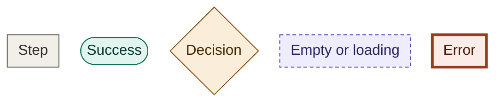

Gray box: a user step. Teal with rounded ends: success. Amber diamond: a decision. Purple with a dashed border: an empty or loading state. Coral with a thick border: an error. A dashed arrow is an exceptional path.

## Cross-cutting states

- **Loading:** skeletons. When the first request after idle takes over 1 second, the screen says "Waking up the server…" (up to 3 s is accepted, PRD P3). Stored data is shown first and refreshed in the background.
- **Offline (1b):** a read-only snapshot with a banner. Write buttons are disabled.
- **Session expired:** return to sign-in, and the local snapshot is cleared.
- **Error pattern:** every error names what failed, keeps the user's input and offers one action.
- **Undo:** deleting or dropping shows an Undo toast for 15 seconds (PRD U3 requires at least 10).

## F1. First run (Must 3, 5, 12)

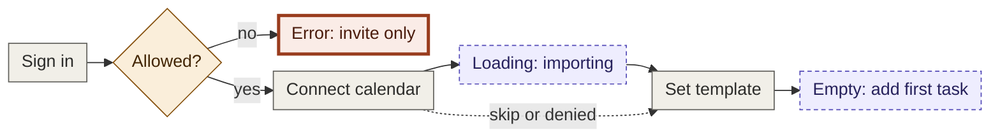

- **Path:** sign in with Google, connect Calendar and choose calendars, set the home zone and the weekly template, then the empty day view.
- **Not on the allow-list:** an "Invite only" screen. Nothing is stored.
- **Calendar step:** skippable. The template step is not, because without a template there is no available time.
- **Starter template (decided):** prefilled with Mon–Fri 09–17 work, 09–11 focus, evenings personal, meals and sleep. One tap accepts it.
- **Loading:** "Importing, n of m calendars".
- **Error:** consent denied or Google down. The user continues without the calendar and sees a reconnect prompt later.
- **iOS:** if notifications need a Home Screen install, the app asks for it here (PRD section 8, plan B).

## F2. Capture a task (Must 6, 7)

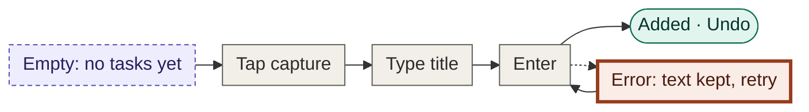

- **Path:** the capture button is always visible. The title field opens focused, Enter saves with type "Other", and a toast shows "Added · Undo". "Add details" expands estimate, flags, deadline and type. This is one typed line, within the 3-tap budget.
- **Empty:** "No tasks yet. Add one above."
- **Error:** the text stays in the field. "Couldn't save. Retry."

## F3. Plan (Must 1, 8, 9)

Suggester:

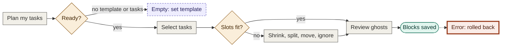

Manual placement:

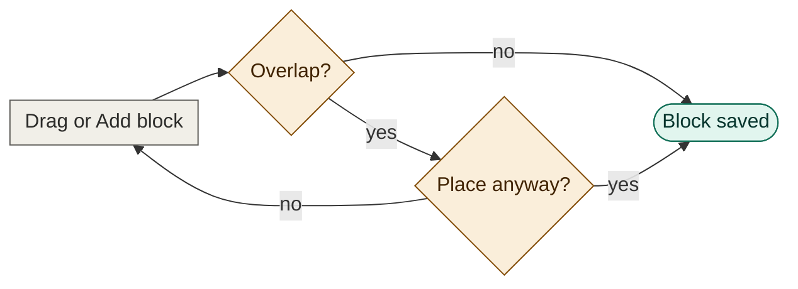

- **Suggester path:** "Plan my tasks", select tasks (all open ones by default), proposed blocks appear as dashed ghosts in the day or week view, then accept all, accept one or adjust. Accepted blocks are saved.
- **Manual path:** drag a block, or use "Add block" with start and end fields. An overlap with a hard event, another block or a recovery buffer opens a warning with "Place anyway" (the only confirm dialog besides delete all).
- **No slot fits:** four options: shrink, split, move another block, ignore the deadline.
- **Empty:** "Nothing to plan", or "Set your template first".
- **Error:** the banner "events as of 10:42, may be out of date" with Reconnect or Refresh. A failed save is rolled back.

## F4. Confirm (Must 2, 11)

Finding blocks to confirm:

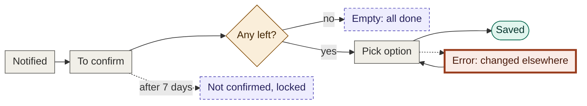

The four options:

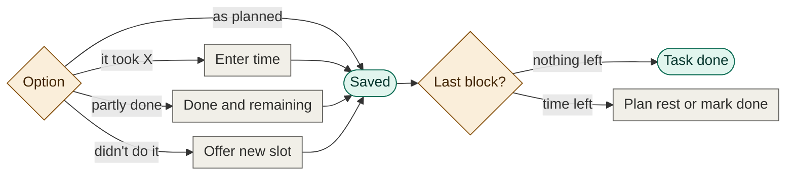

- **Entry (decided):** a "To confirm" screen plus inline confirmation.
  - The screen lists unconfirmed blocks, oldest first, with a counter ("2 left").
  - The end-of-block notification, the in-app prompt and the end-of-day banner all open it.
  - A notification opens it at that block.
  - Blocks in the calendar carry an "Unconfirmed" label, and tapping one opens the same card.
- **Four options** (each at least 44 × 44 px, A4):
  - As planned: one tap.
  - It took X: duration and an optional actual start.
  - Partly done: time done and remaining estimate.
  - Didn't do it: a new slot is offered. Accepting it adds no second postponement.
- **Missed block:** 30 minutes after its end it triggers the reschedule prompt.
- **After the last block:** the task is marked done, or the user is asked to plan the rest.
- **After 7 days (decided):** the block shows as "Not confirmed", greyed, with text and an icon, never color alone (Must 16). It is locked, leaves the queue and the banner, and is excluded from insights. Its detail says "The confirmation window closed on <date>."
- **Empty:** "Nothing to confirm."
- **Error:** a conflict with another device shows the current times and asks the user to confirm again.

## F5. Review the metrics (Must 15)

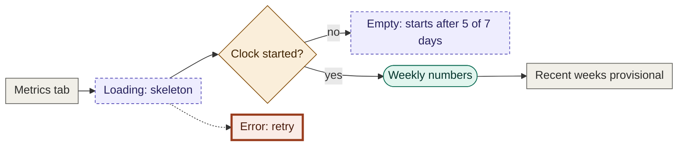

- **Path:** the Metrics tab shows weekly numbers, with the first 4 weeks marked as baseline. A week that ended under 14 days ago is marked provisional.
- **Empty:** "Numbers start after 5 of 7 days of use."
- **Error:** the standard retry pattern.

## F6. Recover and manage the account (Must 6, 12, 14)

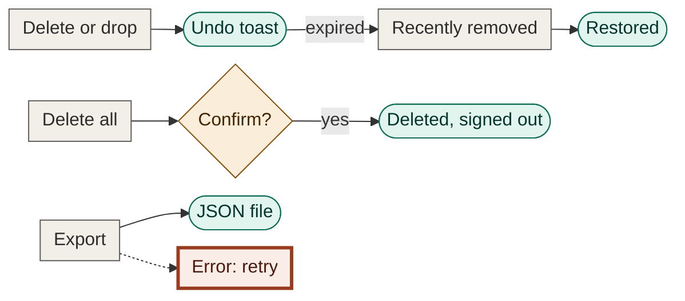

- **Restore:** a "Recently removed" list holds dropped tasks and deleted blocks for 7 days. Overwritten edits can also be restored for 7 days.
- **Account:** sign out everywhere, export (1b) and delete all, which uses a confirmation dialog.
- **Calendar:** disconnect or reconnect.
- **Error:** a failed export keeps the user on the screen with a retry.

## F7. Assistant chat (Should, gated by Must 13)

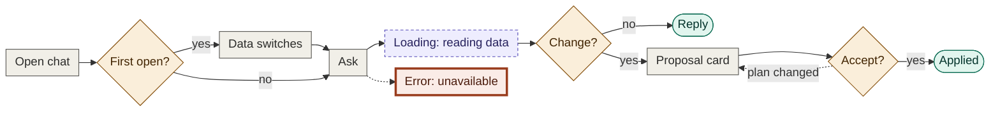

- **Entry:** a chat button. The panel is labelled "AI assistant" and is a side panel on desktop and full screen on phone.
- **First open (decided):** a one-time setup screen shows the five data switches (task titles, notes, checklist steps, event titles, task-type names), what is sent and who processes it. All are off by default, and the user chooses. It links to "How the assistant works".
- **Path:**
  - The user asks, for example "how was my week?".
  - The panel shows "Reading your data…".
  - The reply is plain text, with links as plain text, and each statement about history names its basis.
  - A change arrives as a proposal card marked "Assistant suggestion", distinct from the rule-based suggester. It lists every item it changes (at most 10), with Accept and Reject. Nothing is applied before Accept.
  - Accept re-checks the plan. If it changed, the card says "Your plan changed, review again" and shows a fresh proposal.
- **Data switches (decided):** after the first-open screen they live in Settings only. The chat never asks to share more, and the model cannot trigger a prompt. Under the input a quiet line shows "Assistant sees: times, durations, flags. Titles: off · Change in Settings". Changes are written to the audit log.
- **Empty:** example prompts and "Chats are kept 30 days."
- **Errors:**
  - Provider down, cost cap, rate limit or kill switch: "Assistant unavailable". The input is disabled and the planner keeps working.
  - Request too large: "That covers too much data. Try 13 months or fewer."
  - Off-topic: a polite decline.
  - Distress: a caring reply with crisis resources.

## F8. Month and year planning (Should)

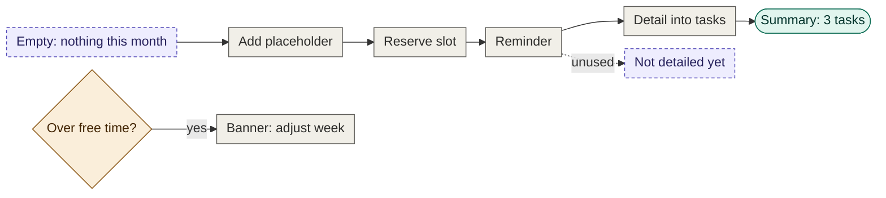

- **Path:** the Month or Year tab opens. The user adds a placeholder with a title and a rough range ("mid-July") and can reserve a planning slot. A light reminder fires when the slot arrives. The user opens the slot and turns the placeholder into tasks and blocks.
- **After detailing (decided):** the placeholder stays on the month and year views as a summary, "3 tasks planned", linked to its tasks. It is not a task and never enters the metrics. The data model needs a link from each task to its placeholder.
- **Overload check:** before the week starts, a banner shows "Planned 34 h, free 28 h" with a link to adjust.
- **Empty:** "Nothing planned for this month. Add a rough plan, for example a vacation."
- **Error:** the standard retry pattern. A planning slot that passes unused shows "Not detailed yet".

## F9. Recurring tasks (Must 18)

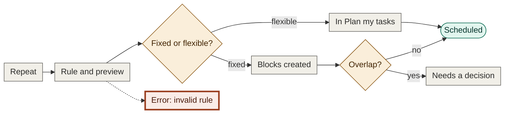

- **Path:** in task details, tap Repeat and choose a rule (daily, weekdays, weekly, every N weeks, monthly). Choose a fixed time ("Mondays 08:00–08:30") or a flexible target ("gym 3 times a week", with days and a time of day). Add an optional end date or count. A preview shows the next dates before saving.
- **Fixed occurrences:** blocks are created at once. An overlap flags "may be affected" and lists it under "Needs a decision". The block is never moved silently.
- **Flexible occurrences:** they appear in "Plan my tasks", at most one per day.
- **Editing:** a choice of "This occurrence" or "This and future". Past and confirmed ones never change.
- **End or delete a series:** future occurrences are removed, past ones are kept, and an Undo toast shows.
- **Empty:** "No repeating tasks. Add one with Repeat on any task."
- **Error:** an invalid rule names the field and suggests a fix.
- **Missed period:** the occurrence counts as not done and is not carried forward. It shows "Not done", with no guilt wording.

## F10. Checklists (Must 17)

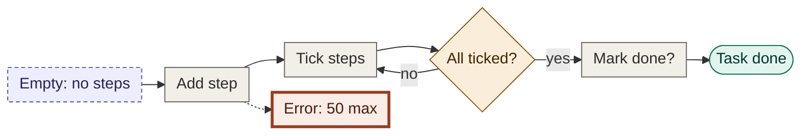

- **Path:** in task details, tap "Add step". Enter adds the next step. Steps can be edited and reordered by keyboard or by drag. Steps are ticked from the task or from a block. When all are ticked, a prompt asks "All steps done. Mark the task done?" Ticking never marks the task done by itself.
- **Limit:** "50 steps is the maximum."
- **Empty:** "No steps. Break this task down into steps."
- **Error:** the text stays in the field with a retry.
- **Recurring tasks:** each occurrence gets the steps unticked.

## Gaps for later steps

- What deleting a past unconfirmed block does to the confirmation rate is not defined in the PRD. Resolve it in the data-model step.
- The exact wording of messages is a design task (PRD section 5, screen states). It is finished in the UX copy pass, not here.
