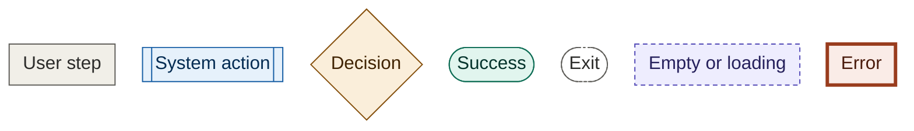
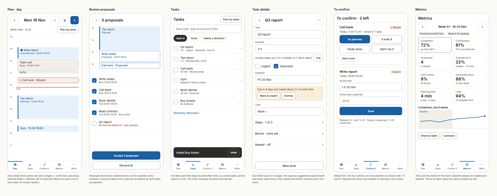
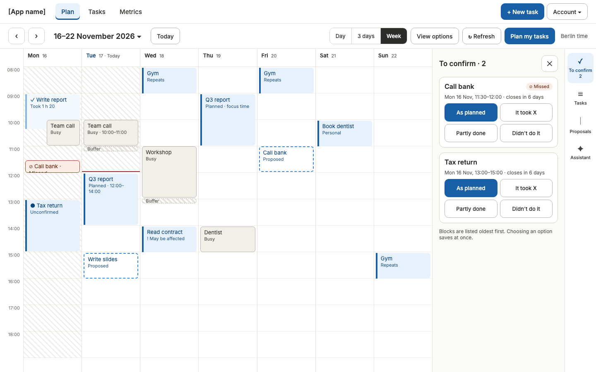
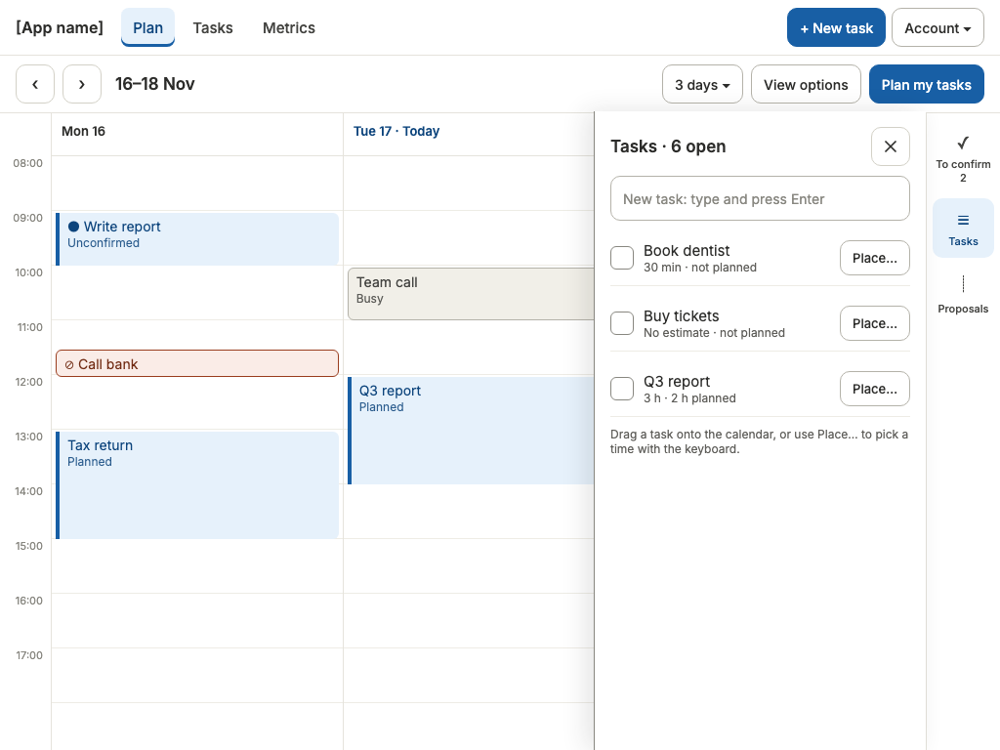
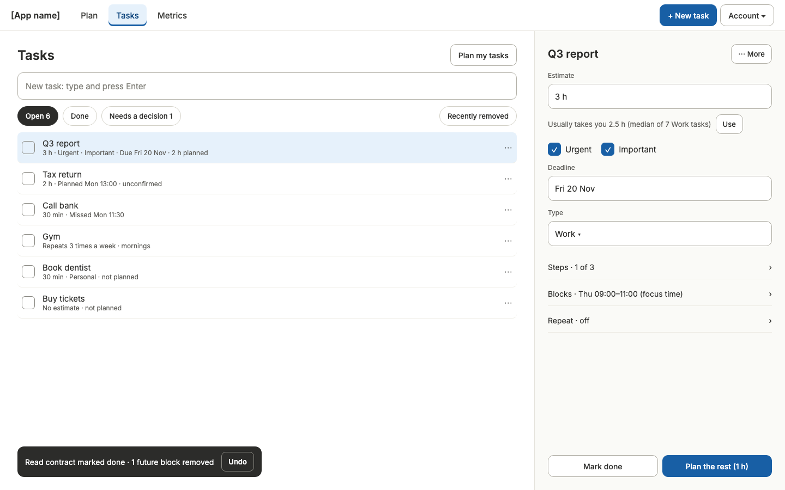
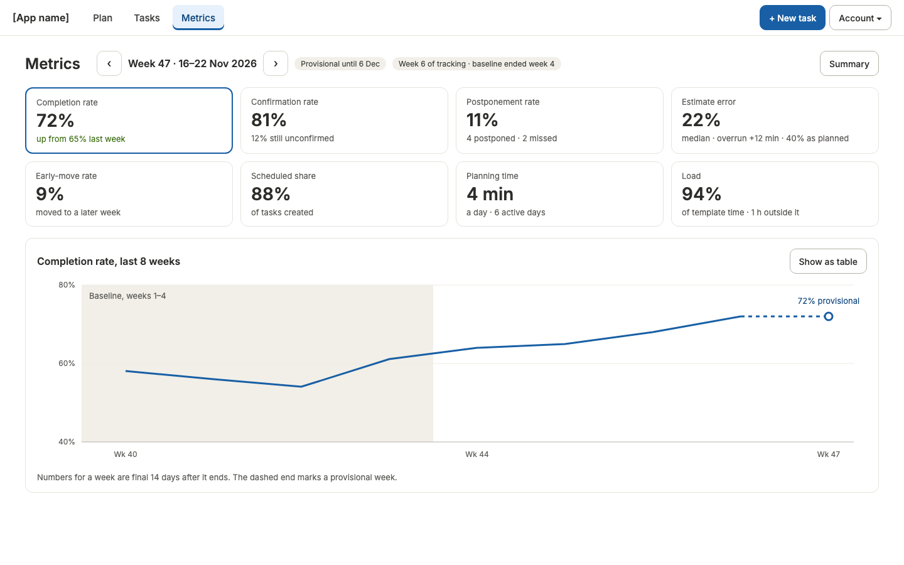

# Design 1: User flows

How people move through the app: each flow's goal, entry points, steps, states, exits and accessibility path. Requirement references (Must 2, A4 and so on) point to the [PRD](../../PRD.md). Terms follow the PRD glossary.

The user in every flow is the signed-in owner, the only user in the first version (PRD section 2), unless a flow says otherwise.

## Files

Each file covers one feature area. Each flow's header gives its release: **1a**, **1b** or **Should**.

| File | Flows |
|---|---|
| [first-run.md](first-run.md) | Sign in, first setup |
| [tasks.md](tasks.md) | New task, task details and urgency, task types, done and undone, drop and delete, Recently removed, earlier versions |
| [planning.md](planning.md) | Plan with the suggester, place blocks by hand, delete a block, overload check |
| [reminders-and-confirmation.md](reminders-and-confirmation.md) | Turn on reminders, block reminders, confirm a block, edit a confirmation, postponement prompts |
| [availability.md](availability.md) | Weekly template, day overrides, home zone, planning settings |
| [calendar.md](calendar.md) | Choose calendars, refresh, reconnect |
| [metrics-and-insights.md](metrics-and-insights.md) | Weekly metrics, duration suggestions, summaries, evidence tips |
| [account.md](account.md) | Sign out, accessibility settings, export, delete all |
| [recurring-tasks.md](recurring-tasks.md) | Create a repeating task, resolve an overlap, edit or end a series |
| [checklists.md](checklists.md) | Steps inside a task |
| [month-and-year.md](month-and-year.md) | Placeholders, planning slots, detailing, edit or delete a placeholder |
| [assistant.md](assistant.md) | Data switches, ask, review a proposal |

## Journey overview

The core loop of the first release. Each step links to its flows.

```mermaid
%%{init: {"flowchart": {"nodeSpacing": 16, "rankSpacing": 24, "padding": 6}}}%%
flowchart LR
  J1[Add new tasks]:::step --> J2[Plan the day or week]:::step --> J3[[Remind at start and end]]:::sys --> J4[Confirm what happened]:::step --> J5[Review the week]:::step --> J6[Adjust template and estimates]:::step
  J6 -.-> J1
  classDef step fill:#F1EFE8,stroke:#5F5E5A,color:#2C2C2A
  classDef sys fill:#E6F1FB,stroke:#185FA5,color:#042C53
  classDef ok fill:#E1F5EE,stroke:#0F6E56,color:#04342C
  classDef exit fill:#FFFFFF,stroke:#5F5E5A,color:#2C2C2A,stroke-dasharray:2 2
  classDef decision fill:#FAEEDA,stroke:#854F0B,color:#412402
  classDef state fill:#EEEDFE,stroke:#534AB7,color:#26215C,stroke-dasharray:4 3
  classDef error fill:#FAECE7,stroke:#993C1D,color:#4A1B0C,stroke-width:3px
```



1. **Add new tasks:** [tasks.md](tasks.md), New task.
2. **Plan the day or week:** [planning.md](planning.md), Plan with the suggester, and Place, move or resize a block.
3. **Remind at start and end:** [reminders-and-confirmation.md](reminders-and-confirmation.md), Block reminders.
4. **Confirm what happened:** [reminders-and-confirmation.md](reminders-and-confirmation.md), Confirm a block.
5. **Review the week:** [metrics-and-insights.md](metrics-and-insights.md), Weekly metrics.
6. **Adjust:** [availability.md](availability.md) and [tasks.md](tasks.md), Edit task details. Duration suggestions (1b) feed the next estimates.

First-time users enter through [first-run.md](first-run.md) before step 1.

## Diagram key



- **User step:** gray box. Something the user does.
- **System action:** blue box with double side bars. Something the app does on its own.
- **Decision:** amber diamond.
- **Success:** teal, rounded ends. The flow's goal is reached.
- **Exit:** white, rounded ends, dotted border. The user leaves without reaching the goal (cancel, back, denied).
- **Empty or loading state:** purple, dashed border. It is attached to its step by a dotted line without an arrow.
- **Error:** coral, thick border. It is reached by a dashed arrow.

Each diagram is followed by its text version. Diagram colors are placeholders until the design system tokens exist (design step 4).

## Cross-cutting states

These apply to every flow and are not repeated in each one.

- **Loading:** skeletons in the shape of the content. When the first request after idle takes over 1 second, the screen adds "Waking up the server…" (up to 3 s is accepted, PRD P3).
- **No connection (1a, decided):** whatever is on screen stays visible. A banner says "No connection. Changes can't be saved right now." Every action that changes data is disabled, not only save buttons: New task, dragging and the keyboard move mode, time fields, checkboxes, the four confirm options, Undo, restore and settings. A block cannot be picked up for dragging, and trying it announces "Can't change while offline". Typed text stays in its field. When the connection returns, the banner goes and the data refreshes. A reload while offline shows the browser's own offline page.
- **Offline (1b):** the saved read-only copy replaces the browser's offline page (Must 12).
- **Signed out mid-task (1a, decided):** a dialog says "Signed out. Sign in to continue". Google sign-in opens in a pop-up, the screen and typed text stay underneath, and the user saves again afterwards.
  - **If the browser blocks the pop-up:** the dialog switches to "Sign in on a new page". Before leaving, the app keeps any unsaved text in the browser's session storage for that tab only. After sign-in the app returns to the same screen, puts the text back in its field and deletes the stored copy, so the user can save it. The stored copy is never sent anywhere, and it is cleared when the tab closes.
- **Errors:** every error names what failed, keeps the user's input and offers one primary action. A secondary action is allowed when it is clearly less prominent.
- **Undo (decided):** these actions show an Undo message:
  - deleting a block, deleting a task and dropping a task (PRD U3);
  - adding a task with New task ("Added · Undo");
  - ending a series, whose future occurrences are tasks ("Gym ended · 4 occurrences removed · Undo");
  - marking a task done, which also removes its future blocks ("done · 1 future block removed · Undo"). Unticking within 7 days remains the later way back.

  How the message behaves:
  - **Timer:** 15 seconds (PRD U3 requires at least 10). It pauses while the message has keyboard focus or the pointer is over it.
  - **Shortcut:** while the message is shown, Ctrl+Z (Cmd+Z on Mac) undoes the most recent action in it, and pressing it again undoes the one before. Which undo runs depends on what there is to undo (decided):
    - **Outside a text field:** Ctrl+Z undoes the latest app action.
    - **In a text field with typing to undo:** Ctrl+Z undoes the typing, as in any text field.
    - **In the New task field, when it is empty and nothing has been typed since the last save:** Ctrl+Z removes the task just added, because there is no typing to undo.

    The app never overrides browser or screen-reader shortcuts.
  - **Setting:** "Keep Undo messages until I close them", in Settings, then Accessibility (see [account.md](account.md)), removes the timer. The message still closes after 10 minutes at most, so a deleted task's title is gone within 10 minutes (Musts 6 and 14). This meets WCAG 2.2.1 (timing adjustable).
  - **Grouping:** removals made while a message is open join it, for example "3 tasks deleted · Undo all · Show". Each addition restarts the timer. "Show" lists each item with its own Undo. Mixed removals read "3 items removed". Screen readers hear each addition, for example "Call bank deleted, 2 items in Undo".
  - **When it closes:** everything in it becomes final at once. Dropped tasks and deleted blocks remain in Recently removed for 7 days.
  - **Server:** the undo deadline for a deleted task is extended while the message stays open, up to the 10-minute cap (architecture 6.4 needs this change).
- **Edits from two devices:** the later edit wins without a prompt (Must 12). The one exception is confirming a block that was moved on another device (decided, see Confirm a block).

**Accessibility, all flows (Must 16, PRD 6.1):**
- Every screen has a "Skip to content" link, one top-level heading and landmarks (banner, navigation, main).
- Undo messages and banners are announced politely by screen readers. Errors that block an action are announced assertively.
- Opening a dialog or panel moves focus into it, and closing it returns focus to the control that opened it.
- After an item is removed, focus moves to the next item, or to the list heading if none is left.
- Every drag action has a keyboard and a form alternative.
- Primary touch actions are at least 44 × 44 px, others at least 24 × 24 px.
- Motion follows the reduced-motion setting.

## State labels

One set of labels, used in the calendar, lists and screen-reader text. Every state has text or an icon, never color alone (Must 16).

**Block states**
- **Planned:** in the future.
- **Unconfirmed:** the end has passed and the block is not confirmed.
- **Missed:** unconfirmed and 30 minutes past its end.
- **Confirmed:** with its outcome (as planned, it took X, partly done, didn't do it).
- **Unconfirmed, window closed:** 7 days have passed since the end. The block is locked and not used in insights (decided).
- **Dropped:** its task was dropped or deleted before the block was confirmed.
- **May be affected:** something now overlaps it.
- **Hard event** and **recovery buffer** are not blocks, but they are labelled the same way.

**Task states**
- **Open**, **Done**, **Dropped** and **Deleted**.
- **Not done:** a recurring occurrence whose period ended without it being done (Must 18).

## Screens: frame, navigation and shared parts

Each feature file ends with a `## Screens` section: the structure of every screen its flows use. This text is the source of truth and stays with the code. Pictures of the main screens follow this text. They are exported from the design canvas ([AI Planner wireframes](https://claude.ai/artifact/J9B7HdCRaHniRwGmxs25fF), private to the owner) into `images/`. Colors are placeholders until the design system step.

**Main screens**

Phone: Plan (day), Review proposals, Tasks, Task details, To confirm and Metrics.



Desktop, Plan (week), with the To confirm panel and the rail:



Tablet, Plan (3 days), with the Tasks panel open over the grid:



Desktop, Tasks with the selected task's details beside the list:



Desktop, Metrics:



**How each screen is written**
- **Flows:** the flows that use it.
- **Phone:** a text layout. Circled numbers (①②③) give the keyboard and screen-reader focus order. The right margin names landmarks and notes.
- **Tablet and desktop:** a layout where it differs, or a note.
- **Elements:** a table with each interactive element's HTML element or role, its accessible name and its requirement.
- **Screen reader:** the heading, the reading order and the announcements.
- **States:** empty, loading, error and other states, with their wording.

### Breakpoints

| | Phone (under 640 px) | Tablet (640–1024 px) | Desktop (above 1024 px) |
|---|---|---|---|
| Navigation | Bottom tabs with labels: Plan, Tasks, Confirm, Metrics, More | Top bar with labels: Plan, Tasks, Metrics, and Account | Same as tablet |
| New task | "+" in the toolbar, named "New task" | "+ New task" in the top bar | Same as tablet |
| Planner default | Day | 3 days | Week, Monday start |
| Side panels (To confirm, Tasks, Proposals, Assistant) | Full screens | Rail with labels; the panel opens over the grid | Rail with labels; the panel sits beside the grid |
| View options | Bottom sheet | Pop-over | Pop-over |
| Settings | "More" tab, then a list | Account menu, then Settings, with a sidebar | Same as tablet |

All layouts work from 320 px wide and at 200% zoom (PRD A3, U2). Tablet is the desktop layout with the panel over the grid, so it is described only where it differs.

**Skip link.** Every screen starts with a "Skip to content" link, hidden until it has focus (PRD A1). It is the same everywhere, so the layouts leave it out and number the focus order from the first element after it.

### Phone frame

```
┌──────────────────────────────────┐
│ ① ‹  ② Mon 16 Nov  ③ ›  ④ ⚙ ⑤ +  │ banner: toolbar of the screen
├──────────────────────────────────┤
│                                  │ main · one h1 per screen
│   screen content                 │
│                                  │
├──────────────────────────────────┤
│ ⑥ Plan ⑦ Tasks ⑧ Confirm 2 ⑨ Metrics ⑩ More │ navigation
└──────────────────────────────────┘
```

- The tab bar shows on the five top-level screens only. Sub-screens (task details, settings pages) show "‹ Back" in the toolbar instead.
- Focus order is: toolbar, main content, tab bar. The tab bar comes last, because it repeats on every screen.
- The current tab has `aria-current="page"` and a visible underline, not only a color.
- The Confirm tab shows its count as text: "Confirm, 2 to confirm". It is information, never an alert badge (Must 13, no manipulation).

### Desktop frame

```
┌────────────────────────────────────────────────────────────────────┐
│ ① Plan ② Tasks ③ Metrics            ④ + New task ⑤ Account ▾ │ banner + navigation
├────────────────────────────────────────────────────────────┬─────────┬──┤
│ ⑥ toolbar of the screen                                     │ ⑧ panel │⑦ │ main | complementary
│ screen content                                              │         │ rail
└────────────────────────────────────────────────────────────┴─────────┴──┘
```

- The rail lists To confirm (with its count), Tasks, Proposals (only while a suggester run is open) and Assistant (Should, only when it is enabled). Each item has an icon and a text label.
- Choosing a rail item opens or switches the panel. Choosing the open item again closes it.
- Focus order is: navigation, New task, Account, the screen's toolbar and content, the rail, then the panel. The rail comes before the panel because it chooses what the panel shows.
- On tablet the panel opens over the content and closes with Esc. Focus moves into it, and back to the rail item when it closes.
- The Account menu holds Settings, Help and tips, and Sign out.

### View options (1a)

- **Flows:** none of its own; it is reached from every planner screen.
- **Phone:** a bottom sheet. **Tablet and desktop:** a pop-over under the "View options" button.

```
┌──────────────────────────────────┐
│ View options                ① ✕  │ dialog · h2
│ ② Days in view   Day ▾           │ Day, 3 days, Week
│ ③ Time           24-hour ▾       │ 12-hour, 24-hour; default from locale
│ ④ Date format    16 Nov 2026 ▾   │ default from locale
│ ⑤ All-day busy   Full ▾          │ Full, Slim bar at the top
└──────────────────────────────────┘
```

| # | Element | HTML / role | Accessible name | Req |
|---|---|---|---|---|
| ① | Close | button | "Close view options" | A1 |
| ②–⑤ | Each option | native select with label | "Days in view", "Time format", "Date format", "All-day busy events" | A2, U6 |

- **Screen reader:** opens as a dialog named "View options", with focus on the first select. Each change applies at once and announces nothing extra. Esc closes it and returns focus to the button.
- **States:** a failed save keeps the change on this device and shows "Couldn't save your view options. Retry."
- Choices are saved to the account, so they follow the user across devices. Start of week is not offered, because weeks start on Monday (PRD section 3).

### Block kinds

Every kind is told apart by text and shape, never by color alone (Must 16). The colors are placeholders until the design system step.

| Kind | Look | Visible text | Accessible name ends with |
|---|---|---|---|
| Planned block | solid fill, bar on the start edge | title, time | "planned" |
| Hard event | grey fill | title or "Busy", time | "busy" |
| Recovery buffer | hatched, not focusable | "Buffer" | (read as text: "Recovery buffer, 10 minutes") |
| Proposed block | dashed outline, no fill | title, "Proposed" | "proposed" |
| Unconfirmed block | solid, with a dot icon | "Unconfirmed" | "unconfirmed" |
| Missed block | solid, with ⊘ icon | "Missed" | "missed" |
| Confirmed block | lighter fill, ✓ icon | outcome, for example "Took 1 h 20" | "confirmed, took 1 hour 20 minutes" |
| Unconfirmed, window closed | greyed, ⊘ icon | "Window closed" | "unconfirmed, window closed" |
| May be affected | any of the above, with ! icon | "May be affected" | adds "may be affected" |
| Assistant suggestion (Should) | dashed outline with a spark icon | "Assistant suggestion" | "assistant suggestion" |

Block text is at least 14 px. Short blocks cut the title with an ellipsis rather than shrink the text, and the full text stays in the accessible name.

### More (1a)

- **Flows:** reaches every settings flow. On tablet and desktop it is Settings from the Account menu, with the same items as a sidebar.

```
┌──────────────────────────────────┐
│ More                             │ h1
│ ① Weekly template              › │
│ ② Planning                     › │ buffer, default duration
│ ③ Task types                   › │
│ ④ Calendar                     › │
│ ⑤ Notifications                › │
│ ⑥ Time zone                    › │
│ ⑦ Accessibility                › │
│ ⑧ Assistant data               › │ Should
│ ⑨ Account                      › │
│ ⑩ Recently removed             › │
│ ⑪ Tips                         › │ Should
├──────────────────────────────────┤
│ tab bar                          │
└──────────────────────────────────┘
```

- **Elements:** each row is a link with its visible name. Rows are at least 44 px tall (PRD A4).
- **Screen reader:** a list of 11 links under the heading "More".
- **States:** a row shows a short status where useful, such as "Calendar · Disconnected", as text.

## Decisions made in this step

| Decision | Where |
|---|---|
| Starter template, accepted with one tap | first-run.md |
| A block unconfirmed after 7 days is locked, labelled "Unconfirmed, window closed" | State labels, reminders-and-confirmation.md |
| A "To confirm" list plus inline confirmation | reminders-and-confirmation.md |
| Confirming a block moved on another device asks again (amends Must 12) | reminders-and-confirmation.md |
| Missed blocks get a label in 1a. The reschedule prompt stays a Should | reminders-and-confirmation.md |
| No connection in 1a: keep the screen and disable every action that changes data, including drag | Cross-cutting states |
| Signed out mid-task: sign in with a pop-up. If the pop-up is blocked, sign in on a full page and return to the same screen with unsaved text kept for that tab | Cross-cutting states |
| Assistant data switches: a one-time screen on first open, then Settings only | assistant.md |
| A detailed placeholder stays as a linked summary | month-and-year.md |
| A planning slot is a normal block of a "Plan: …" task | month-and-year.md |
| "Plan: …" tasks count in every metric like any task | month-and-year.md |
| The PRD is updated at the end of each design step | This file |
| "Other" cannot be deleted | tasks.md |
| Deleting a task type and deleting a placeholder ask inline, with no Undo, because PRD U3 limits Undo to blocks and tasks | tasks.md, month-and-year.md |
| Ending a series works like deleting tasks: no question, and a grouped Undo restores the series and its future occurrences | recurring-tasks.md |
| "Day off" clears work and focus time only | availability.md |
| Reminders permission is asked after the first block is saved. "Not now" waits 7 days | reminders-and-confirmation.md |
| Delete all asks the user to type "delete" | account.md |
| Disconnecting the calendar asks inline, not in a dialog | calendar.md |
| Declining calendar access at sign-in still signs in, and the calendar can be connected later | first-run.md, calendar.md |
| Closing the assistant's first-open screen keeps every switch off and counts as seen | assistant.md |
| "It took X" and "partly done" accept 1 minute to 24 hours | reminders-and-confirmation.md |
| The overlap dialog starts with focus on "Don't place" | planning.md |
| Confirming an old block of a done task never re-plans it: "didn't do it" offers no new slot, and "partly done" asks no time left | reminders-and-confirmation.md |
| Confirmed blocks can't be deleted. A wrong confirmation is edited instead (narrows Must 6) | planning.md |
| The add button is named "New task". "Fast capture" stays only as the PRD requirement name | tasks.md, Screens |
| Phone uses bottom tabs (Plan, Tasks, Confirm, Metrics, More). Tablet and desktop use a top bar plus a labelled rail for side panels | Screens |
| The planner defaults to Day on phone, 3 days on tablet and Week on desktop | Screens |
| View options: days in view, time format, date format, all-day busy events, saved to the account. Start of week is not offered | Screens |
| Marking a task done removes its future blocks (restored if unticked within 7 days). Past unconfirmed blocks stay in To confirm | tasks.md |
| Undo message: shown for block delete, task delete and drop, New task, mark done and series end. It pauses on focus or hover, has Ctrl+Z (Cmd+Z) as its shortcut, which yields to typing undo in text fields but works in the empty New task field right after a save, and groups removals into one message. "Keep Undo messages until I close them", in Settings, then Accessibility, removes the timer, with a 10-minute cap | Cross-cutting states, account.md |

**When the PRD and architecture are updated.** This design step ends when this document is approved. The PRD is then updated to v0.3 with every decision above, and `docs/architecture.md` gets the matching changes:
- **6.4:** the undo deadline for a deleted task is extended while the Undo message stays open, up to 10 minutes. Ending a series can be undone.
- **6.4 and 7.4:** marking a task done removes its future blocks, and unticking within 7 days restores the ones whose start has not passed.
- **7.5:** confirming an old block of a done task offers no new slot, and "partly done" records no remainder.
- **8:** routes for undoing a series end and extending an undo, and no delete route for confirmed blocks.
Until then, the PRD still says in Must 12 that the later edit always wins, and the flows follow the decision above to ask again when confirming a block that was moved on another device.

## Not covered on purpose

- **Email reminder fallback (Should):** it needs an email sender, which is not chosen yet (architecture section 17). Its flow is written when the sender is chosen.
- **Could items** (full plan vs. actual view, mobile quick-confirm widgets, learned template adjustments): not part of the first version. They get flows when they are scheduled.
- **Later items** (PRD section 5): out of scope for the first version.

## Gaps for later steps

- **Data model:**
  - what deleting a past unconfirmed block does to the confirmation rate;
  - the link from a task to its placeholder;
  - the task type of a "Plan: …" task.
- **Wireframes:** tablet layouts, the exact focus order per screen, and the drag handles for resize.
- **UX copy:** final wording of every message quoted here.
- **Build check:** whether Google sign-in works in a pop-up in our setup. The full-page fallback above covers the case where it does not.
- **Open in the PRD (section 10):**
  - notification de-duplication across devices;
  - how the template behaves when it conflicts with calendar events;
  - limits on tasks, blocks and history;
  - time-zone handling of imported events.
