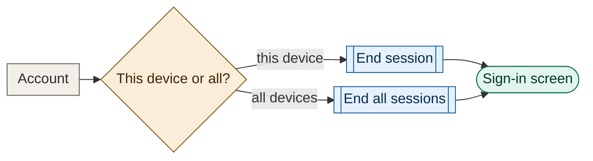
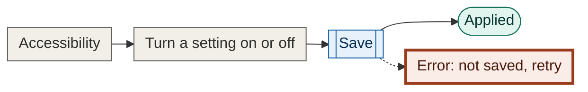
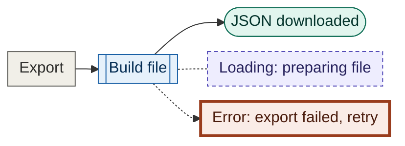
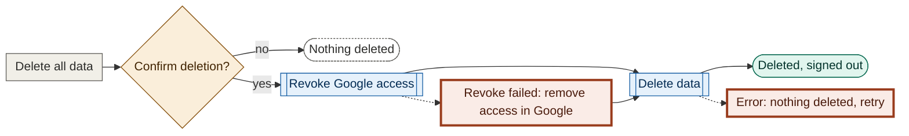

# Account

Part of [Design 1: User flows](README.md). The diagram key, cross-cutting states and state labels are in the README.

## Sign out (1a)

- **Goal:** end the session on this device, or on every device.
- **Entry:** Settings, then Account.
- **Preconditions:** signed in.
- **Success:** the sign-in screen is shown, and the chosen sessions are ended.



**Steps**
1. "Sign out" ends this session. "Sign out everywhere" ends every session (PRD S3).
2. Both are written to the audit log (PRD S7). Other devices show the signed-out dialog on their next request (README, cross-cutting states).

**Accessibility**
- Two clearly labelled buttons. Focus lands on the sign-in screen's heading.

## Accessibility settings (1a)

- **Goal:** adjust how the app behaves for your needs.
- **Entry:** Settings, then Accessibility.
- **Preconditions:** none.
- **Success:** the setting applies at once on this account, on every device.



**Steps**
1. "Keep Undo messages until I close them" (off by default). When on, Undo messages have no timer and close after 10 minutes at most (README, Undo).
2. Motion, contrast and text size follow the system settings (PRD A6, U7), so they are not repeated here. The page says so and points to the system settings.

**States and errors**
- **Save failed:** the switch returns to its previous position, with "Couldn't save. Retry."

**Accessibility**
- A native switch with a one-line description of its effect.

## Export your data (1b)

- **Goal:** download everything the app holds about you.
- **Entry:** Settings, then Account, then Export.
- **Preconditions:** signed in.
- **Success:** a JSON file is downloaded.



**Steps**
1. Tap Export. The screen lists what the file contains (Must 14).
2. The file downloads. Deleted tasks appear without titles. The export is written to the audit log (PRD S7).

**States and errors**
- **Loading:** "Preparing your file…"
- **Failed:** "Export failed. Retry." The user stays on the screen.

**Accessibility**
- Progress and completion are announced. The download uses the browser's own handling.

## Delete all data (1a)

- **Goal:** remove everything the app holds about you.
- **Entry:** Settings, then Account, then Delete all data.
- **Preconditions:** signed in.
- **Success:** all data is deleted, Google access is revoked, and the user is signed out.



**Steps**
1. The screen explains what will be deleted, that it cannot be undone, and that backups are purged within 30 days (Must 14).
2. A confirmation dialog asks the user to type "delete" (the only confirmation dialog besides the overlap warning, PRD U3).
3. The app revokes Google access, then deletes every record in one step (Must 14, architecture 7.9).
4. The user is signed out on every device, and the final screen confirms the deletion.

**States and errors**
- **Revoke failed:** deletion continues. The final screen says "We couldn't remove Google access automatically. Remove it in your Google account settings." with a link (architecture 7.9).
- **Delete failed:** "Nothing was deleted. Retry." Deletion happens all at once, so there is never a partial delete.

**Exits**
- Cancel in the dialog deletes nothing.

**Accessibility**
- The dialog has focus on its text field, with Cancel reachable by Esc.
- The final screen is announced, and its heading takes focus.

## Screens

### Account (1a)

- **Flows:** Sign out, Export your data (1b), Delete all data.

```
┌──────────────────────────────────┐
│ ‹ Back   Account                 │ h1
│ Signed in with Google            │
│ ① Sign out                       │
│ ② Sign out everywhere            │
│ ③ Export your data               │ 1b
│ ④ Delete all data                │ destructive style, text says it
└──────────────────────────────────┘
```

- **Elements:** four buttons, each at least 44 px tall. ④ uses the danger style and its text alone says what it does.
- **Export, while preparing:** ③ shows "Preparing your file…" as a live status; on failure "Export failed. Retry."

### Delete all data (1a)

```
┌──────────────────────────────┐
│ Delete all data?             │ dialog · h2
│ Removes your tasks, blocks,  │
│ settings, history and        │
│ imported events now. Backups │
│ are purged within 30 days.   │
│ This can't be undone.        │
│ ① Type delete to confirm     │
│   [            ]             │
│ ② Delete all data            │ enabled after typing
│ ③ Cancel                     │
└──────────────────────────────┘
```

- **Screen reader:** focus starts in the text field; the paragraph is the dialog's description. Esc equals Cancel.
- **Final screen:** "Your data is deleted." If revoking Google access failed: "We couldn't remove Google access automatically. Remove it in your Google account settings." with the link.

### Accessibility (1a)

```
┌──────────────────────────────────┐
│ ‹ Back   Accessibility           │ h1
│ ① Keep Undo messages until I     │ switch, off by default
│   close them                     │
│ Motion, contrast and text size   │
│ follow your system settings.     │
└──────────────────────────────────┘
```
