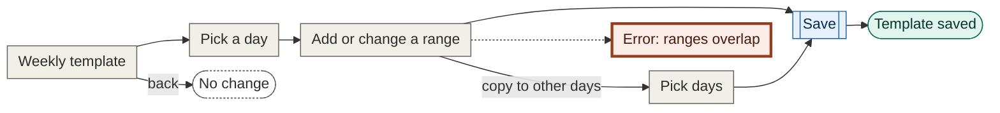
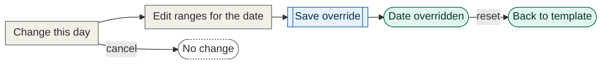
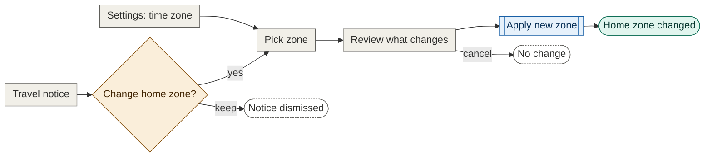
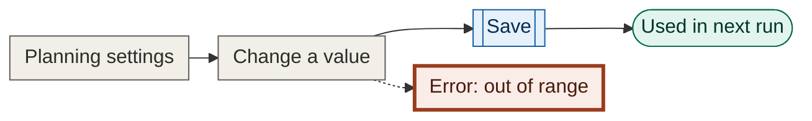

# Availability

Part of [Design 1: User flows](README.md). The diagram key, cross-cutting states and state labels are in the README.

## Edit the weekly template (1a)

- **Goal:** tell the app when you work, focus, have personal time, eat and sleep.
- **Entry:** Settings, then Weekly template. Also step 4 of first setup.
- **Preconditions:** none.
- **Success:** the template is saved, and the suggester uses it.



**Steps**
1. Pick a weekday.
2. Add or change ranges of five kinds: work, focus (inside work), personal, sleep and meal (Must 5).
3. Optionally copy the day's ranges to other days.
4. Each change saves. Existing blocks are never moved. Blocks that now sit outside their task type's time are counted in the load guardrail (PRD section 3).

**States and errors**
- **Overlapping ranges:** "Work 09–17 overlaps Meal 12–13. Meals can sit inside work; other kinds can't overlap." (The exact rules for each kind are an open data-model detail.)

**Accessibility**
- Ranges are edited as a list of rows with a kind, a start and an end, using native time inputs. A visual week strip mirrors the list but is not needed to use it.

## Override a single day (1a)

- **Goal:** change availability for one date, such as a day off or a late start.
- **Entry:** a day's header in the day or week view, then "Change this day". Or Settings, then Weekly template, then Overrides.
- **Preconditions:** a template exists.
- **Success:** that date uses the override, and other dates are unchanged.



**Steps**
1. Open "Change this day". The day's template ranges are prefilled.
2. Edit them, or choose "Day off", which clears work and focus time.
3. The override applies to that date only (Must 5). The day header shows "Changed".
4. "Reset to template" removes the override.

**Accessibility**
- The "Changed" marker is text, not only color.

## Change the home time zone (1a)

- **Goal:** plan in a new home time zone after moving, or notice when you are travelling.
- **Entry:**
  - Settings, then Time zone;
  - the travel notice "Your device is in New York time. Plans use Berlin time."
- **Preconditions:** none.
- **Success:** the home zone is changed, or the user keeps it knowingly.



**Steps**
1. When the device zone differs from the home zone, a notice shows both (Must 12). Display follows the device zone.
2. Pick the new home zone.
3. A summary explains the effect: "Future blocks keep their clock times in the new zone. Past blocks and your metrics don't change." It lists the number of future blocks that now overlap events (Must 12).
4. Apply. Overlapping blocks are flagged "May be affected". This is never counted as a postponement (Must 12).

**Exits**
- "Keep" on the notice hides it until the device zone changes again. Cancel on the summary changes nothing.

**Accessibility**
- The zone picker is a searchable list with a text input.
- The summary is a plain paragraph read before the Apply button.

## Planning settings (1a)

- **Goal:** adjust the recovery buffer and the default task duration.
- **Entry:** Settings, then Planning.
- **Preconditions:** none.
- **Success:** the new values apply to future suggestions.



**Steps**
1. Recovery buffer: minutes after long meetings (default 10) and what counts as long (default 60 minutes) (Must 9).
2. Default task duration for tasks with no estimate (default 30 minutes) (Must 8).
3. Changes apply to the next suggester run. Existing blocks are not moved, and buffers redraw at once.

**States and errors**
- **Out of range:** the field names the limits, for example "Use 0 to 60 minutes."

**Accessibility**
- Native number inputs with visible units and limits in the label.

## Screens

Settings screens use the frame in the [README](README.md#screens-frame-navigation-and-shared-parts): on phone a screen from More with "‹ Back", on tablet and desktop a section of Settings with a sidebar.

### Weekly template (1a)

- **Flows:** Edit the weekly template, First setup step 3.

```
┌──────────────────────────────────┐
│ ‹ Back   Weekly template         │ h1
│ ① Mon ② Tue ③ Wed … ⑦ Sun        │ tab list of days
│ Monday                           │ h2
│ ⑧ Work      [09:00]–[17:00]  ⑨ ⋯ │
│ ⑩ Focus     [09:00]–[11:00]  ⑪ ⋯ │
│ ⑫ Meal      [12:30]–[13:15]  ⑬ ⋯ │
│ ⑭ Personal  [18:00]–[21:00]  ⑮ ⋯ │
│ ⑯ Sleep     [23:00]–[07:00]  ⑰ ⋯ │
│ ⑱ + Add range   ⑲ Copy to days   │
│ ▭▭▭▭ week strip (summary only)   │ aria-hidden
└──────────────────────────────────┘
```

- **Elements:** each range row is a fieldset named "Work, Monday" with a kind select and two native time inputs. Its menu holds Delete. Copy to days opens checkboxes for the weekdays.
- **Screen reader:** the week strip is decorative; the list is the content. Changing a range announces nothing; errors are announced.
- **States:** overlapping ranges show the error under the row; the entry stays.

### Change this day (1a)

- **Flows:** Override a single day.
- **Phone:** a bottom sheet from the day header. **Desktop:** a pop-over.

```
┌──────────────────────────────────┐
│ Change Mon 16 Nov           ① ✕  │ dialog · h2
│ ② ☐ Day off                      │ clears work and focus
│ ③ Work  [10:00]–[17:00]          │ prefilled from template
│ ④ Focus [10:00]–[11:00]          │
│ ⑤ + Add range                    │
│ ⑥ Save                           │ primary
│ ⑦ Reset to template              │
└──────────────────────────────────┘
```

- **After saving:** the day header shows "Changed" as text.

### Time zone (1a)

- **Flows:** Change the home time zone.

```
┌──────────────────────────────────┐
│ ‹ Back   Time zone               │ h1
│ Device: New York · Plans: Berlin │ only when they differ
│ ① Home time zone [ Europe/Berlin ]│ searchable
│ What changes                     │ h2, after a new pick
│ Future blocks keep their clock   │
│ times. Past blocks and metrics   │
│ don't change. 3 blocks may be    │
│ affected.                        │
│ ② Apply   ③ Cancel               │
└──────────────────────────────────┘
```

- **Screen reader:** the summary is read before Apply. Applying announces "Home time zone changed to New York".

### Planning settings (1a)

- **Flows:** Planning settings.

```
┌──────────────────────────────────┐
│ ‹ Back   Planning                │ h1
│ ① Buffer after long meetings     │
│   [ 10 ] minutes (0–60)          │
│ ② A meeting is long from         │
│   [ 60 ] minutes (30–240)        │
│ ③ Default task duration          │
│   [ 30 ] minutes                 │
│ ④ Why a buffer?                  │ Should: evidence tip
└──────────────────────────────────┘
```

- **Elements:** native number inputs with the unit and limits in the label.
