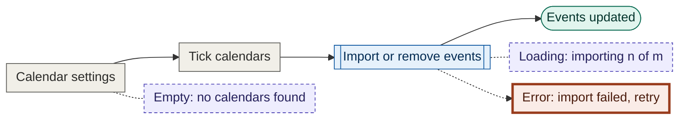
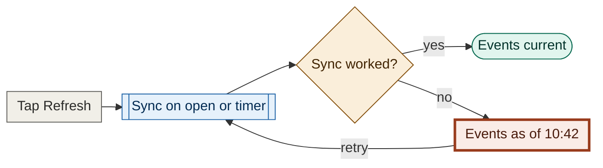
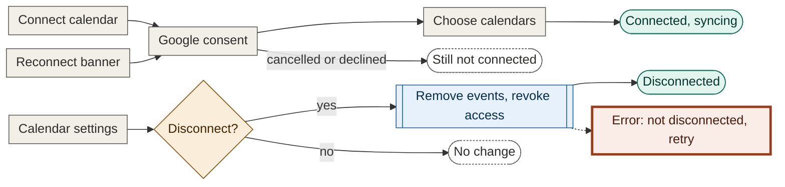

# Calendar

Part of [Design 1: User flows](README.md). The diagram key, cross-cutting states and state labels are in the README.

## Choose calendars (1a)

- **Goal:** decide which Google calendars count as busy time.
- **Entry:** Settings, then Calendar. Also step 1 of first setup.
- **Preconditions:** Google Calendar is connected.
- **Success:** the selected calendars' events show as hard events.

**Steps**
1. The account's calendars are listed with checkboxes (Must 3).
2. Ticking a calendar imports its events, and unticking removes them.
3. Planned blocks that now overlap a hard event are flagged "May be affected".

**States and errors**
- **Loading:** "Importing, n of m calendars."
- **Empty:** "No calendars found in this Google account."
- **Import failed:** "Couldn't import Work calendar. Retry." The other calendars are kept.

**Accessibility**
- A native checkbox list labelled with the calendar names. Progress is announced at the start and at the end, not on every calendar.

## Refresh and stale events (1a)

- **Goal:** see current Google events, and know when they may be out of date.
- **Entry:** shown by the app on app open and every 10 minutes, or the Refresh button in the day and week views.
- **Preconditions:** Google Calendar is connected.
- **Success:** the events are current, or clearly marked with their age.

**Steps**
1. The app syncs in the background on open and on a timer, and the screen never waits for it (Must 3, architecture 7.2). New and changed events appear within 15 minutes.
2. Refresh syncs immediately. While a sync runs, the button shows "Syncing…".

**States and errors**
- **Sync failed:** the last events stay, labelled "Events as of 10:42", and planning shows "Events may be out of date" (Must 3). Primary action: Retry.

**Accessibility**
- "Syncing…" and "Events updated" are announced politely, and only for a manual refresh.

## Connect, reconnect or disconnect Google Calendar (1a)

- **Goal:** connect the calendar for the first time after skipping it, restore access after Google revoked it, or stop importing.
- **Entry:**
  - "Connect calendar" in Settings, then Calendar, shown while nothing is connected;
  - the reconnect banner;
  - "Disconnect" in Settings, then Calendar.
- **Preconditions:** none for connecting. Disconnecting needs a connected calendar.
- **Success:** the calendar is connected and syncing, or disconnected with its events removed.

**Steps**
1. **Connect** (after skipping it in first setup, or declining calendar access at sign-in): Settings shows "Google Calendar isn't connected" and a Connect button. It opens Google's consent screen for the calendar scope, then Choose calendars.
2. **Reconnect:** when access is revoked or failing, a banner says "Google Calendar disconnected. Events as of 10:42." Primary action: Reconnect (Must 3). It opens the same consent screen. Choose calendars then shows the previous selection, already ticked, to confirm or change, and a sync follows.
3. **Disconnect**, in Settings, removes the imported events and revokes access. Blocks stay. It is written to the audit log (PRD S7).

**States and errors**
- **Disconnect failed:** "Couldn't disconnect. Retry." Nothing was removed.

**Exits**
- Cancelling or declining on Google's screen changes nothing. Old events, if any, keep their "as of" label.

**Accessibility**
- The banner stays until the problem is fixed. It is announced once, and its button is reachable by Tab.
- Disconnect is a plain button with an inline "Are you sure?" row rather than a dialog (PRD U3 allows dialogs only for delete all and overlaps).
