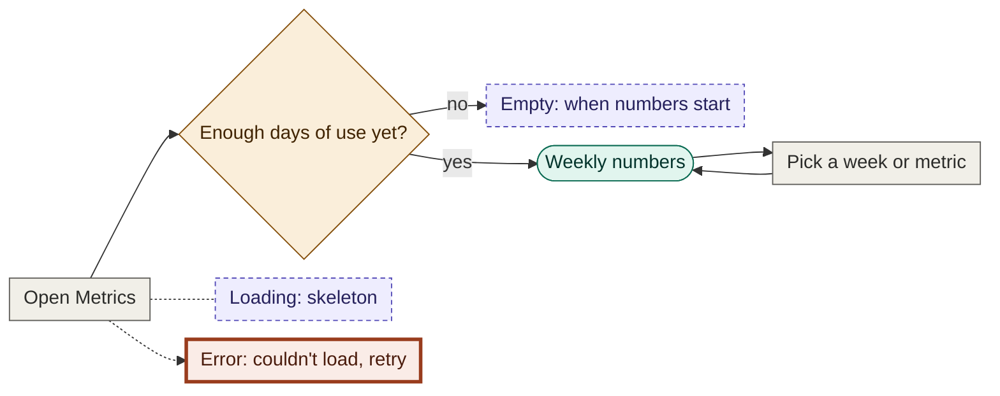
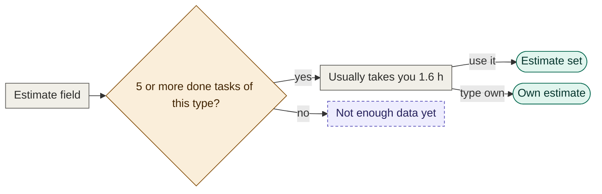
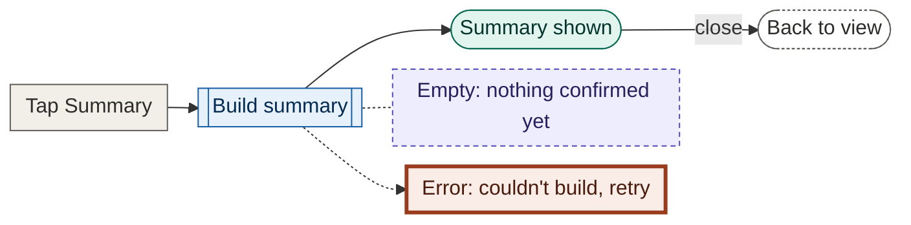
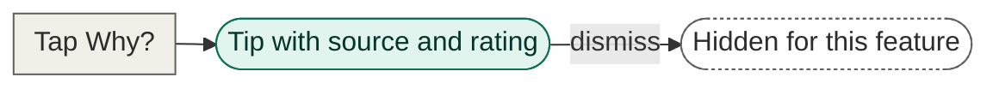

# Metrics and insights

Part of [Design 1: User flows](README.md). The diagram key, cross-cutting states and state labels are in the README.

## Weekly metrics (1a)

- **Goal:** see whether planning is working, week by week.
- **Entry:** Metrics in the main navigation.
- **Preconditions:** none. Numbers appear once the measurement clock has started.
- **Success:** the user reads this week's numbers and the trend.



**Steps**
1. Open Metrics. Each metric from PRD section 3 shows this week's value and a trend over the past weeks (Must 15).
2. The first 4 weeks are labelled "Baseline". Weeks that ended under 14 days ago are labelled "Provisional" (Must 15).
3. Pick a week to see its numbers, or a metric tile to see its detail: its trend over the tracked weeks, its definition in one sentence, and its companion numbers (below).

**States and errors**
- **Empty:** "Numbers start on the first Monday after you've used the app on 5 of 7 days. So far: 3 of 7." (PRD section 3).
- **Error:** "Couldn't load your metrics. Retry."

**Accessibility**
- Every chart has a data table, reachable by a "Show as table" toggle, with the same numbers.
- Charts have a text summary, for example "Completion rate 72%, up from 65% last week".
- "Baseline" and "Provisional" are text labels, not only colors or patterns.

## Duration suggestion (1b)

- **Goal:** estimate a task from your own history instead of guessing.
- **Entry:** the estimate field when creating or editing a task.
- **Preconditions:** the task has a type.
- **Success:** the suggestion is accepted or overridden.



**Steps**
1. With at least 5 done tasks of that type, all blocks confirmed, the field shows "Usually takes you 1.6 h (median of 7 Work tasks)" and offers it as the default (Must 10).
2. With fewer, it says "Not enough data yet" and invents nothing (Must 10).

**Accessibility**
- The suggestion is the field's description, read with its label. "Use it" is a button next to the field.

## Summaries (Should)

- **Goal:** get a short picture of a day, week, month or year.
- **Entry:** the "Summary" button on Metrics (for the selected week, month or year), or asking the assistant ("how was my week?").
- **Preconditions:** some confirmed blocks in the period.
- **Success:** the summary is read.



**Steps**
1. Tap Summary. It is never pushed automatically (PRD section 5, Should).
2. It shows tasks planned, completed and postponed, hours in total and by type, planned vs. actual time, and a few facts such as the most postponed task.

**States and errors**
- **Empty:** "Nothing confirmed in this period yet."
- **Failed:** "Couldn't build the summary. Retry."

**Accessibility**
- The summary is headed text, not an image, so it is read in order.

## Evidence tips (Should)

- **Goal:** learn which planning habits the research supports.
- **Entry:** a small "Why?" link next to features that have a tip, such as the recovery buffer, and a Tips page in Help.
- **Preconditions:** none.
- **Success:** the tip is read or dismissed.



**Steps**
1. A tip comes only from the curated evidence list, with its source and evidence rating (PRD section 4). It gives wellbeing guidance only, never medical advice.
2. Dismissing it hides that feature's "Why?" link. Tips stay available on the Tips page.

**Accessibility**
- Tips open as an expandable section, not a pop-over, so they reflow at 200% zoom.

## Screens

### Metrics (1a)

- **Flows:** Weekly metrics; Summaries (Should) and Evidence tips (Should) open from here.

```
┌──────────────────────────────────┐
│ Metrics                          │ h1
│ ① ‹ ② Week 47 · 16–22 Nov ③ ›    │
│ Provisional until 6 Dec          │ text label
│ ┌ Completion   ┐┌ Confirmation ┐ │ tiles, 2 per row
│ │ 72% ▲ from 65││ 81%          │ │
│ ├ Postponed    ┤├ Estimate err.┤ │
│ │ 11% · 2 missed││ 22% median  │ │
│ ├ Early moves  ┤├ Scheduled    ┤ │
│ ├ Planning time┤├ Load         ┤ │
│ ④ Trend: Completion ▾            │
│ [ line chart, baseline weeks shaded and labelled ]│
│ ⑤ Show as table                  │
│ ⑥ Summary                        │ Should
├──────────────────────────────────┤
│ tab bar                          │
└──────────────────────────────────┘
```

- **Tablet and desktop:** eight tiles in one or two rows of four, then the trend chart.
- **Each tile shows** (PRD section 3, Must 15):

| Tile | Main number | Companion numbers |
|---|---|---|
| Completion | completion rate | change from last week |
| Confirmation | confirmation rate | unconfirmed share |
| Postponed | postponement rate | postponements, missed blocks |
| Estimate error | median error | signed overrun, share of "as planned", planned-hours trend |
| Early moves | early-move rate | number of moves |
| Scheduled share | scheduled share | tasks created |
| Planning time | minutes a day | active days this week |
| Load | planned hours as a share of template time | hours outside allowed time, in buffers or over hard events |

- **Metric detail:** choosing a tile shows its trend chart and table, a one-sentence definition with a link to "How this is counted", and its companion numbers for each week.
- **A day of use** (empty state): a day with at least one planning session, meaning active editing as defined for planning time (PRD section 3).
- **Elements:** each tile is a button that selects its metric for the trend, named "Completion rate 72 percent, up from 65, show trend". ⑤ toggles a table with the same numbers. Baseline and Provisional are text labels.
- **Screen reader:** the chart has a text summary as its accessible name ("Completion rate over 8 weeks, from 58 to 72 percent"); the table is the full alternative (PRD A2).
- **States:**
  - Before the clock starts: "Numbers start on the first Monday after you've used the app on 5 of 7 days. So far: 3 of 7."
  - Loading: tile skeletons.
  - Error: "Couldn't load your metrics. Retry."

### Summary (Should)

- **Phone:** a bottom sheet from Summary. **Desktop:** a panel.
- **Content:** headed sections: Tasks (planned, completed, postponed), Hours (total and by type, as a list), Planned vs. actual, A few facts. All text, read in order.

### Tips (Should)

- **From a "Why?" link:** an expandable section under the setting, with the tip, its source and its evidence rating, and "Hide tip".
- **Tips page:** More, then Tips: a list of all tips, each expandable.
