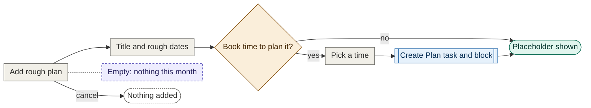
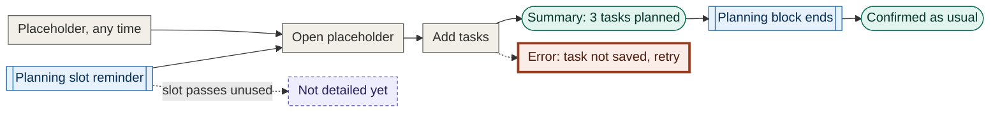
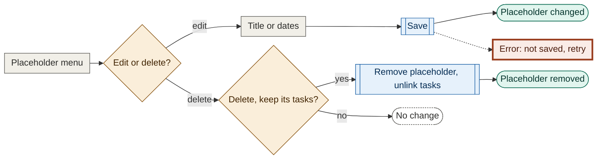

# Month and year

Part of [Design 1: User flows](README.md). The diagram key, cross-cutting states and state labels are in the README.

## Add a placeholder and a planning slot (Should)

- **Goal:** put something big on the month or year without planning its details yet.
- **Entry:** the Month or Year view, then "Add rough plan".
- **Preconditions:** none.
- **Success:** the placeholder shows on the month and year views, with a planning slot booked if wanted.



**Steps**
1. Enter a title and a rough period, such as "mid-July" or "July 10–24" (PRD section 4, placeholder).
2. Optionally book time to plan it. This creates a task "Plan: Vacation" with one block at the chosen time (decided: a planning slot is a normal block). The time is picked with manual placement or the suggester (see [planning.md](planning.md)).
3. The "Plan: …" task counts in the metrics like any task: completion rate, confirmation rate, scheduled share and load guardrail (decided).

**States and errors**
- **Empty:** "Nothing planned for this month. Add a rough plan, for example a vacation."

**Exits**
- Cancel adds nothing.

**Accessibility**
- The month and year views are also available as a list of placeholders by date, so nobody has to read them off a grid.

## Detail a placeholder (Should)

- **Goal:** turn a rough plan into real tasks and blocks.
- **Entry:** the planning slot's reminder, or the placeholder itself.
- **Preconditions:** the placeholder exists.
- **Success:** the tasks are created, and the placeholder shows them as a linked summary.



**Steps**
1. The planning block's normal reminder fires (see [reminders-and-confirmation.md](reminders-and-confirmation.md)). Detailing can also start earlier from the placeholder itself.
2. Open the placeholder and add tasks. They are ordinary tasks, linked to the placeholder.
3. The placeholder stays on the month and year views as a summary, "3 tasks planned", with links to its tasks (decided).
4. The planning block is confirmed like any block, after its end, through the normal To confirm path. Detailing early does not confirm it. "As planned" marks "Plan: Vacation" done.

**States and errors**
- **Planning slot unused:** the placeholder shows "Not detailed yet". The planning block follows the normal Missed and To confirm path.
- **Task not saved:** "Couldn't save the task. Retry." The text stays.

**Accessibility**
- The summary is a link list labelled "Vacation, 3 tasks planned".

## Edit or delete a placeholder (Should)

- **Goal:** change a rough plan's title or dates, or remove it.
- **Entry:** the placeholder's menu in the month or year view.
- **Preconditions:** the placeholder exists.
- **Success:** the placeholder is changed or removed, and its linked tasks are untouched.



**Steps**
1. Edit the title or the rough dates. Linked tasks and the planning block do not move.
2. Delete asks inline "Delete Vacation? Its 3 tasks and planning block stay as ordinary tasks." If confirmed, the placeholder is removed and its tasks are unlinked. Nothing else changes. There is no Undo, because PRD U3 limits Undo to blocks and tasks.

**States and errors**
- **Save failed:** "Couldn't save. Retry."

**Accessibility**
- The menu items are labelled with the placeholder's title, for example "Delete Vacation".

## Screens

### Month (Should)

- **Flows:** Add a placeholder and a planning slot, Detail a placeholder, Edit or delete a placeholder.
- **All sizes:** a month grid, Monday first, with placeholders as bars across their rough dates, and a "Show as list" switch.

```
┌──────────────────────────────────┐
│ ① ‹ ② November 2026 ③ ›  ④ + Add │ h1, + Add rough plan
│ ⑤ Grid | List                    │
│ Mo Tu We Th Fr Sa Su             │
│ ▬▬▬ ⑥ Vacation · 3 tasks planned │ bar
│ ▭▭ ⑦ Q3 report · Not detailed yet│
└──────────────────────────────────┘
```

- **Elements:** each placeholder is a button named "Vacation, 10 to 24 July, 3 tasks planned". The list view shows the same placeholders by date.
- **States:** empty: "Nothing planned for this month. Add a rough plan, for example a vacation."

### Year (Should)

- Twelve months in a grid (3 × 4 on desktop, 1 column on phone), each with its placeholder bars, and the same list switch.

### Rough plan (Should)

- **Phone:** a bottom sheet. **Desktop:** a pop-over.

```
┌──────────────────────────────────┐
│ Vacation                    ① ✕  │ dialog · h2
│ ② Title  [ Vacation ]            │
│ ③ Rough dates [ mid-July ]       │
│ ④ Book time to plan it ›         │ creates "Plan: Vacation"
│ 3 tasks planned ⑤ ›              │ links to them
│ ⑥ Save                           │
│ ⑦ Delete, keep its tasks         │ asks inline first
└──────────────────────────────────┘
```
