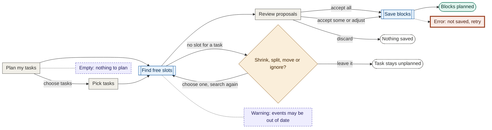
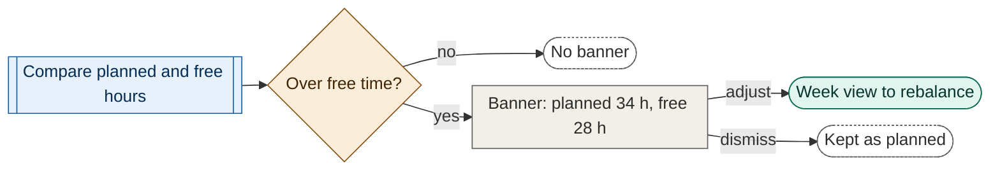

# Planning

Part of [Design 1: User flows](README.md). The diagram key, cross-cutting states and state labels are in the README.

## Plan with the suggester (1a)

- **Goal:** turn open tasks into blocks on the calendar quickly.
- **Entry:** "Plan my tasks" in the day view, the week view or the task list.
- **Preconditions:** a weekly template exists, and at least one open task has unscheduled time.
- **Success:** the accepted proposals are saved as blocks.



**Steps**
1. Tap "Plan my tasks". By default it plans every open task with unscheduled time (Must 8). "Choose tasks" is optional, which keeps the shortest path at two steps (plan, accept).
2. The suggester places each task in the earliest free slot that fits, in priority order, never over a hard event, another block or a recovery buffer (Musts 8 and 9).
3. The proposals appear as dashed "Proposed" blocks in the day or week view, and as a list.
4. Accept all, accept some, move or resize a proposal before accepting, or discard all.
5. Accepted proposals are saved as blocks (Must 1).

**No slot fits (Must 8).** The task is listed as "No free slot before the deadline", with the four choices from Must 8 plus "Leave it":
- **Shrink:** lower the estimate, then search again.
- **Split:** propose it as several parts, then search again.
- **Move another block:** opens manual placement, then search again.
- **Ignore the deadline:** search the next 14 days instead.
- **Leave it:** the task stays unplanned, and the other proposals are unaffected.

**States and errors**
- **Empty:** "Nothing to plan. Every open task already has blocks."
- **No template:** "Set your weekly template first." Primary action: Set template. This should not happen after first setup, but it is covered.
- **Stale calendar:** "Events as of 10:42, may be out of date." Primary action: Refresh (Must 3).
- **Save failed:** the proposals stay visible, with "Couldn't save. Retry."

**Exits**
- Discard all: nothing is saved, and the proposals disappear.

**Accessibility**
- The proposals are also an ordered list with one Accept checkbox per proposal, so nobody has to read them off the grid.
- The list is announced as "5 proposals".
- Focus moves to the list heading when it appears, and back to "Plan my tasks" when it closes.
- "Proposed" is shown as a text label, not only a dashed outline (Must 16).

## Place, move or resize a block by hand (1a)

- **Goal:** put a task at a specific time, or change a block's time.
- **Entry:** drag on the grid, "Add block" on a task, or "Edit time" on a block.
- **Preconditions:** the task exists and the block is not confirmed.
- **Success:** the block is saved at the new time.

Moving a block whose start has passed (an Unconfirmed or Missed block) counts as one postponement (PRD glossary). Before saving, the move says so: "This block's time has passed. Moving it counts as postponed." Moving a future block never does.


**Steps**
1. Place, move or resize the block in one of three ways (Must 16):
   - drag on the grid;
   - with the keyboard: select the block, then use the arrow keys to move it 15 minutes, Shift + arrows to resize, and Enter to save;
   - with start and end time fields.
2. If the block overlaps a hard event, another block or a recovery buffer, a warning names what it overlaps and asks "Place anyway?" (Must 1).
3. The block is saved. Its result shows within 100 ms, before the server answers (PRD P2).

**States and errors**
- **Save failed:** the block returns to its old time, with "Couldn't save the change. Retry" (PRD P2).
- **Invalid time:** under 15 minutes, crossing midnight or in a missing daylight-saving hour gives "Blocks need at least 15 minutes and must end by midnight" or "02:30 doesn't exist on 28 March" (Must 12).

**Exits**
- Esc while dragging or in the keyboard mode puts the block back. "Don't place" on the overlap warning does the same.

**Accessibility**
- The keyboard mode is announced as "Moving Write report, 10:00 to 11:00. Arrows move, Shift + arrows resize, Enter saves, Esc cancels."
- Each change of time is announced.
- The overlap warning is a dialog. Focus starts on "Don't place", the safer choice, and Esc does the same.

## Delete a block (1a)

- **Goal:** remove one block without touching its task.
- **Entry:** a block's menu in the day or week view.
- **Preconditions:** the block is not confirmed.
- **Success:** the block is removed, and its time becomes unscheduled time on the task.

Confirmed blocks cannot be deleted, on purpose: they record what happened, and estimates and metrics depend on them. A wrong confirmation is corrected with Edit a confirmation instead, within 7 days (see [reminders-and-confirmation.md](reminders-and-confirmation.md)). This narrows Must 6, "a single block can also be deleted", to unconfirmed blocks, and the change goes into PRD v0.3.


**Steps**
1. Choose "Delete block" in the block's menu (Must 6).
2. The block is removed, and its time becomes unscheduled time on the task, so the next suggester run can place it again.
3. An Undo message shows "Block deleted · Undo" (PRD U3, see the README, Undo). Afterwards it can be restored from Recently removed for 7 days (Must 6).

What deleting a past unconfirmed block does to the confirmation rate is not defined in the PRD. It is listed in the README's gaps for the data-model step.

**States and errors**
- **Delete failed:** "Couldn't delete the block. Retry."

**Exits**
- Closing the menu changes nothing.

**Accessibility**
- After deleting, focus moves to the next block in the day, or to the day's heading if none is left. "Block deleted" is announced.

## Overload check (Should)

- **Goal:** notice before the week starts that more work is planned than fits.
- **Entry:** shown by the app on the first app open of the week, and in the week view.
- **Preconditions:** the template exists, and the planned hours for the coming week exceed the free hours.
- **Success:** the user adjusts the week, or knowingly keeps it.



**Steps**
1. Before the week starts, the app compares planned block hours with the template's free hours (PRD section 5, Should).
2. If the plan is over, a banner states both numbers.
3. Adjust opens the week view. Dismiss keeps the plan, and the banner does not return that week.

**Accessibility**
- The banner is announced once, politely. It is dismissible, with no urgency wording (Must 13, no manipulation).

## Screens

The frame, navigation, View options and block kinds are in the [README](README.md#screens-frame-navigation-and-shared-parts).

### Plan: day view (1a)

- **Flows:** Plan with the suggester, Place, move or resize a block, Delete a block, Block reminders, Confirm a block (calendar entry).
- **Phone:**

```
┌──────────────────────────────────┐
│ ① ‹ ② Mon 16 Nov ③ ›  ④ ⚙  ⑤ +   │ banner: toolbar
│ Berlin time      ⑥ Plan my tasks │
├──────────────────────────────────┤ main · h1 "Monday 16 November"
│ ⚠ Events as of 10:42  ⑦ Refresh  │ only when stale
│ 09 ┃ ⑧ Write report · Planned    │
│ 10 ▓ ⑨ Team call · Busy          │
│ 11 ▨ Buffer                      │ not focusable
│ 14 ⊘ ⑩ Tax return · Missed       │
├──────────────────────────────────┤
│ ⑪ Plan ⑫ Tasks ⑬ Confirm 2 ⑭ Metrics ⑮ More │
└──────────────────────────────────┘
```

- **Tablet and desktop:** the same toolbar adds "Day | 3 days | Week". The grid shows 3 days on tablet and 7 on desktop, Monday first, today marked with "Today" as text. The rail opens To confirm, Tasks or Proposals beside the grid (desktop) or over it (tablet). The week heading is "16–22 November 2026".

| # | Element | HTML / role | Accessible name | Req |
|---|---|---|---|---|
| ① ③ | Previous, next | button | "Previous day", "Next day" (or week) | A1 |
| ② | Date | button, opens a date picker | "Monday 16 November, choose a date" | A2 |
| ④ | View options | button | "View options" | README |
| ⑤ | New task | button, 44 × 44 px | "New task" | Must 7, A4 |
| ⑥ | Plan my tasks | button | "Plan my tasks" | Must 8 |
| ⑦ | Refresh | button | "Refresh calendar events" | Must 3 |
| ⑧ ⑩ | Block | button in a list | "Write report, 09:00 to 10:00, planned" | Must 1, 16 |
| ⑨ | Hard event | list item, not editable | "Team call, 10:00 to 11:00, busy" | Must 3 |

- **Screen reader:** the h1 is the date. Blocks and events are a list in time order, so the grid is never the only way to read the day. Enter or Space on a block opens its menu: Edit time, Move with keys, Delete, Confirm (once the end has passed), Open task. Changing the day announces "Tuesday 17 November, 3 blocks".
- **States:**
  - Empty: "Your day is empty." with a New task button.
  - Loading: a skeleton of four blocks.
  - Stale events: the banner above the grid.
  - No connection: the README banner, and blocks can't be picked up.
  - Time zone mismatch: "Your device is in New York time. Plans use Berlin time." under the toolbar.
- **Drag targets:** dragging is optional. Every drag result is also reachable through the block menu (Must 16).

### Review proposals (1a)

- **Flows:** Plan with the suggester.
- **Phone:** the day view stays visible with dashed "Proposed" blocks, and a list slides up from the bottom.

```
┌──────────────────────────────────┐
│ ‹ Back      Proposals · 5        │ h1 "5 proposals"
├──────────────────────────────────┤
│ 09 ┆ Write report · Proposed ┆   │ dashed
│ 10 ▓ Team call · Busy            │
├──────────────────────────────────┤ list
│ ① ☑ Write report  Mon 09:00–11:00│
│ ② ☑ Call bank     Mon 11:15–11:45│
│ ③ ☐ Tax return    No free slot › │ opens no-slot choices
│ ④ Accept selected (2)            │ primary
│ ⑤ Discard all                    │
└──────────────────────────────────┘
```

- **Tablet and desktop:** the list is the Proposals panel from the rail. The grid shows the dashed blocks.

| # | Element | HTML / role | Accessible name | Req |
|---|---|---|---|---|
| ①② | Proposal | checkbox with label | "Write report, Monday 09:00 to 11:00" | Must 8 |
| ③ | No slot | link | "Tax return, no free slot, see choices" | Must 8 |
| ④ | Accept | button, primary | "Accept 2 proposals" | Must 1 |
| ⑤ | Discard | button | "Discard all proposals" | Must 8 |

- **Screen reader:** opening announces "5 proposals" and focuses the list heading. Each proposed block on the grid is also a button that moves focus to its list row.
- **States:** "Nothing to plan. Every open task already has blocks." when empty; "Set your weekly template first" with a button when there is no template; a save failure keeps the list with "Couldn't save. Retry."

### No free slot (1a)

- **Flows:** Plan with the suggester.
- **Phone and all sizes:** a screen (phone) or panel view (desktop) for one task.

```
┌──────────────────────────────────┐
│ ‹ Back   Tax return              │ h1
│ No free slot before Fri 20 Nov   │
│ ① Shrink it      estimate 3 h ›  │
│ ② Split it into parts         ›  │
│ ③ Move another block          ›  │
│ ④ Ignore the deadline            │
│ ⑤ Leave it unplanned             │
└──────────────────────────────────┘
```

- **Elements:** five buttons, each at least 44 px tall. Shrink opens the estimate field in place; the others act at once and return to Review proposals.
- **Screen reader:** the heading and the deadline sentence are read first, then the five choices.

### Overlap warning (1a)

- **Flows:** Place, move or resize a block; Review an assistant proposal.

```
┌──────────────────────────────┐
│ Overlaps Team call           │ dialog · h2
│ Write report 10:00–11:00     │
│ overlaps Team call 10:30–11:30│
│ ① Don't place                │ focused first
│ ② Place anyway               │
└──────────────────────────────┘
```

- **Elements:** a modal dialog with two buttons. Esc equals "Don't place".
- **Screen reader:** announced as "Overlaps Team call" with the sentence as its description. Focus returns to the block afterwards.

### Edit block (1a)

- **Flows:** Place, move or resize a block; Delete a block; Restore an earlier version.
- **Phone:** a bottom sheet over the day view. **Tablet and desktop:** a pop-over next to the block.

```
┌──────────────────────────────────┐
│ Write report                ① ✕  │ dialog · h2
│ ② Start  [ 09:00 ]               │ native time input
│ ③ End    [ 10:00 ]               │
│ ④ Move with keys                 │
│ ⑤ Open task                      │
│ ⑥ Earlier versions               │
│ ⑦ Delete block                   │ not shown for confirmed blocks
│ ⑧ Save                           │ primary
└──────────────────────────────────┘
```

| # | Element | HTML / role | Accessible name | Req |
|---|---|---|---|---|
| ②③ | Start, end | input type time with label | "Start", "End" | Must 16, U4 |
| ④ | Move with keys | button | "Move Write report with the keyboard" | Must 16 |
| ⑦ | Delete block | button | "Delete block Write report" | Must 6 |
| ⑧ | Save | button | "Save" | Must 1 |

- **Screen reader:** Move with keys closes the sheet and announces "Moving Write report, 09:00 to 10:00. Arrows move, Shift + arrows resize, Enter saves, Esc cancels."
- **States:** invalid times show inline errors under the field (PRD A5). Moving a past block shows "This block's time has passed. Moving it counts as postponed." above Save.

### Overload banner (Should)

- **Flows:** Overload check.
- **All sizes:** a banner under the toolbar of the week (or day) view: "Planned 34 h, free 28 h this week. ① Adjust ② Dismiss". It is announced once, politely, and never takes focus.
