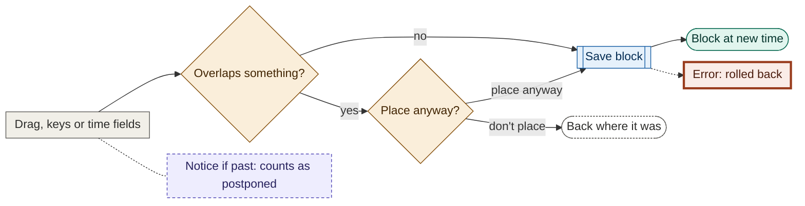
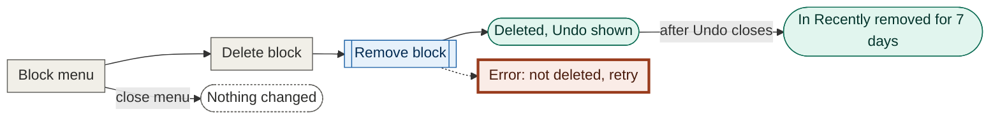

# Planning

Part of [Design 1: User flows](README.md). The diagram key, cross-cutting states and state labels are in the README.

## Plan with the suggester (1a)

- **Goal:** turn open tasks into blocks on the calendar quickly.
- **Entry:** "Plan my tasks" in the day view, the week view or the task list.
- **Preconditions:** a weekly template exists, and at least one open task has unscheduled time.
- **Success:** the accepted proposals are saved as blocks.

**Steps**
1. Tap "Plan my tasks". By default it plans every open task with unscheduled time (Must 8). "Choose tasks" is optional, which keeps the shortest path at two steps (plan, accept).
2. The suggester places each task in the earliest free slot that fits, in priority order, never over a hard event, another block or a recovery buffer (Musts 8 and 9).
3. The proposals appear as dashed "Proposed" blocks in the day or week view, and as a list.
4. Accept all, accept some, move or resize a proposal before accepting, or discard all.
5. Accepted proposals are saved as blocks (Must 1).

**No slot fits (Must 8).** The task is listed as "No free slot before the deadline", with the four choices from Must 8 plus "Leave it":
- **Shrink:** lower the estimate, then search again.
- **Split:** propose it as several parts, then search again.
- **Move another block:** opens manual placement, then search again.
- **Ignore the deadline:** search the next 14 days instead.
- **Leave it:** the task stays unplanned, and the other proposals are unaffected.

**States and errors**
- **Empty:** "Nothing to plan. Every open task already has blocks."
- **No template:** "Set your weekly template first." Primary action: Set template. This should not happen after first setup, but it is covered.
- **Stale calendar:** "Events as of 10:42, may be out of date." Primary action: Refresh (Must 3).
- **Save failed:** the proposals stay visible, with "Couldn't save. Retry."

**Exits**
- Discard all: nothing is saved, and the proposals disappear.

**Accessibility**
- The proposals are also an ordered list with one Accept checkbox per proposal, so nobody has to read them off the grid.
- The list is announced as "5 proposals".
- Focus moves to the list heading when it appears, and back to "Plan my tasks" when it closes.
- "Proposed" is shown as a text label, not only a dashed outline (Must 16).

## Place, move or resize a block by hand (1a)

- **Goal:** put a task at a specific time, or change a block's time.
- **Entry:** drag on the grid, "Add block" on a task, or "Edit time" on a block.
- **Preconditions:** the task exists and the block is not confirmed.
- **Success:** the block is saved at the new time.

Moving a block whose start has passed (an Unconfirmed or Missed block) counts as one postponement (PRD glossary). Before saving, the move says so: "This block's time has passed. Moving it counts as postponed." Moving a future block never does.

**Steps**
1. Place, move or resize the block in one of three ways (Must 16):
   - drag on the grid;
   - with the keyboard: select the block, then use the arrow keys to move it 15 minutes, Shift + arrows to resize, and Enter to save;
   - with start and end time fields.
2. If the block overlaps a hard event, another block or a recovery buffer, a warning names what it overlaps and asks "Place anyway?" (Must 1).
3. The block is saved. Its result shows within 100 ms, before the server answers (PRD P2).

**States and errors**
- **Save failed:** the block returns to its old time, with "Couldn't save the change. Retry" (PRD P2).
- **Invalid time:** under 15 minutes, crossing midnight or in a missing daylight-saving hour gives "Blocks need at least 15 minutes and must end by midnight" or "02:30 doesn't exist on 28 March" (Must 12).

**Exits**
- Esc while dragging or in the keyboard mode puts the block back. "Don't place" on the overlap warning does the same.

**Accessibility**
- The keyboard mode is announced as "Moving Write report, 10:00 to 11:00. Arrows move, Shift + arrows resize, Enter saves, Esc cancels."
- Each change of time is announced.
- The overlap warning is a dialog. Focus starts on "Don't place", the safer choice, and Esc does the same.

## Delete a block (1a)

- **Goal:** remove one block without touching its task.
- **Entry:** a block's menu in the day or week view.
- **Preconditions:** the block is not confirmed.
- **Success:** the block is removed, and its time becomes unscheduled time on the task.

Confirmed blocks cannot be deleted, on purpose: they record what happened, and estimates and metrics depend on them. A wrong confirmation is corrected with Edit a confirmation instead, within 7 days (see [reminders-and-confirmation.md](reminders-and-confirmation.md)). This narrows Must 6, "a single block can also be deleted", to unconfirmed blocks, and the change goes into PRD v0.3.

**Steps**
1. Choose "Delete block" in the block's menu (Must 6).
2. The block is removed, and its time becomes unscheduled time on the task, so the next suggester run can place it again.
3. An Undo message shows "Block deleted · Undo" (PRD U3, see the README, Undo). Afterwards it can be restored from Recently removed for 7 days (Must 6).

What deleting a past unconfirmed block does to the confirmation rate is not defined in the PRD. It is listed in the README's gaps for the data-model step.

**States and errors**
- **Delete failed:** "Couldn't delete the block. Retry."

**Exits**
- Closing the menu changes nothing.

**Accessibility**
- After deleting, focus moves to the next block in the day, or to the day's heading if none is left. "Block deleted" is announced.

## Overload check (Should)

- **Goal:** notice before the week starts that more work is planned than fits.
- **Entry:** shown by the app on the first app open of the week, and in the week view.
- **Preconditions:** the template exists, and the planned hours for the coming week exceed the free hours.
- **Success:** the user adjusts the week, or knowingly keeps it.

**Steps**
1. Before the week starts, the app compares planned block hours with the template's free hours (PRD section 5, Should).
2. If the plan is over, a banner states both numbers.
3. Adjust opens the week view. Dismiss keeps the plan, and the banner does not return that week.

**Accessibility**
- The banner is announced once, politely. It is dismissible, with no urgency wording (Must 13, no manipulation).
