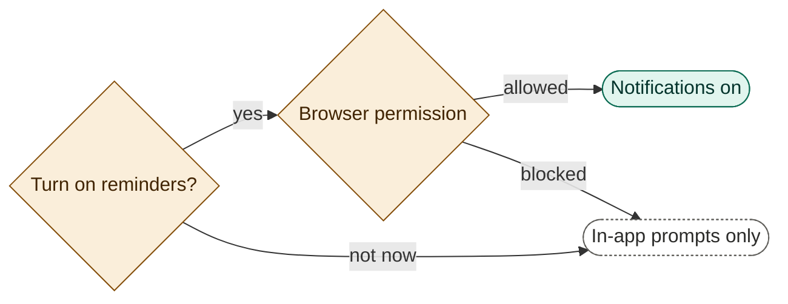
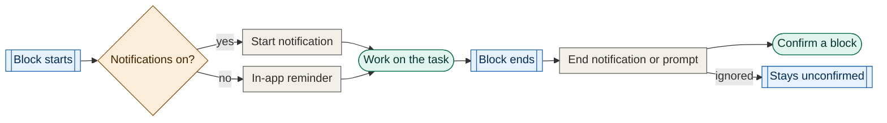
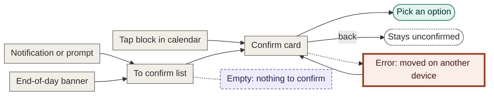
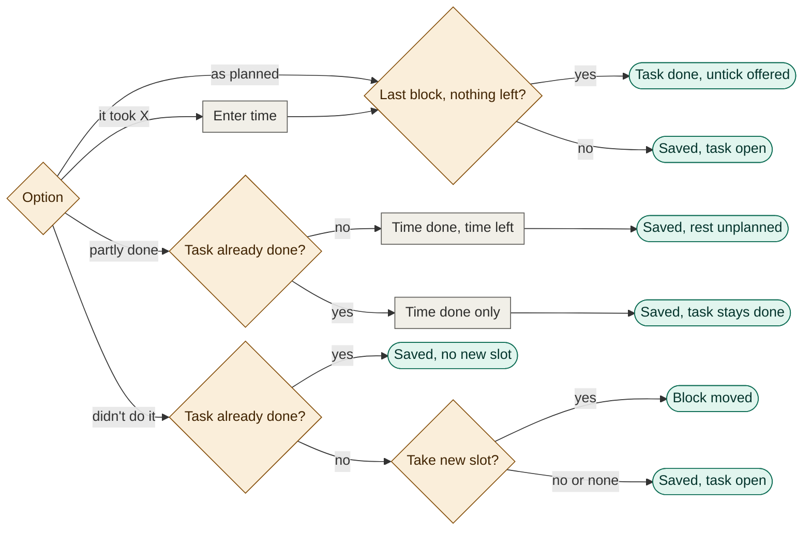
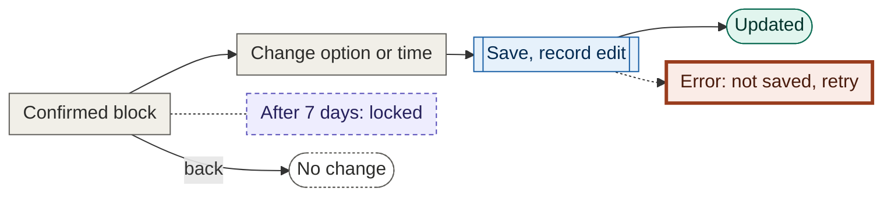
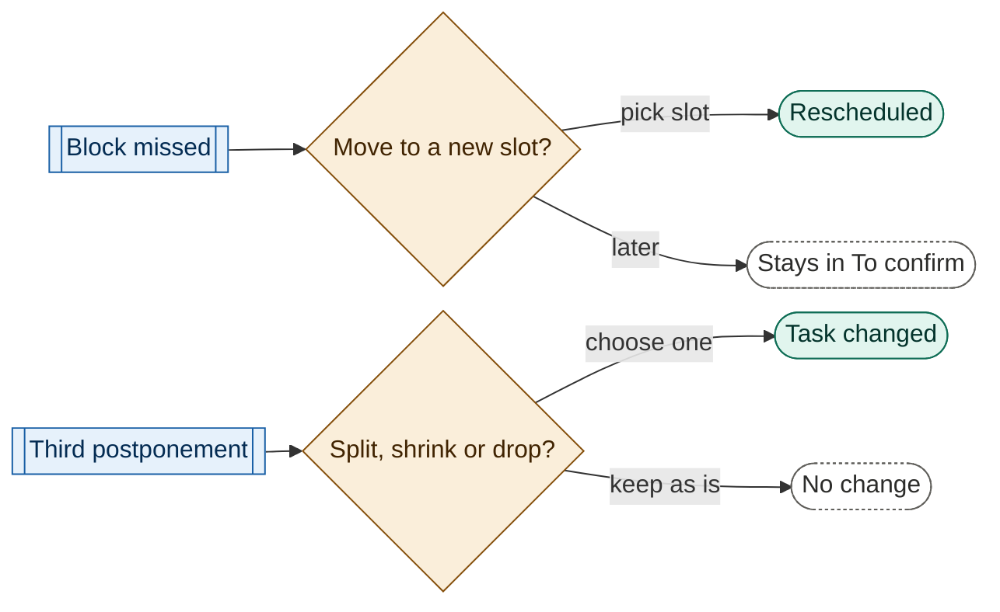

# Reminders and confirmation

Part of [Design 1: User flows](README.md). The diagram key, cross-cutting states and state labels are in the README.

## Turn on reminders (1a)

- **Goal:** get browser notifications when blocks start and end.
- **Entry:** shown by the app after the first block is saved, and from Settings, then Notifications. It is never shown on app load.
- **Preconditions:** the browser supports notifications, and permission has not been asked yet.
- **Success:** notifications are on, or the app falls back to in-app prompts.

**Steps**
1. After the first block is saved, the app explains: "Get a reminder when a block starts and ends? Only while the app is open." (Must 11).
2. "Turn on" opens the browser's permission request.
3. If permission is blocked, the app uses in-app prompts, and Settings explains how to allow notifications in the browser (Must 11).

**Exits**
- "Not now" does not ask again for 7 days. Settings can turn reminders on at any time.

**Accessibility**
- The explanation is an inline card, not a dialog, and is reachable by Tab.
- The browser's own permission prompt follows the browser's accessibility.

## Block reminders (1a)

- **Goal:** know when a block starts, and be asked to confirm when it ends.
- **Entry:** shown by the app at a block's start and end while the app is open.
- **Preconditions:** a planned block, and the app open (Must 11).
- **Success:** the user starts the work, or confirms the block.

**Steps**
1. At the block's start, a notification shows "Write report, 10:00–11:00" (Must 11). If notifications are off or blocked, an in-app reminder appears instead (Must 16).
2. At the end, a notification or in-app prompt asks "How did Write report go?" and opens Confirm a block.
3. If ignored, the block stays unconfirmed and waits in the To confirm list.
4. When the app returns from the background, reminders missed meanwhile are shown as in-app prompts (architecture 7.7).

**Known limit:** nothing fires while the browser is closed (Must 11).

**Accessibility**
- The in-app reminder is announced politely and does not take focus.
- Every notification has an in-app equivalent (Must 16).

## Confirm a block (1a)

- **Goal:** record what really happened in a block.
- **Entry:**
  - the end notification or in-app prompt;
  - the end-of-day banner ("2 blocks to confirm") on the next app open after the end of day;
  - the To confirm list in the main navigation, with a count;
  - tapping an Unconfirmed or Missed block in the calendar.
- **Preconditions:** the block's end has passed, it is unconfirmed, and its end was under 7 days ago (Must 2).
- **Success:** the block is confirmed, and the task is marked done where that applies.

Finding a block to confirm:

The four options:

**Steps**
1. The To confirm list shows unconfirmed blocks, oldest first, with "2 left" and "Closes in 5 days" on each. Missed blocks carry the "Missed" label (decided). A notification opens the list at its block.
2. Each card shows the title, the planned time, and four buttons at least 44 × 44 px (PRD A4). After confirming, the card shows the planned-vs-real summary: the block's planned and actual time, and the day's planned and confirmed hours (Must 2).
3. The options (Must 2):
   - **As planned:** one tap.
   - **It took X:** enter the actual time, and optionally the actual start. A new start moves the block, and later blocks that now overlap are flagged "May be affected".
   - **Partly done:** enter the time done and the time left. The rest stays as unplanned time on the task. A remainder under 15 minutes becomes 15.
   - **Didn't do it:** the app offers a new slot for the same block. Accepting moves the block. Declining, or having no free slot, leaves the task open with the time unscheduled.
   - An optional one-line note ("stopped at section 3, next: charts") on every option.
4. **A block of a task already marked done** (decided): its past unconfirmed blocks stay in To confirm. Confirming one never re-plans the task.
   - "Didn't do it" is recorded and counts as one postponement, but no new slot is offered. The card says "Write report is done, so no new time is needed."
   - "Partly done" asks only for the time done, with no "time left" field.
   - To plan more work, the user unticks Done first (see Mark a task done or not done, in [tasks.md](tasks.md)).
5. **Auto-done:** only "as planned" and "it took X" on the task's last block, with no time left unscheduled, mark the task done. The confirmation says "Write report marked done" with an Untick button (Must 2). If time is still unscheduled, the card offers "Plan the rest" or "Mark done".

**Input checks** (PRD A5: the field is named and a fix suggested, and the entry is kept)
- **It took X:** the actual time must be above 0 and at most 24 hours ("Enter a time between 1 minute and 24 hours"). An actual start in the future is rejected ("The start can't be in the future").
- **Crossing midnight:** if the actual start and time run past midnight, the block is shown ending at midnight and the full time is still recorded. The card says "Shown until midnight. 2 h 30 recorded." (Must 2)
- **Partly done:** the time done must be between 1 minute and 24 hours. The time left can be 0, which means no remainder.

**States and errors**
- **Empty:** "Nothing to confirm."
- **Moved on another device (decided, amends Must 12):** "This block was moved to 14:00–15:00 on another device. Confirm against the new time?" The user confirms again.
- **Save failed:** the card stays, with "Couldn't save. Retry."
- **Window closed:** 7 days after the end, the block becomes "Unconfirmed, window closed". It is locked, leaves the list and the banner, and is not used in insights (decided).

**Exits**
- Back, or closing the list: the block stays unconfirmed and in the list.

**Accessibility**
- Each card is a group labelled "Write report, Monday 10:00 to 11:00".
- The four options are buttons in a fixed order, so the Tab order matches the visual order.
- After a confirmation, focus moves to the next card, and "Confirmed, 1 left" is announced. When the list empties, focus moves to the "Nothing to confirm" heading.
- The "Missed" and "closed" states have text labels.

## Edit a confirmation (1a)

- **Goal:** correct a confirmation.
- **Entry:** a confirmed block in the calendar, then "Edit confirmation".
- **Preconditions:** the block's end was under 7 days ago (Must 2).
- **Success:** the confirmation is changed, and the metrics update.

**Steps**
1. Open a confirmed block and choose "Edit confirmation". The same four options appear, prefilled, with the same input checks (Must 2).
2. The edit is recorded, and the metrics update (Musts 2 and 15).

Restoring an edit that another device overwrote is a separate flow for every task and block: Restore an earlier version, in [tasks.md](tasks.md).

**States and errors**
- **Save failed:** the card stays, with "Couldn't save. Retry."

**Accessibility**
- The same as Confirm a block. After saving, focus returns to the block in the calendar.

## Postponement prompts (Should)

- **Goal:** reschedule missed work right away, and rethink tasks that keep slipping.
- **Entry:** shown by the app when a block becomes Missed, or when a task's third postponement is recorded.
- **Preconditions:** the app is open.
- **Success:** the block has a new time, or the task is split, shrunk or dropped.

**Steps**
1. When a block becomes Missed, a prompt offers new slots from the suggester (PRD section 5, Should). Picking one moves the block, which counts as one postponement.
2. On a task's third postponement, a prompt asks "Split it, shrink it, or drop it?", with "Keep as is" also available.

**Accessibility**
- Both prompts are inline cards that do not take focus, are announced politely, and can be dismissed (Must 13, no pressure).
