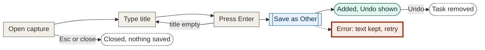
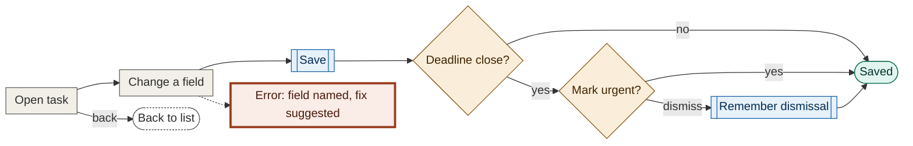
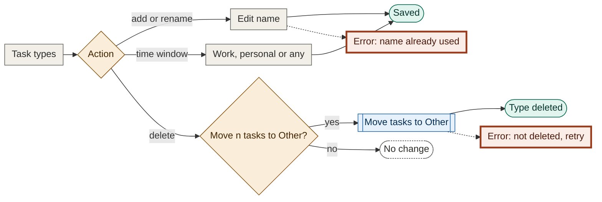
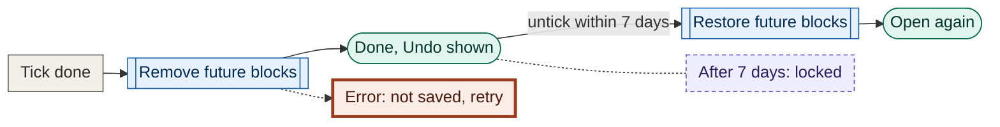
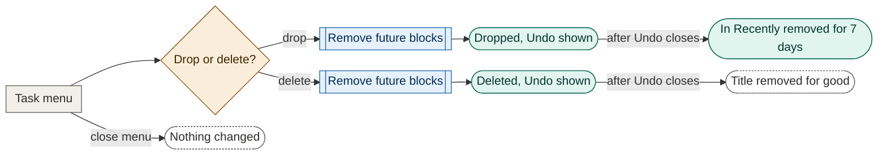
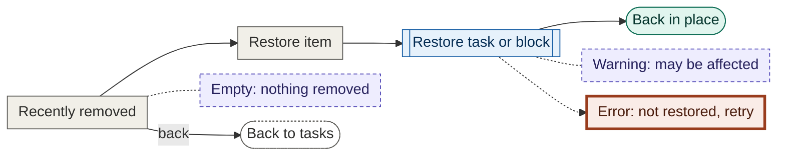
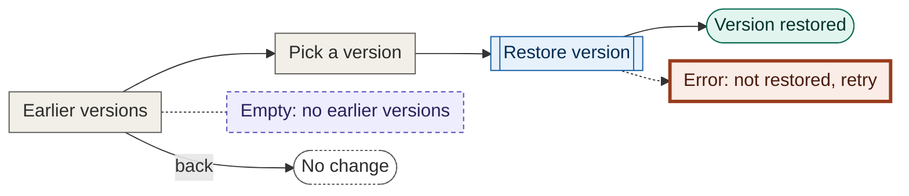

# Tasks

Part of [Design 1: User flows](README.md). The diagram key, cross-cutting states and state labels are in the README.

## Capture a task (1a)

- **Goal:** get a task out of your head and into the app in seconds.
- **Entry:** the capture button, always visible on every main screen, or its keyboard shortcut.
- **Preconditions:** signed in.
- **Success:** the task is saved and shown in the task list.

**Steps**
1. Open capture (Must 7).
2. Type a title. "Add details" optionally opens the estimate, flags, deadline and type.
3. Press Enter. The task is saved with type "Other" unless another was chosen (Must 6).
4. An Undo message shows "Added · Undo" (see the README, Undo).

One typed line counts as the capture, within the 3-tap budget (Must 7).

**States and errors**
- **Empty task list:** "No tasks yet. Add one with capture."
- **Empty title:** Enter does nothing, and the field shows "Add a title".
- **Save failed:** "Couldn't save the task. Retry." The text stays in the field.

**Exits**
- Esc or close: nothing is saved. If a title was typed, it is kept as a draft in the field until the page is closed.

**Accessibility**
- Opening capture moves focus to the title field.
- After saving, focus stays in an empty title field so the next task can be typed. The Undo message is announced as "Task added".
- Undo is reachable by Tab while the message is shown. Ctrl+Z (Cmd+Z) also undoes the capture straight from the empty title field, as long as nothing has been typed since the save. Once typing starts, Ctrl+Z undoes the typing instead (see the README, Undo). The message's timer pauses while it has focus.

## Edit task details and urgency (1a)

- **Goal:** add or change a task's estimate, flags, deadline and type.
- **Entry:** a task in the task list, or a block's "Open task".
- **Preconditions:** the task exists and is open.
- **Success:** the changes are saved.

**Steps**
1. Open the task (Must 6).
2. Change any field: title, estimate, urgent, important, deadline or type (Musts 4 and 6).
   - The type list has "New type…", which creates a type inline (Must 6).
   - From 1b, the estimate field offers "Usually takes you 1.6 h" when there is enough history (see [metrics-and-insights.md](metrics-and-insights.md)).
3. Each field saves on change.
4. If the deadline is close, the app suggests "Mark as urgent?" with the reason, for example "Due in 3 days, needs about 2" (Must 4).
5. Dismissing it is remembered for that task until the deadline changes (Must 4).

**States and errors**
- **Invalid value:** the field is named and a fix is suggested, for example "Estimate must be at least 15 minutes." The entered value stays (PRD A5).

**Exits**
- Back returns to where the task was opened. Saved fields stay saved.

**Accessibility**
- Fields use native inputs for dates and numbers (PRD U4).
- The urgency suggestion is announced as a status, and its two buttons are reachable by Tab.
- The suggestion never takes focus by itself.

## Manage task types (1a)

- **Goal:** keep the list of task types useful.
- **Entry:** Settings, then Task types.
- **Preconditions:** none. "Other" always exists.
- **Success:** the list is changed, and tasks of a deleted type are moved to "Other".

**Steps**
1. The list starts with Work, Personal, Admin and Other (Must 6).
2. Add or rename a type.
3. Set a type's time window: work time, personal time or any. This decides where the suggester can place its tasks (Must 6).
4. Delete a type. An inline row asks "Delete Admin? Its 12 tasks move to Other." If confirmed, its tasks and history move to "Other", and the metrics recompute (Must 6). There is no Undo, because PRD U3 limits Undo to blocks and tasks. The inline row is the safety net, and it is not a dialog.
5. "Other" cannot be deleted, because quick capture needs it (Must 6).

**States and errors**
- **Duplicate name:** "A type with this name already exists."
- **Delete failed:** "Couldn't delete the type. Retry." Nothing moved.

**Exits**
- Back to Settings.

**Accessibility**
- Each row has its own labelled Rename, Time window and Delete controls, not icon-only buttons.
- After a delete, focus moves to the next row.

## Mark a task done or not done (1a)

- **Goal:** record that a task is finished, or correct that.
- **Entry:** the task's done checkbox in the list or task details, or the auto-done after a confirmation (see [reminders-and-confirmation.md](reminders-and-confirmation.md)).
- **Preconditions:** the task is open, or was marked done in the last 7 days.
- **Success:** the done flag is set or cleared.

**Steps**
1. Tick "Done". The task leaves the open list (Must 6).
2. Its blocks are handled as follows (decided):
   - **Future planned blocks** are removed, so the time is free and no reminder fires for finished work. The message reads "Write report done · 1 future block removed · Undo". Removing them is not a postponement.
   - **Past unconfirmed blocks** stay in To confirm, because the work may have happened then and confirming it keeps estimates accurate. They are not marked "Dropped".
   - **Confirmed blocks** are untouched.
3. Within 7 days, untick it to reopen it (PRD section 3). The removed future blocks whose start has not passed come back. The rest becomes unscheduled time again.
4. After 7 days the checkbox is locked and labelled "Done, can't be changed".

**States and errors**
- **Save failed:** the checkbox returns to its previous state, with "Couldn't save. Retry."

**Accessibility**
- The checkbox is a native checkbox labelled with the task title.
- The change is announced as "Write report done" or "Write report reopened".

## Drop or delete a task (1a)

- **Goal:** stop working on a task, either keeping it recoverable (drop) or removing it (delete).
- **Entry:** the task's menu in the list or in task details.
- **Preconditions:** the task exists.
- **Success:** the task leaves the open list, and its future blocks are removed.

**Steps**
1. Open the task menu and choose "Drop" or "Delete". The menu explains the difference: "Drop: keep it for 7 days" and "Delete: remove it for good" (Must 6).
2. Its future planned blocks are removed. Confirmed blocks stay. Past unconfirmed blocks become "Dropped" and stop asking for confirmation (Must 6).
3. An Undo message shows "Dropped" or "Deleted" (PRD U3, see the README, Undo).
4. After the Undo message closes:
   - a dropped task can still be restored from Recently removed for 7 days;
   - a deleted task cannot be restored, and its title is removed (Musts 6 and 14).

Both count as not done in the metrics (Must 6).

**Exits**
- Closing the menu changes nothing. Undo in the Undo message restores the task and its removed future blocks.

**Accessibility**
- Neither action uses a confirmation dialog (PRD U3). The menu wording and the Undo message are the safety net.
- After removal, focus moves to the next task in the list.

## Recently removed (1a)

- **Goal:** bring back a dropped task or a deleted block.
- **Entry:** the task list's "Recently removed" link, or the link in a "Dropped" Undo message.
- **Preconditions:** something was dropped or deleted in the last 7 days.
- **Success:** the item is back where it was.

**Steps**
1. The list shows dropped tasks and deleted blocks, newest first, each with "Removed 2 days ago, restorable until 18 Nov". Deleted tasks are never listed (Must 6).
2. Restore an item.
3. A restored dropped task gets back its removed blocks whose start has not passed. The rest becomes unscheduled time again (Must 6).

**States and errors**
- **Empty:** "Nothing removed in the last 7 days."
- **Restored block now overlaps:** it is restored anyway and flagged "May be affected". This is a warning, not a failure (Must 1).
- **Restore failed:** "Couldn't restore. Retry." The item stays in the list.

**Exits**
- Back to the task list.

**Accessibility**
- The list is a plain list with one Restore button per row, labelled with the item's name.
- After a restore, focus moves to the next row, and "Restored" is announced.

## Restore an earlier version (1a)

- **Goal:** bring back an edit to a task or block that a later edit, usually from another device, overwrote.
- **Entry:** "Earlier versions" in a task's or block's menu.
- **Preconditions:** the overwritten edit was under 7 days ago (Must 12).
- **Success:** the chosen version is back.

**Steps**
1. The list shows overwritten values from the last 7 days, each with the field, the old and new value, and the time (Must 12).
2. Restore one. A block's start and end are restored together, as one unit (Must 12).
3. The restore is itself an edit, so it is recorded and can be restored in turn.

Entries older than 7 days stay in the read-only edit history for 30 days, for audit and support, and are not shown here (Must 12).

**States and errors**
- **Empty:** "No earlier versions in the last 7 days."
- **Restore failed:** "Couldn't restore. Retry."

**Accessibility**
- Each entry is a row such as "Start, 10:00 changed to 14:00, Monday 09:12", with a labelled Restore button.
