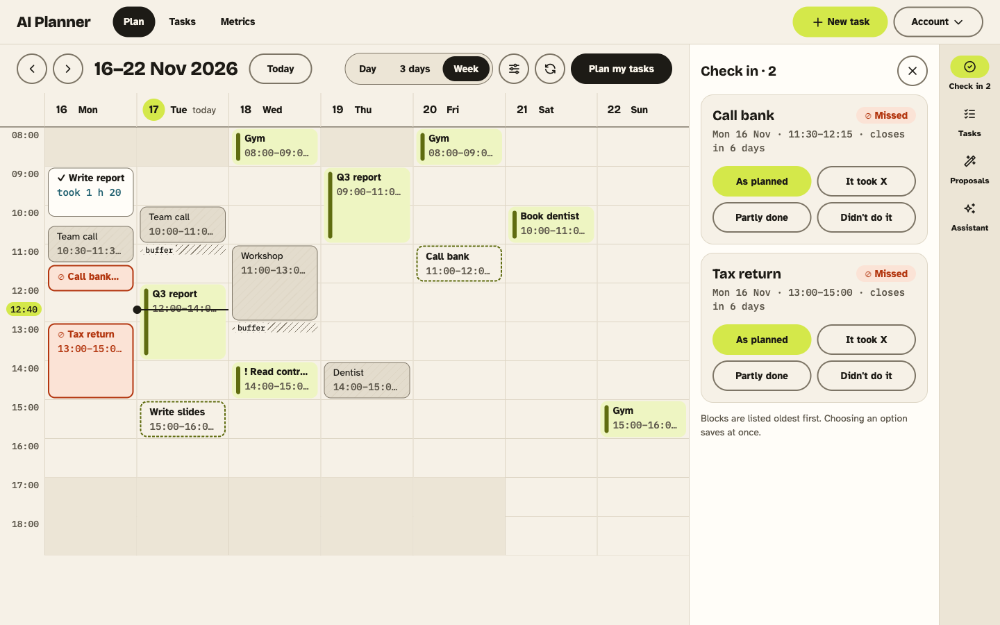
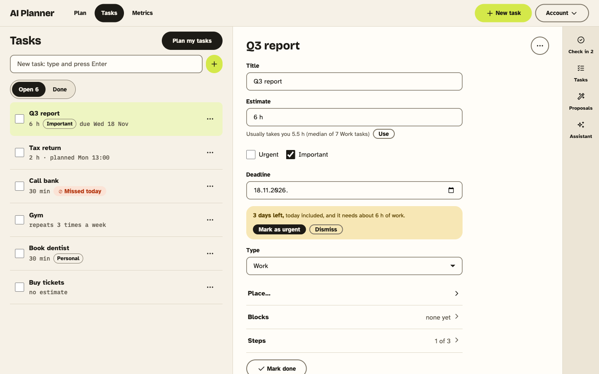
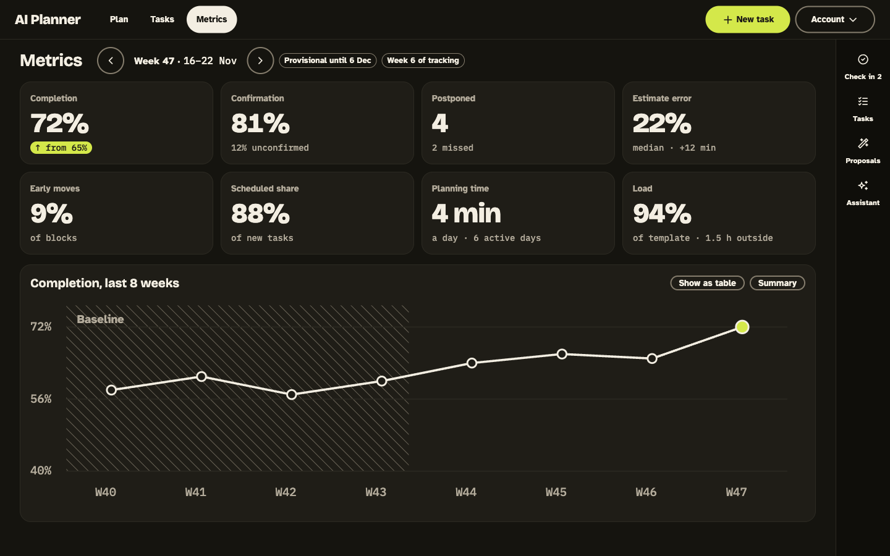
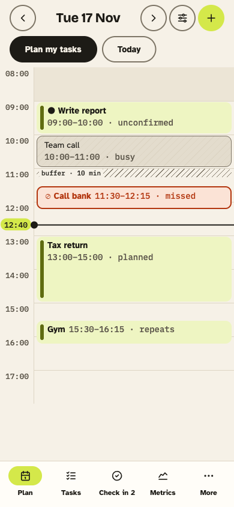
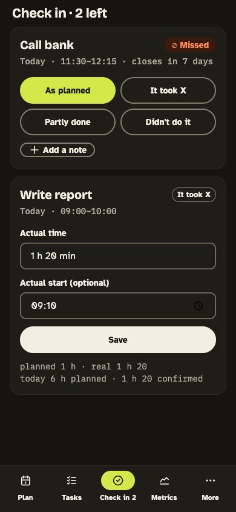

# Main screens

The main screens from the [user flows](../../user-flows/README.md) (Screens), built only from [tokens.css](../tokens.css) and [components.css](../components.css). Each HTML file opens in a browser and follows the system light or dark setting. The PNG files beside it are screenshots in each theme.

Content, focus order and wording come from the flow files; these pages show the look. Data is sample data.

| Screen | HTML | Light | Dark |
|---|---|---|---|
| Plan, week, desktop (1440 × 900), with Check in panel and rail | [plan-week-desktop.html](plan-week-desktop.html) | [png](plan-week-desktop.png) | [png](plan-week-desktop-dark.png) |
| Tasks, desktop, with task details | [tasks-desktop.html](tasks-desktop.html) | [png](tasks-desktop.png) | [png](tasks-desktop-dark.png) |
| Metrics, desktop | [metrics-desktop.html](metrics-desktop.html) | [png](metrics-desktop.png) | [png](metrics-desktop-dark.png) |
| Plan, day, phone (390 × 844) | [plan-day-phone.html](plan-day-phone.html) | [png](plan-day-phone.png) | [png](plan-day-phone-dark.png) |
| Check in, phone, with "It took X" open | [check-in-phone.html](check-in-phone.html) | [png](check-in-phone.png) | [png](check-in-phone-dark.png) |







 

## Regenerating the screenshots

Serve this folder's parent and capture each page at its size, once per colour scheme, for example with Playwright:

```js
await page.setViewportSize({ width: 1440, height: 900 });   // phone: 390 × 844
await page.emulateMedia({ colorScheme: 'dark' });           // or 'light'
await page.goto('http://127.0.0.1:8766/screens/plan-week-desktop.html', { waitUntil: 'networkidle' });
await page.screenshot({ path: 'plan-week-desktop-dark.png' });
```

The fonts and icons load from Google Fonts and jsDelivr, so capture with a network connection.
