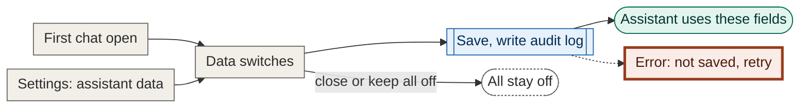
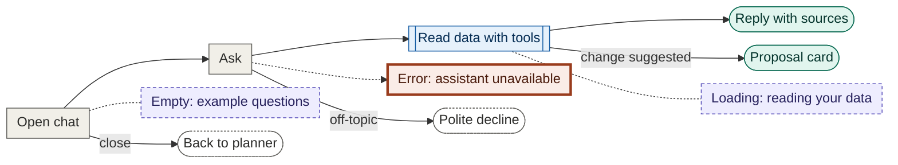
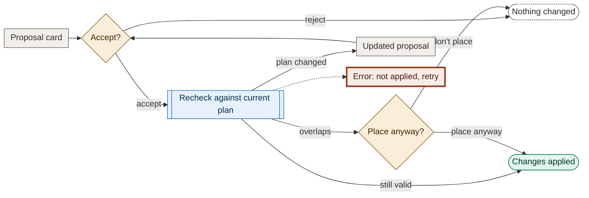

# Assistant

Part of [User flows](README.md). The diagram key, cross-cutting states and state labels are in the README.

The assistant is a Should item. It does not ship until every Must 13 condition is met.

## Choose what the assistant sees (Should)

- **Goal:** decide which of your text the assistant may read.
- **Entry:** the first open of the chat (once), and later Settings, then Assistant data.
- **Preconditions:** the assistant is enabled.
- **Success:** the switches are saved and logged.



**Steps**
1. On the first open, a one-time screen shows five switches: task titles, notes, checklist steps, event titles and task-type names. All are off by default (Must 13, decided).
2. The screen says what is always sent (times, durations, flags, a type ID), what is never sent (event descriptions, attendees), and who processes the data. It links to "How the assistant works".
3. Changes are saved and written to the audit log (spec S7). Afterwards the switches live only in Settings, and the chat never asks to change them (decided).

**States and errors**
- **Save failed:** "Couldn't save your choices. Retry." The switches keep their positions on screen, and the stored ones stay unchanged. Nothing new is sent until the save succeeds.

**Exits**
- Closing the screen without choosing keeps all switches off, which is the default. The screen counts as seen and is not shown again. Settings can change them at any time.

**Accessibility**
- Native switches, each labelled with its field and a one-line description.
- The screen is a dialog: focus starts on its heading, and Esc closes it with everything off.

## Ask the assistant (Should)

- **Goal:** get an answer about your plan or history.
- **Entry:** the chat button. The panel is labelled "AI assistant".
- **Preconditions:** the data switches have been seen once.
- **Success:** a grounded reply is shown.



**Steps**
1. Open the chat. It is a side panel on desktop and full screen on phone.
2. Ask, for example "how was my week?". A quiet line under the input shows what the assistant can see: "Assistant sees: times, durations, flags. Titles: off · Change in Settings". The last part links to Settings, then Assistant data.
3. The assistant reads data through tools. Numbers, dates and times in the reply come from tool results, and statements about history name their basis (Must 13).
4. The reply is plain text, and links show as text (Must 13).
5. If the answer includes a change, it arrives as a proposal card (see Review an assistant proposal).

**States and errors**
- **Empty:** example questions, and "Chats are kept 30 days."
- **Loading:** "Reading your data…"
- **Unavailable:** provider down, cost cap or rate limit. "Assistant unavailable. The planner works as usual." The input is disabled (Must 13).
- **Turned off by its feature flag (kill switch):** the assistant is hidden: no chat button, rail item or settings entry (spec R6).
- **Too much data:** "That covers too much data. Try 13 months or fewer."
- **Off-topic:** a polite decline (Must 13).
- **Distress:** a caring reply with crisis resources, and no medical advice (Must 13).

**Exits**
- Closing the panel returns to the planner, and the chat is kept for 30 days.

**Accessibility**
- Opening the panel moves focus to the input, and closing it returns focus to the chat button.
- New replies are announced politely when they finish, not word by word.
- The "AI assistant" label is part of the panel's accessible name (Must 13, transparency).

## Review an assistant proposal (Should)

- **Goal:** accept or reject a change the assistant suggests.
- **Entry:** a proposal card in the chat.
- **Preconditions:** the assistant proposed a change.
- **Success:** the change is applied after acceptance, or rejected.



**Steps**
1. The card is labelled "Assistant suggestion", separately from rule-based suggestions (Must 13).
2. It is built from the actual command and lists every item it changes, at most 10 (Must 13).
3. Accept re-checks against the current data. If the plan changed, the card says "Your plan changed. Review the updated suggestion." Every planner rule applies (Must 13). If a change overlaps a hard event, another block or a recovery buffer, the same overlap warning as manual placement appears, with "Don't place" focused first. "Don't place" applies nothing from the proposal.
4. Reject changes nothing.

**States and errors**
- **Apply failed:** "Couldn't apply the changes. Nothing was changed. Retry." A proposal is applied as a whole or not at all.

**Accessibility**
- The card is a group with a heading, a list of changes, and Accept and Reject buttons in that order.
- After a choice, "Applied" or "Rejected" is announced, and focus returns to the chat input.

## Screens

### What the assistant can see (Should)

```
┌──────────────────────────────┐
│ What the assistant can see   │ dialog · h2
│ Always sent: times, durations,│
│ flags, a type ID.            │
│ Never sent: event            │
│ descriptions, attendees.     │
│ ① Task titles          ○     │ switches, off
│ ② Notes                ○     │
│ ③ Checklist steps      ○     │
│ ④ Event titles         ○     │
│ ⑤ Task-type names      ○     │
│ Processed by [provider], EU. │
│ ⑥ How the assistant works    │ link
│ ⑦ Save                       │
└──────────────────────────────┘
```

- **Shown:** once, on the first open of the chat; afterwards as More, then Assistant data, with the same content.

### Chat (Should)

- **Phone:** a full screen from the "Assistant" button in the planner's toolbar, which appears only when the assistant is enabled. **Tablet and desktop:** the Assistant panel from the rail.

```
┌──────────────────────────────────┐
│ AI assistant            ① ✕      │ h1 (phone) / h2 (panel)
│ You: fit these in this week      │
│ Based on your template and 4     │ reply, plain text
│ open tasks: …                    │
│ ┌ Assistant suggestion · 3 changes│ proposal card
│ │ Write report → Tue 10:00–12:00 │
│ │ Call bank → Tue 13:00–13:30    │
│ │ Tax return → Wed 09:00–11:00   │
│ │ ② Accept  ③ Reject             │
│ ④ [ Ask about your plan        ] │
│ Assistant sees: times, durations,│
│ flags. Titles: off · ⑤ Change in Settings│
└──────────────────────────────────┘
```

- **Screen reader:** the panel is a region named "AI assistant". A finished reply is announced once. The proposal card is a group with a heading and a list of changes, read before its buttons.
- **States:**
  - Empty: example questions and "Chats are kept 30 days."
  - Working: "Reading your data…"
  - Unavailable: "Assistant unavailable. The planner works as usual." and the input disabled.
