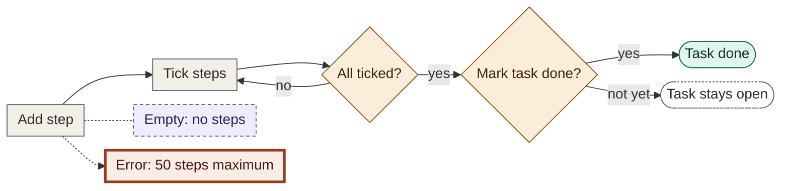

# Checklists

Part of [User flows](README.md). The diagram key, cross-cutting states and state labels are in the README.

## Add and tick steps (1b)

- **Goal:** break a task into steps and track them while working.
- **Entry:** the Steps section of task details, or "Steps" on a block.
- **Preconditions:** the task exists.
- **Success:** steps are ticked, and the task is marked done when the user agrees.



**Steps**
1. Tap "Add step" and type. Enter adds the next step (Must 17).
2. Edit, reorder or delete steps. Reordering works by drag, or with Move up and Move down in each step's menu.
3. Tick steps from the task or from a block during work.
4. When every step is ticked, the app asks "All steps done. Mark the task done?" It never marks the task done on its own (Must 17).

**States and errors**
- **Empty:** "No steps. Break this task into steps."
- **Limit:** "50 steps is the maximum." (Must 17)
- **Save failed:** the text stays, with "Couldn't save. Retry."

**Exits**
- "Not yet" leaves the task open, and the prompt does not repeat until a step is unticked and ticked again.

**Accessibility**
- Steps are a list of native checkboxes, and each label is the step text.
- After a move, "Moved to position 3 of 5" is announced.
- The done prompt is announced politely and does not take focus.

## Screens

### Steps (1b)

- **Where:** the Steps section of task details, and "Steps" in a block's menu, which opens the same list as a sheet.

```
┌──────────────────────────────────┐
│ Steps · 2 of 3                   │ h2
│ ① ☑ Collect receipts        ② ⋯  │
│ ③ ☑ Fill in the form        ④ ⋯  │
│ ⑤ ☐ Submit                  ⑥ ⋯  │
│ ⑦ [ Add a step                 ] │ Enter adds the next
│ ┌ All steps done. Mark the task  │ appears when all ticked
│ │ done? ⑧ Mark done ⑨ Not yet    │
└──────────────────────────────────┘
```

- **Elements:** each step is a native checkbox labelled with its text. Its menu has Edit, Move up, Move down and Delete.
- **Screen reader:** "2 of 3 steps done" updates politely. Moving announces "Moved to position 3 of 5".
- **States:** at 50 steps the field is replaced by "50 steps is the maximum."
