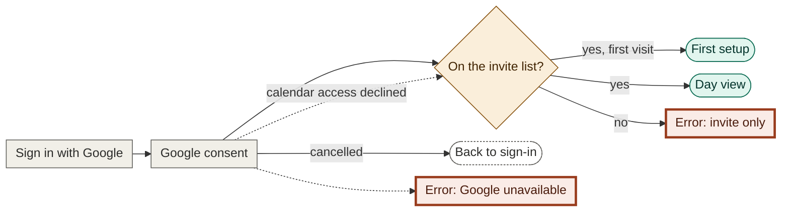
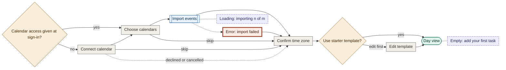

# First run

Part of [User flows](README.md). The diagram key, cross-cutting states and state labels are in the README.

## Sign in (1a)

- **Goal:** get into the app with a Google account.
- **Entry:** the app's address, or the sign-in pop-up after being signed out.
- **Preconditions:** none.
- **Success:** the day view opens, or first setup if it is the first visit.



**Steps**
1. Tap "Sign in with Google" (Must 12).
2. Google's consent screen asks for sign-in and read-only calendar access (Must 3). Google lets the user grant sign-in but untick calendar access. Sign-in still succeeds, and the calendar counts as not connected: first setup starts at "Connect calendar" with the reason, and it can be connected later from Settings (see [calendar.md](calendar.md)).
3. The app checks the invite list (Must 12). A first visit continues to first setup, and a returning user goes to the day view.

**States and errors**
- **Not on the invite list:** "This app is invite only." Nothing is stored (Must 12).
- **Google unavailable:** "Google sign-in isn't responding. Try again." Primary action: Try again.

**Exits**
- Cancelled on Google's screen: back to the sign-in screen, with no message.

**Accessibility**
- The sign-in screen has one heading and one primary button.
- Returning from Google moves focus to the new screen's heading.
- The invite-only message is announced as a status.

## First setup (1a)

- **Goal:** get the app ready to plan: calendar connected, time zone and weekly template set.
- **Entry:** the first successful sign-in.
- **Preconditions:** signed in, with no template saved yet.
- **Success:** the day view, ready for the first task.



**Steps**
1. Choose which Google calendars to import, or skip (Must 3). Skipping shows a "Connect calendar" reminder in Settings.
   - If calendar access was declined at sign-in, this step starts with "Connect calendar" instead. It explains why the app asks, and opens Google's consent screen for calendar access only. After consent it continues to Choose calendars. It can also be skipped.
2. The app imports the events (Must 3).
3. Confirm the home time zone. It is prefilled from the device (Must 12).
4. Accept the starter template with one tap, or edit it first (Must 5). The starter has Mon–Fri 09–17 work, 09–11 focus, evenings 18–21 personal, meals and sleep (decided).
5. iPhone and iPad only: if notifications need a Home Screen install, an "Add to Home Screen" step with instructions appears here (spec section 8, plan B).

**States and errors**
- **Loading:** "Importing, n of m calendars."
- **Import failed:** "Couldn't import your calendar. You can continue and reconnect later." Primary action: Continue.
- **Empty day view:** "Your day is empty. Add your first task."

**Exits**
- The template step cannot be skipped, because without a template there is no available time (spec glossary). Leaving the app here resumes setup at the same step next time.

**Accessibility**
- Setup is a sequence of steps with "Step 2 of 3" in the heading. The total is counted for the device: 3 steps (calendar, time zone, template), or 4 on iPhone and iPad when the Home Screen step is needed.
- Each step moves focus to its heading.
- The template editor follows [availability.md](availability.md).

## Screens

### Sign in (1a)

```
┌──────────────────────────────────┐
│                                  │
│ [App name]                       │ h1
│ Plan your day, then confirm      │
│ what really happened.            │
│ ① Sign in with Google            │ primary, ≥ 44 px
│ We recommend Google 2-Step       │
│ Verification. ② Learn how        │
└──────────────────────────────────┘
```

- **Tablet and desktop:** the same content, centered, at most 440 px wide.
- **Elements:** ① button "Sign in with Google"; ② link to Google's help page.
- **States:**
  - Invite only: the same screen with "This app is invite only." in place of the button, and "Use another account".
  - Google unavailable: "Google sign-in isn't responding. Try again." with Try again.
  - Signing in: the button shows "Signing in…" and is announced.

### First setup (1a)

- **Flows:** First setup. Three steps (four on iPhone and iPad when the Home Screen step is needed), one per screen.

```
┌──────────────────────────────────┐
│ Step 1 of 3                      │ progress, as text
│ Choose your calendars            │ h1
│ Events from these count as busy. │
│ ① ☑ Personal                     │
│ ② ☑ Work                         │
│ ③ ☐ Birthdays                    │
│ Importing 1 of 2…                │ live status
│ ④ Continue                       │ primary
│ ⑤ Skip for now                   │
└──────────────────────────────────┘
```

- **Step 1 variant:** if calendar access was declined at sign-in, the step shows "Connect calendar" with one sentence on why, then the list.
- **Step 2, Time zone:** "Your home time zone" with a searchable field prefilled from the device (`input` with a list of suggestions), and Continue.
- **Step 3, Your week:** the starter template as a list of ranges per day (Mon–Fri Work 09–17, Focus 09–11, Personal 18–21, Meals, Sleep), a small week strip as a visual summary, then "① Use this template" (primary) and "② Edit first".
- **iPhone and iPad step:** "Add to Home Screen to get reminders" with three numbered steps as text and a picture, then Continue.
- **Screen reader:** each step moves focus to its h1; the progress text is part of the heading ("Step 1 of 3, Choose your calendars"). Import progress is a polite live region, announced at start and end.
- **States:** import failed: "Couldn't import your calendar. You can continue and reconnect later." with Continue.
