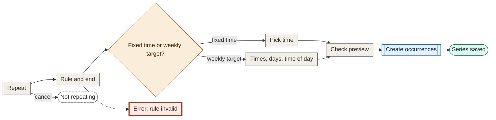
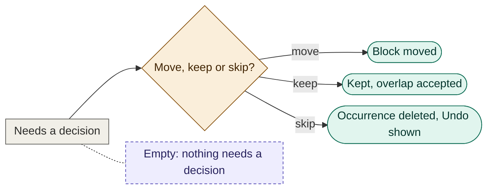
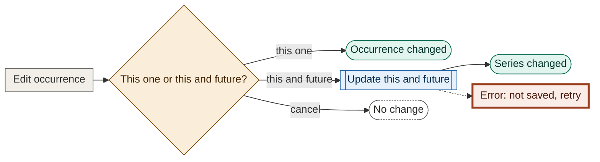
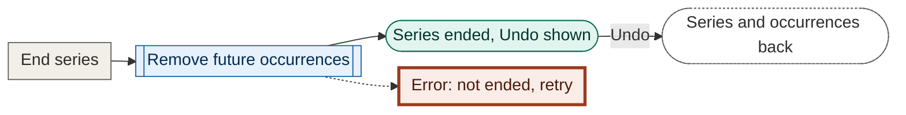

# Recurring tasks

Part of [User flows](README.md). The diagram key, cross-cutting states and state labels are in the README.

## Create a repeating task (1b)

- **Goal:** enter routine work once and have it come back on its own.
- **Entry:** "Repeat" in task details.
- **Preconditions:** the task exists.
- **Success:** the series is saved, and occurrences exist for the next 14 days.



**Steps**
1. Choose the rule: daily, chosen weekdays, weekly, every N weeks, or monthly on a date or a day such as "the first Monday". Optionally add an end date or a number of times (Must 18).
2. Choose the kind:
   - **Fixed time**, for example "Mondays 08:00–08:30";
   - **Weekly target**, for example "gym 3 times a week", optionally limited to days and a time of day: morning 06:00–12:00, afternoon 12:00–17:00, evening 17:00–22:00 (Must 18; the boundaries are a design default).
3. A preview lists the next 5 dates.
4. Save. Occurrences are created for the next 14 days. Fixed ones get their blocks at once. Weekly-target ones join "Plan my tasks", at most one per day (Must 18).

**States and errors**
- **Invalid rule:** the field is named, for example "Every 0 weeks isn't possible. Use 1 or more."

**Exits**
- Cancel leaves the task as a one-off.

**Accessibility**
- The rule is built from native selects and number inputs.
- The preview is a list, announced when it updates.

## Resolve a fixed occurrence overlap (1b)

- **Goal:** decide what to do when a fixed occurrence lands on busy time.
- **Entry:** the "Needs a decision" filter in Tasks, and the "May be affected" label on the block.
- **Preconditions:** a fixed occurrence was created over a hard event, another block or a recovery buffer.
- **Success:** the block is moved, kept, or the occurrence skipped.



**Steps**
1. The list shows each flagged occurrence and what it overlaps. Nothing is ever moved without the user (Must 18).
2. The choices:
   - **Move:** uses manual placement (see [planning.md](planning.md)).
   - **Keep:** accepts the overlap and clears the flag.
   - **Skip:** deletes this occurrence only, with Undo (Must 6).
3. The item leaves the list.

**Accessibility**
- One row per occurrence with three labelled buttons. After a choice, focus moves to the next row.

## Edit a series (1b)

- **Goal:** change a routine.
- **Entry:** task details of any occurrence.
- **Preconditions:** the task belongs to a series.
- **Success:** the chosen occurrences are changed.



**Steps**
1. Saving a change asks "This occurrence" or "This and future occurrences" (Must 18).
2. Past and confirmed occurrences never change.
3. An occurrence whose period ends without being done shows "Not done" and is not carried forward (Must 18).

**Accessibility**
- The choice is a two-option radio group with the safer "This occurrence" selected first.

## End a series (1b)

- **Goal:** stop a routine.
- **Entry:** "End series" in task details of any occurrence, or on the Repeat screen.
- **Preconditions:** the task belongs to a series.
- **Success:** future occurrences are removed, and past ones are kept.



**Steps**
1. Choose "End series" (decided: there is no separate "Delete series"). Future occurrences are removed, with their blocks, and past ones stay as ordinary tasks with their history (Must 18). No question is asked, the same as deleting a task (decided). A past occurrence is removed by deleting that task like any other.
2. The Undo message shows "Gym ended · 4 occurrences removed · Undo", with the usual timer, pause and Ctrl+Z (README, Undo). Undo brings back the series and its future occurrences with their blocks.

**States and errors**
- **Failed:** "Couldn't end the series. Retry." Nothing was removed.

**Accessibility**
- After ending, focus moves to the next task in the list, and "Gym ended, 4 occurrences removed" is announced.

## Screens

### Repeat (1b)

- **Flows:** Create a repeating task, Edit a series, End a series.
- **Phone:** a screen from task details. **Desktop:** a pop-over from the Repeat row.

```
┌──────────────────────────────────┐
│ ‹ Back   Repeat · Gym            │ h1
│ ① Repeats [ Weekly ▾ ]           │ daily, weekdays, weekly, every N weeks, monthly
│ ② ◉ Weekly target ○ Fixed time   │ radio group
│ ③ Times a week [ 3 ]             │ target only
│ ④ Days  ☑Mon ☐Tue ☑Wed ☐Thu ☑Fri │
│ ⑤ Time of day [ Morning ▾ ]      │
│ ⑥ Ends [ Never ▾ ]               │
│ Next: Mon 16, Wed 18, Fri 20 …   │ preview, live region
│ ⑦ Save                           │ primary
│ ⑧ End series                     │ only for an existing series
└──────────────────────────────────┘
```

- **Fixed time** replaces ③–⑤ with Start and End time inputs.
- **States:** an invalid rule shows the error under its field; End series shows "Gym ended · 4 occurrences removed · Undo".

### Needs a decision (1b)

```
┌──────────────────────────────────┐
│ ‹ Back   Needs a decision · 2    │ h1
│ ┌ Gym · Mon 08:00–08:30          │ group
│ │ Overlaps Team call 08:00–09:00 │
│ │ ① Move  ② Keep  ③ Skip         │
│ ┌ Standup · Tue 09:00            │
│ │ Overlaps a recovery buffer     │
│ │ ④ Move  ⑤ Keep  ⑥ Skip         │
└──────────────────────────────────┘
```

- **Entry:** the "Needs a decision" filter in Tasks and the "May be affected" label on the block.
- **States:** empty: "Nothing needs a decision."
