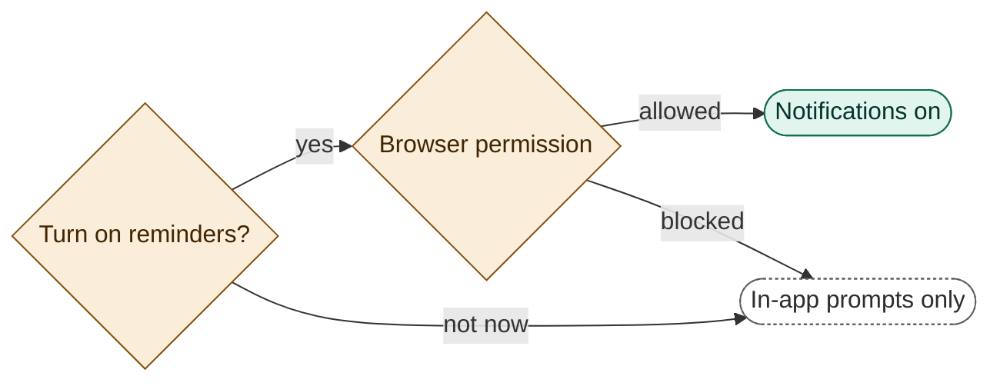
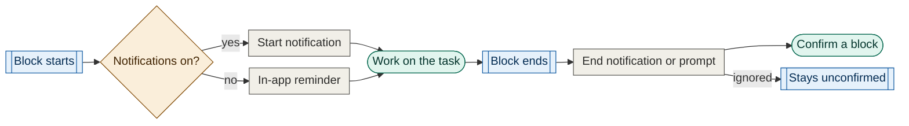
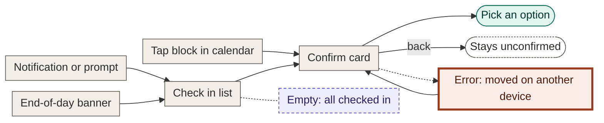
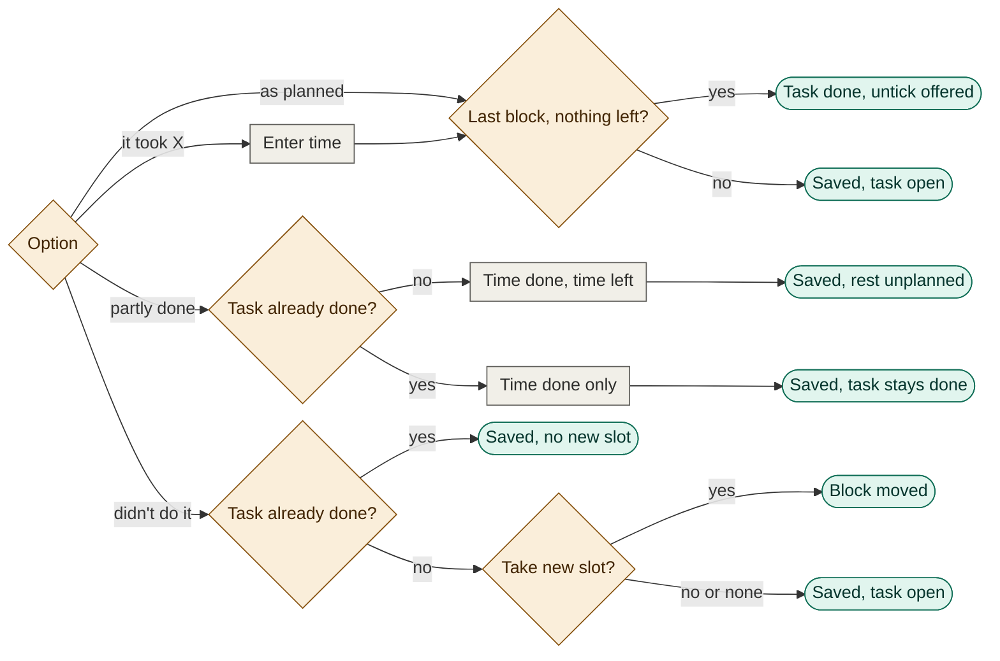
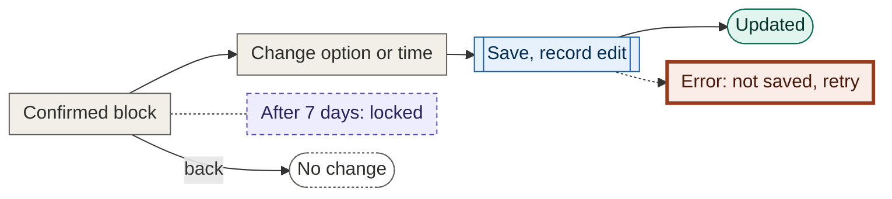
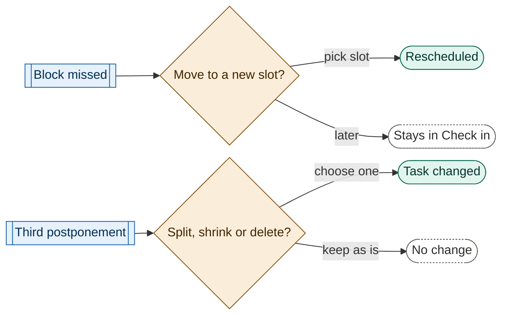

# Reminders and confirmation

Part of [User flows](README.md). The diagram key, cross-cutting states and state labels are in the README.

## Turn on reminders (1a)

- **Goal:** get browser notifications when blocks start and end.
- **Entry:** shown by the app after the first block is saved, and from Settings, then Notifications. It is never shown on app load.
- **Preconditions:** the browser supports notifications, the browser has not already granted or blocked them, and the user has not chosen "Not now" in the last 7 days.
- **Success:** notifications are on, or the app falls back to in-app prompts.



**Steps**
1. After the first block is saved, the app explains: "Get a reminder when a block starts and ends? Only while the app is open." (Must 11).
2. "Turn on" opens the browser's permission request.
3. If permission is blocked, the app uses in-app prompts, and Settings explains how to allow notifications in the browser (Must 11).

**Exits**
- "Not now" does not ask again for 7 days. Settings can turn reminders on at any time.

**Accessibility**
- The explanation is an inline card, not a dialog, and is reachable by Tab.
- The browser's own permission prompt follows the browser's accessibility.

## Block reminders (1a)

- **Goal:** know when a block starts, and be asked to confirm when it ends.
- **Entry:** shown by the app at a block's start and end while the app is open.
- **Preconditions:** a planned block, and the app open (Must 11).
- **Success:** the user starts the work, or confirms the block.



**Steps**
1. At the block's start, a notification shows "Write report, 10:00–11:00" (Must 11). If notifications are off or blocked, an in-app reminder appears instead (Must 16).
2. At the end, a notification or in-app prompt asks "How did Write report go?" and opens Confirm a block.
3. If ignored, the block stays unconfirmed and waits in the Check in list.
4. When the app returns from the background, reminders missed meanwhile are shown as in-app prompts (architecture 7.7).

**Known limit:** nothing fires while the browser is closed (Must 11).

**Accessibility**
- The in-app reminder is announced politely and does not take focus.
- Every notification has an in-app equivalent (Must 16).

## Confirm a block (1a)

- **Goal:** record what really happened in a block.
- **Entry:**
  - the end notification or in-app prompt;
  - the end-of-day banner ("2 blocks to check in") on the next app open after the end of day;
  - the Check in list: the Check in tab on phone, or the rail item on every tablet and desktop screen, with a count;
  - tapping an Unconfirmed or Missed block in the calendar.
- **Preconditions:** the block's end has passed, it is unconfirmed, and its end was under 7 days ago (Must 2).
- **Success:** the block is confirmed, and the task is marked done where that applies.

Finding a block to confirm:



The four options:



**Steps**
1. The Check in list shows unconfirmed blocks, oldest first, with "2 left" and "Closes in 5 days" on each. Missed blocks carry the "Missed" label (decided). A notification opens the list at its block.
2. Each card shows the title, the planned time, and four buttons at least 44 × 44 px (spec A4). After confirming, the card shows the planned-vs-real summary: the block's planned and actual time, and the day's planned and confirmed hours (Must 2).
3. The options (Must 2):
   - **As planned:** one tap.
   - **It took X:** enter the actual time, and optionally the actual start. A new start moves the block, and later blocks that now overlap are flagged "May be affected".
   - **Partly done:** enter the time done and the time left. The rest stays as unplanned time on the task. A remainder under 15 minutes becomes 15.
   - **Didn't do it:** the app offers a new slot for the same block. Accepting moves the block. Declining, or having no free slot, leaves the task open with the time unscheduled.
   - An optional one-line note ("stopped at section 3, next: charts") on every option.
4. **A block of a task already marked done** (decided): its past unconfirmed blocks stay in Check in. Confirming one never re-plans the task.
   - "Didn't do it" is recorded and counts as one postponement, but no new slot is offered. The card says "Write report is done, so no new time is needed."
   - "Partly done" asks only for the time done, with no "time left" field.
   - To plan more work, the user unticks Done first (see Mark a task done or not done, in [tasks.md](tasks.md)).
5. **Auto-done:** only "as planned" and "it took X" on the task's last block, with no time left unscheduled, mark the task done. The confirmation says "Write report marked done" with an Untick button (Must 2). If time is still unscheduled, the card offers "Plan the rest" or "Mark done".

**Input checks** (spec A5: the field is named and a fix suggested, and the entry is kept)
- **It took X:** the actual time must be above 0 and at most 24 hours ("Enter a time between 1 minute and 24 hours"). An actual start in the future is rejected ("The start can't be in the future").
- **Crossing midnight:** if the actual start and time run past midnight, the block is shown ending at midnight and the full time is still recorded. The card says "Shown until midnight. 2 h 30 recorded." (Must 2)
- **Partly done:** the time done must be between 1 minute and 24 hours. The time left can be 0, which means no remainder.

**States and errors**
- **Empty:** "All checked in."
- **Moved on another device (decided, amends Must 12):** "This block was moved to 14:00–15:00 on another device. Confirm against the new time?" The user confirms again.
- **Save failed:** the card stays, with "Couldn't save. Retry."
- **Window closed:** 7 days after the end, the block becomes "Unconfirmed, window closed". It is locked, leaves the list and the banner, and is not used in insights (decided).

**Exits**
- Back, or closing the list: the block stays unconfirmed and in the list.

**Accessibility**
- Each card is a group labelled "Write report, Monday 10:00 to 11:00".
- The four options are buttons in a fixed order, so the Tab order matches the visual order.
- After a confirmation, focus moves to the next card, and "Confirmed, 1 left" is announced. When the list empties, focus moves to the "All checked in" heading.
- The "Missed" and "closed" states have text labels.

## Edit a confirmation (1a)

- **Goal:** correct a confirmation.
- **Entry:** a confirmed block in the calendar, then "Edit confirmation".
- **Preconditions:** the block's end was under 7 days ago (Must 2).
- **Success:** the confirmation is changed, and the metrics update.



**Steps**
1. Open a confirmed block and choose "Edit confirmation". The same four options appear, prefilled, with the same input checks (Must 2).
2. The edit applies as if the new outcome had been chosen in the first place (decided):

| Change | Effect |
|---|---|
| To "as planned" or "it took X" on the task's last block, with nothing left unscheduled | The task is marked done, with the usual Undo message |
| From an outcome that auto-marked the task done, to "partly done" or "didn't do it" | The task is reopened ("Write report reopened · Undo"). If the user ticked Done themself, it stays done |
| To or from "partly done" | Sets or clears the time left that this block recorded |
| "It took X": change or remove the actual start | The block moves to the new start, or back to its planned time. Not a postponement |
| "Didn't do it" where a new slot was accepted | Not editable: the block was moved and is planned again, so it has no confirmation |

3. The edit is recorded, and the metrics update (Musts 2 and 15).

Restoring an edit that another device overwrote is a separate flow for every task and block: Restore an earlier version, in [tasks.md](tasks.md).

**States and errors**
- **Save failed:** the card stays, with "Couldn't save. Retry."

**Accessibility**
- The same as Confirm a block. After saving, focus returns to the block in the calendar.

## Postponement prompts (Should)

- **Goal:** reschedule missed work right away, and rethink tasks that keep slipping.
- **Entry:** shown by the app when a block becomes Missed, or when a task's third postponement is recorded.
- **Preconditions:** the app is open.
- **Success:** the block has a new time, or the task is split, shrunk or deleted.



**Steps**
1. When a block becomes Missed, a prompt offers new slots from the suggester (spec section 5, Should). Picking one moves the block, which counts as one postponement.
2. On a task's third postponement, a prompt asks "Split it, shrink it, or delete it?", with "Keep as is" also available.

**Accessibility**
- Both prompts are inline cards that do not take focus, are announced politely, and can be dismissed (Must 13, no pressure).

## Screens

The frame and navigation are in the [README](README.md#screens-frame-navigation-and-shared-parts).

### Check in (1a)

- **Flows:** Confirm a block, Edit a confirmation, Postponement prompts (Should).
- **Phone:** the Check in tab. **Tablet and desktop:** the Check in panel from the rail, beside the planner.

```
┌──────────────────────────────────┐
│ Check in · 2 left              │ h1
├──────────────────────────────────┤
│ ┌ Write report                   │ group per block
│ │ Mon 16 Nov, 09:00–10:00 · Missed│
│ │ ① As planned   ② It took X    │ 2 × 2, each ≥ 44 × 44 px
│ │ ③ Partly done  ④ Didn't do it │
│ │ ⑤ Add a note (optional)        │
│ │ Closes in 5 days               │
│ └                                │
│ ┌ Tax return · Tue 14:00–15:00   │
│ │ ⑥ … same four options          │
├──────────────────────────────────┤
│ tab bar                          │
└──────────────────────────────────┘
```

| # | Element | HTML / role | Accessible name | Req |
|---|---|---|---|---|
| card | Block group | group with heading | "Write report, Monday 16 November, 09:00 to 10:00, missed" | Must 2 |
| ① | As planned | button | "As planned" | Must 2, A4 |
| ②③ | It took X, Partly done | button, expands the card's form | "It took X, enter the actual time", "Partly done" | Must 2, WCAG 2.5.3 |
| ④ | Didn't do it | button | "Didn't do it" | Must 2 |
| ⑤ | Note | button, opens a one-line text field | "Add a note" | Must 2 |

- **After choosing:**
  - **It took X** expands the card with "Actual time" (hours and minutes) and "Actual start (optional)", then Save.
  - **Partly done** expands with "Time done" and "Time left". For a task already done, only "Time done".
  - **Didn't do it** shows the offered slot: "Move to Tue 14:00?" with Move and Not now. For a task already done, it shows "Write report is done, so no new time is needed."
  - **Saved:** the card turns into its summary in place, "Confirmed: took 1 h 20. Planned 1 h, real 1 h 20. Today 5 h planned, 3 h confirmed", with a "Next" button and Edit. It stays until the user chooses Next, opens another card or leaves the list. There is no timer.
  - **Auto-done:** the standard Undo message shows "Write report marked done · Undo", with the usual timer, pause, setting and Ctrl+Z (README, Undo). Undo there is the untick of Must 2.
- **Screen reader:** focus starts on the first card's heading. After saving, focus moves to the card's summary, which is read in full with "1 left". "Next" moves focus to the next card's heading; when the list is empty, to the "All checked in" heading.
- **States:**
  - Empty: "All checked in."
  - Moved on another device: "This block was moved to 14:00–15:00 on another device. Confirm against the new time?" inside the card, with the options again.
  - Input errors: inline under the field, entry kept.
  - Save failed: "Couldn't save. Retry." in the card.

### End-of-day banner (1a)

- **Flows:** Confirm a block (entry).
- **Shown:** on the first app open after the end of day (spec glossary) while any block of that day is unconfirmed, and again on the first open of each later day while unconfirmed blocks from the last 7 days remain. Not shown when the Check in list is already open.
- **All sizes:** under the toolbar of the planner: "2 blocks to check in from yesterday. ① Check in now ② Later". Check in now opens Check in. Later hides it until the next day's first open.
- **Screen reader:** a region named "Check in", announced politely once. It never takes focus.
- **Order:** it follows the README's banner order.

### Edit a confirmation (1a)

- **Flows:** Edit a confirmation.
- **Phone:** a bottom sheet from the block menu's "Edit confirmation". **Tablet and desktop:** a pop-over next to the block.

```
┌──────────────────────────────────┐
│ Write report                ① ✕  │ dialog · h2
│ Mon 16 Nov, 09:00–10:00          │
│ Confirmed: took 1 h 20           │ current outcome
│ ② As planned   ③ It took X       │ the current one is selected
│ ④ Partly done  ⑤ Didn't do it    │
│ ⑥ Actual time  [ 1 h 20 ]        │ fields of the selected option
│ ⑦ Note         [            ]    │
│ What changes                     │ shown when the outcome changes
│ ⑧ Save                           │ primary
└──────────────────────────────────┘
```

- **Elements:** the four options are a radio group named "Outcome", with the current one selected. The fields are the same as in Check in, with the same checks.
- **What changes:** when the outcome changes, a short paragraph above Save explains the effect on the task and block, by the rules in the Edit a confirmation flow.
- **Screen reader:** opens as a dialog named "Edit confirmation, Write report", with focus on the selected option. Saving announces "Confirmation updated".
- **States:** shown only within 7 days of the block's end. A save failure keeps the dialog with "Couldn't save. Retry."

### Confirm from the calendar (1a)

- **Flows:** Confirm a block, calendar entry.
- **All sizes:** tapping an Unconfirmed or Missed block opens the same card as a bottom sheet (phone) or pop-over (desktop). It behaves exactly like a Check in card.

### Reminders (1a)

- **Flows:** Turn on reminders, Block reminders.
- **Turn on reminders:** an inline card at the top of the day view after the first block is saved: "Get a reminder when blocks start and end? Only while the app is open. ① Turn on ② Not now". It is a region named "Reminders", announced politely, never focused automatically.
- **Block reminders without notifications:** an in-app reminder strip under the toolbar, "Write report starts now, 09:00–10:00", and at the end "How did Write report go? ① Check in". It is announced politely and stays until dismissed or acted on. Only the newest strip is shown: a newer reminder replaces it, and an end reminder that is replaced stays reachable in Check in. Strips follow the README's banner order.
- **Notifications on:** the browser notification shows the same text. Clicking the start notification opens the planner at that block. Clicking the end notification opens Check in at that block.
- **Settings:** More, then Notifications: a switch "Block reminders", and, when the browser blocks notifications, a short explanation of how to allow them in the browser.

### Postponement prompts (Should)

- **Missed block:** an inline card at the top of Check in: "Write report was missed. ① Move to Tue 14:00 ② Other times ③ Later".
- **Third postponement:** an inline card in task details: "Tax return was postponed 3 times. ① Split it ② Shrink it ③ Delete it ④ Keep as is".
- Both are announced politely, never take focus, and can be dismissed (Must 13).
