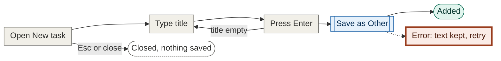
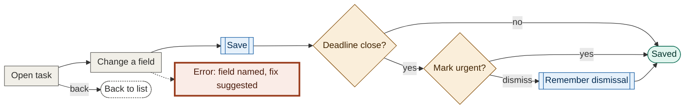
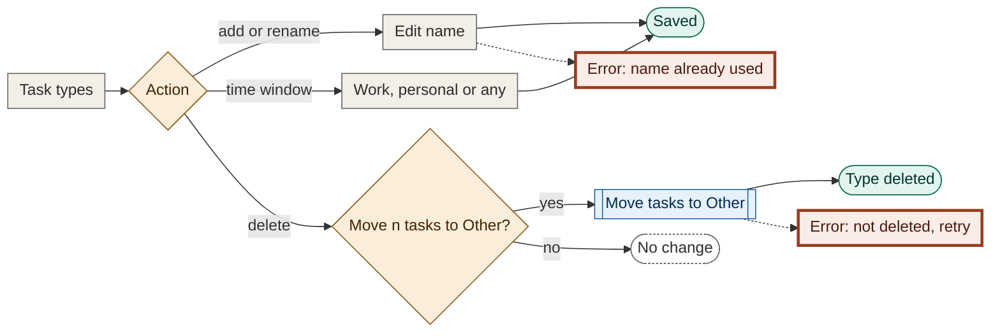
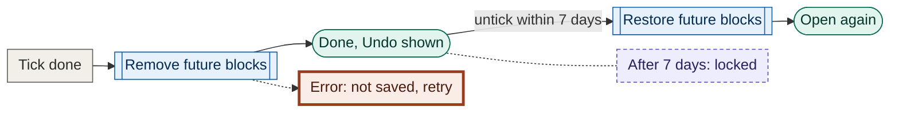
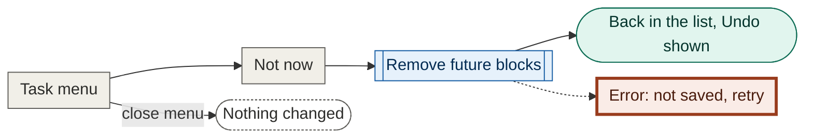
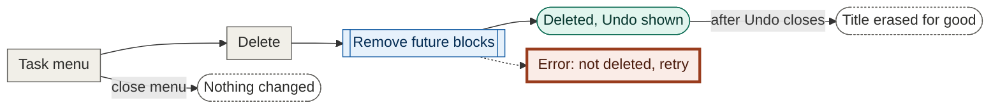
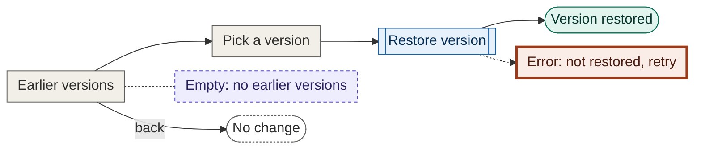

# Tasks

Part of [User flows](README.md). The diagram key, cross-cutting states and state labels are in the README.

## New task (1a)

- **Goal:** get a task out of your head and into the app in seconds.
- **Entry:** the "+ New task" button, always visible on every main screen, or its keyboard shortcut.
- **Preconditions:** signed in.
- **Success:** the task is saved and shown in the task list.



**Steps**
1. Open New task (Must 7, fast capture).
2. Type a title. "Add details" optionally opens the estimate, flags, deadline and type.
3. Press Enter. The task is saved with type "Other" unless another was chosen (Must 6).
4. A short status message confirms "Added Buy tickets". It has no Undo (decided): a wrong task is renamed in task details, or deleted like any other task (Delete a task).

One typed line counts as adding the task, within the 3-tap budget (Must 7).

**States and errors**
- **Empty task list:** "No tasks yet. Add one with New task."
- **Empty title:** Enter does nothing, and the field shows "Add a title".
- **Save failed:** "Couldn't save the task. Retry." The text stays in the field.

**Exits**
- Esc or close: nothing is saved. If a title was typed, it is kept as a draft in the field until the page is closed.

**Accessibility**
- Opening New task moves focus to the title field.
- After saving, focus stays in an empty title field so the next task can be typed. The status message is announced as "Buy tickets added". In the title field, Ctrl+Z only undoes typing.

## Edit task details and urgency (1a)

- **Goal:** add or change a task's estimate, flags, deadline and type.
- **Entry:** a task in the task list, or a block's "Open task".
- **Preconditions:** the task exists and is open.
- **Success:** the changes are saved.



**Steps**
1. Open the task (Must 6).
2. Change any field: title, estimate, urgent, important, deadline or type (Musts 4 and 6).
   - The type list has "New type…", which creates a type inline (Must 6).
   - From 1b, the estimate field offers "Usually takes you 1.6 h" when there is enough history (see [metrics-and-insights.md](metrics-and-insights.md)).
3. Each field saves on change.
4. If the deadline is close, the app suggests "Mark as urgent?" with the reason, for example "3 days left, today included, and it needs about 6 h of work" (Must 4: 6 h fits in 1 working day, and 3 days left is at most 1 + 2).
5. Dismissing it is remembered for that task until the deadline changes (Must 4).

**States and errors**
- **Invalid value:** the field is named and a fix is suggested, for example "Estimate must be at least 15 minutes." The entered value stays (spec A5).

**Exits**
- Back returns to where the task was opened. Saved fields stay saved.

**Accessibility**
- Fields use native inputs for dates and numbers (spec U4).
- The urgency suggestion is announced as a status, and its two buttons are reachable by Tab.
- The suggestion never takes focus by itself.

## Manage task types (1a)

- **Goal:** keep the list of task types useful.
- **Entry:** Settings, then Task types.
- **Preconditions:** none. "Other" always exists.
- **Success:** the list is changed, and tasks of a deleted type are moved to "Other".



**Steps**
1. The list starts with Work, Personal, Admin and Other (Must 6).
2. Add or rename a type.
3. Set a type's time window: work time, personal time or any. This decides where the suggester can place its tasks (Must 6).
4. Delete a type. An inline row asks "Delete Admin? Its 12 tasks move to Other." If confirmed, its tasks and history move to "Other", and the metrics recompute (Must 6). There is no Undo, because spec U3 limits Undo to blocks and tasks. The inline row is the safety net, and it is not a dialog.
5. "Other" cannot be deleted, because New task saves to it by default (Must 6).

**States and errors**
- **Duplicate name:** "A type with this name already exists."
- **Delete failed:** "Couldn't delete the type. Retry." Nothing moved.

**Exits**
- Back to Settings.

**Accessibility**
- Each row has its own labelled Rename, Time window and Delete controls, not icon-only buttons.
- After a delete, focus moves to the next row.

## Mark a task done or not done (1a)

- **Goal:** record that a task is finished, or correct that.
- **Entry:** the task's done checkbox in the list or task details, or the auto-done after a confirmation (see [reminders-and-confirmation.md](reminders-and-confirmation.md)).
- **Preconditions:** the task is open, or was marked done in the last 7 days.
- **Success:** the done flag is set or cleared.



**Steps**
1. Tick "Done". The task leaves the open list (Must 6).
2. Its blocks are handled as follows (decided):
   - **Future planned blocks** are removed, so the time is free and no reminder fires for finished work. The message reads "Write report done · 1 future block removed · Undo". Removing them is not a postponement.
   - **Past unconfirmed blocks** stay in Check in, because the work may have happened then and confirming it keeps estimates accurate. They are not marked "Task deleted".
   - **Confirmed blocks** are untouched.
3. Within 7 days, untick it to reopen it (spec section 3). The removed future blocks whose start has not passed come back. The rest becomes unscheduled time again.
4. After 7 days the checkbox is locked and labelled "Done, can't be changed".

**States and errors**
- **Save failed:** the checkbox returns to its previous state, with "Couldn't save. Retry."

**Accessibility**
- The checkbox is a native checkbox labelled with the task title.
- The change is announced as "Write report done" or "Write report reopened".

## Not now (1a)

- **Goal:** take a planned task off the calendar without giving it up.
- **Entry:** "Not now" in the task's menu in the list or in task details.
- **Preconditions:** the task is open and has future planned blocks.
- **Success:** the future blocks are gone, and the task is back in the open list with its time unscheduled.



**Steps**
1. Choose "Not now" (decided: replaces Drop).
2. The task's future planned blocks are removed. This is not a postponement, because blocks that have not started can be moved freely (spec glossary). Past unconfirmed blocks stay in Check in, and confirmed blocks are untouched.
3. The task stays open, with its time unscheduled, so the next "Plan my tasks" can place it again.
4. An Undo message shows "Tax return: not now · 2 blocks removed · Undo" (README, Undo).

**Exits**
- Closing the menu changes nothing. Undo brings the removed blocks back.

**Accessibility**
- The menu item is named "Not now, Tax return". After it, focus stays on the task row, and "2 blocks removed" is announced.

## Delete a task (1a)

- **Goal:** remove a task for good.
- **Entry:** "Delete" in the task's menu in the list or in task details.
- **Preconditions:** the task exists.
- **Success:** the task leaves every list, and its future blocks are removed.



**Steps**
1. Choose "Delete" (Must 6). Delete is the only way to remove a task (decided).
2. Its future planned blocks are removed. Confirmed blocks stay. Past unconfirmed blocks become "Task deleted": they stop asking for confirmation and each counts as one postponement (Must 6).
3. An Undo message shows "Tax return deleted · Undo" (spec U3, README, Undo).
4. When the message closes, the task can't be brought back, and its title, notes and steps are erased (Musts 6 and 14). It stays in the metrics as a record without text and counts as not done.

**Exits**
- Closing the menu changes nothing. Undo while the message is shown restores the task and its removed blocks.

**Accessibility**
- No confirmation dialog (spec U3). The Undo message is the safety net.
- After deleting, focus moves to the next task in the list.

## Restore an earlier version (1a)

- **Goal:** bring back an edit to a task or block that a later edit, usually from another device, overwrote.
- **Entry:** "Earlier versions" in a task's or block's menu.
- **Preconditions:** the overwritten edit was under 7 days ago (Must 12).
- **Success:** the chosen version is back.



**Steps**
1. The list shows overwritten values from the last 7 days, each with the field, the old and new value, and the time (Must 12).
2. Restore one. A block's start and end are restored together, as one unit (Must 12).
3. The restore is itself an edit, so it is recorded and can be restored in turn.

Entries older than 7 days stay in the read-only edit history for 30 days, for audit and support, and are not shown here (Must 12).

**States and errors**
- **Empty:** "No earlier versions in the last 7 days."
- **Restore failed:** "Couldn't restore. Retry."

**Accessibility**
- Each entry is a row such as "Start, 10:00 changed to 14:00, Monday 09:12", with a labelled Restore button.

## Screens

The frame, navigation and the Undo message are in the [README](README.md#screens-frame-navigation-and-shared-parts).

### Tasks (1a)

- **Flows:** New task, Mark a task done or not done, Not now, Delete a task, Plan with the suggester (entry).
- **Phone:**

```
┌──────────────────────────────────┐
│ Tasks          ① Plan my tasks   │ banner · h1 "Tasks"
├──────────────────────────────────┤ main
│ ② [ New task: type and press Enter ]│ always visible on this screen
│ ③ Open ④ Done ⑤ Needs a decision 1│ filter tabs; ⑤ from 1b
│ ⑥ ☐ Write report  2 h · Urgent ⋯ │
│ ⑦ ☐ Call bank     30 min       ⋯ │
│ ⑧ ☐ Tax return    Due Fri      ⋯ │
│ ┌ Added Buy tickets ───────────┐ │ status message, no Undo
├──────────────────────────────────┤
│ tab bar                          │
└──────────────────────────────────┘
```

- **Tablet and desktop:** the list on the left, the selected task's details on the right (see Task details). In the planner, the same list is the Tasks panel from the rail, and a task can be dragged onto the grid or placed with "Place…" in its menu.

| # | Element | HTML / role | Accessible name | Req |
|---|---|---|---|---|
| ② | New task field | input type text with label | "New task" | Must 7 |
| ③–⑤ | Filters | tab list | "Open, 12", "Done", "Needs a decision, 1" (this tab appears in 1b, with recurring tasks) | Must 18 |
| ⑥–⑧ | Task row | checkbox + link + menu button | checkbox "Write report, done"; link "Write report, 2 hours, urgent"; menu "More actions, Write report" with Place…, Mark done, Not now, Delete | Must 6, 16 |

- **Screen reader:** the list announces its count ("12 open tasks"). Each row reads title, estimate, flags, deadline and "repeats" when it does. After adding a task, focus stays in the New task field and "Buy tickets added" is announced.
- **States:**
  - Empty: "No tasks yet. Add one with New task."
  - Loading: five skeleton rows.
  - Error: "Couldn't load your tasks. Retry."
- **New task from other screens:** the "+" or "+ New task" button opens this field in a small sheet (phone) or pop-over (desktop) with the same behavior.

### Task details (1a)

- **Flows:** Edit task details and urgency, Mark a task done or not done, Not now, Delete a task, Restore an earlier version, Place, move or resize a block ("Place…"); Checklists and Repeat (1b) appear here too.
- **Phone:** its own screen. **Tablet and desktop:** the right-hand side of Tasks.

```
┌──────────────────────────────────┐
│ ① ‹ Back   Write report      ② ⋯ │ h1 "Write report"
├──────────────────────────────────┤
│ ③ Title     [ Write report     ] │
│ ④ Estimate  [ 6 h ]              │
│   Usually takes you 5.5 h ⑤ Use  │ 1b
│ ⑥ ☐ Urgent  ⑦ ☑ Important        │
│ ⑧ Deadline  [ Wed 18 Nov ]       │
│ ┌ 3 days left, today included,   │ urgency suggestion
│ │ and it needs about 6 h of work.│
│ │ ⑨ Mark as urgent ⑩ Dismiss    │
│ ⑪ Type      [ Work ▾ ]           │ includes "New type…"
│ ⑫ Place…                         │ create a block without dragging
│ Blocks: Mon 09–10 ✓  ⑬ ›         │ list of this task's blocks
│ Steps 2 of 3                  ⑭ ›│ 1b, see checklists.md
│ ⑮ Repeat                      ›  │ 1b
│ ⑯ Mark done                      │
└──────────────────────────────────┘
```

| # | Element | HTML / role | Accessible name | Req |
|---|---|---|---|---|
| ② | More actions | menu button | "More actions": Not now, Delete, Earlier versions | Must 6, 12 |
| ④ | Estimate | input with unit | "Estimate, hours and minutes" | Must 6 |
| ⑤ | Use suggestion | button | "Use, 5.5 hours" | Must 10 |
| ⑥⑦ | Flags | checkboxes | "Urgent", "Important" | Must 4 |
| ⑧ | Deadline | input type date | "Deadline" | Must 4, U4 |
| ⑨⑩ | Urgency suggestion | two buttons in a group | "Mark as urgent", "Dismiss" | Must 4 |
| ⑪ | Type | select | "Type" | Must 6 |
| ⑫ | Place… | button | "Place…, Write report" | Must 1, 16 |
| ⑯ | Mark done | button | "Mark done, Write report" | Must 6 |

- **Place…:** opens Edit block for a new block of this task: date (today), start (the next quarter hour), end (start plus the unscheduled time or the default duration), then Save with the usual overlap check.
- **Mark done states:** open: "Mark done". Done, within 7 days: the button reads "Done ✓ · Mark not done". Done for 7 days or more: the text "Done, can't be changed" and no button.
- **Screen reader:** the urgency suggestion is a group labelled with its sentence, announced politely when it appears; it never takes focus. Each field saves on change and announces "Saved" only if the save took longer than a second.
- **States:**
  - Invalid value: an inline error under the field, with the entry kept (spec A5).
  - Save failed: "Couldn't save. Retry." next to the field.
  - Deleted task while open (another device): "This task was deleted on another device." with a link back to Tasks.

### Task types (1a)

- **Flows:** Manage task types.
- **Phone:** a settings screen from More. **Desktop:** a Settings sidebar section.

```
┌──────────────────────────────────┐
│ ‹ Back   Task types              │ h1
│ ① Work      Work time      ② ⋯   │
│ ③ Personal  Personal time  ④ ⋯   │
│ ⑤ Admin     Work time      ⑥ ⋯   │
│ ┌ Delete Admin? 12 tasks move to │ inline confirm row
│ │ Other.  ⑦ No  ⑧ Yes, delete   │
│ Other       Any time   (fixed)   │ no menu
│ ⑨ + Add type                     │
└──────────────────────────────────┘
```

- **Elements:** each row's menu has Rename, Time window (work, personal, any) and Delete, each a labelled menu item (not icon-only). The inline confirm row's "No" is focused first.
- **Screen reader:** rows read "Admin, uses work time". Deleting announces "Admin deleted, 12 tasks moved to Other".
- **States:** duplicate name shows "A type with this name already exists." inline.

### Earlier versions (1a)

- **Flows:** Restore an earlier version.

```
┌──────────────────────────────────┐
│ ‹ Back   Earlier versions        │ h1, names the task or block
│ Start · 10:00 → 14:00 · Mon 09:12│
│                        ① Restore │
│ Title · "Report" → "Write report"│
│                        ② Restore │
└──────────────────────────────────┘
```

- **Elements:** each row is text plus a Restore button named "Restore start 10:00".
- **States:** empty: "No earlier versions in the last 7 days."
